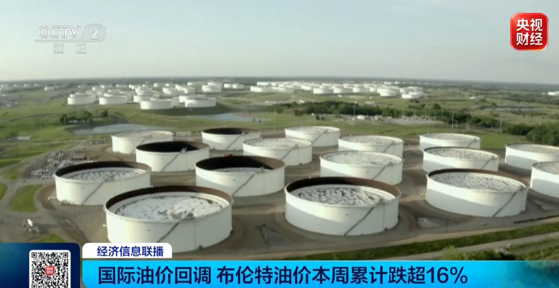
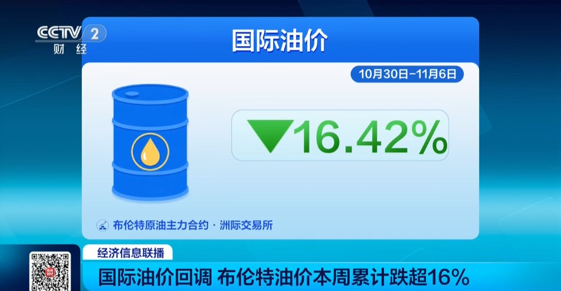
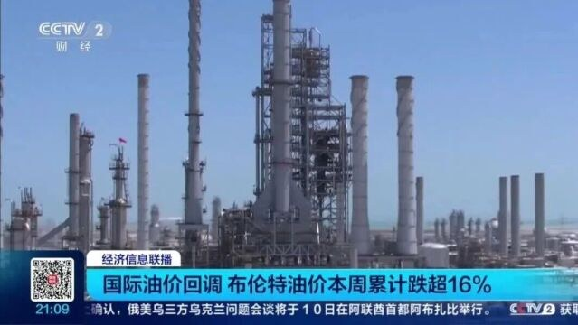
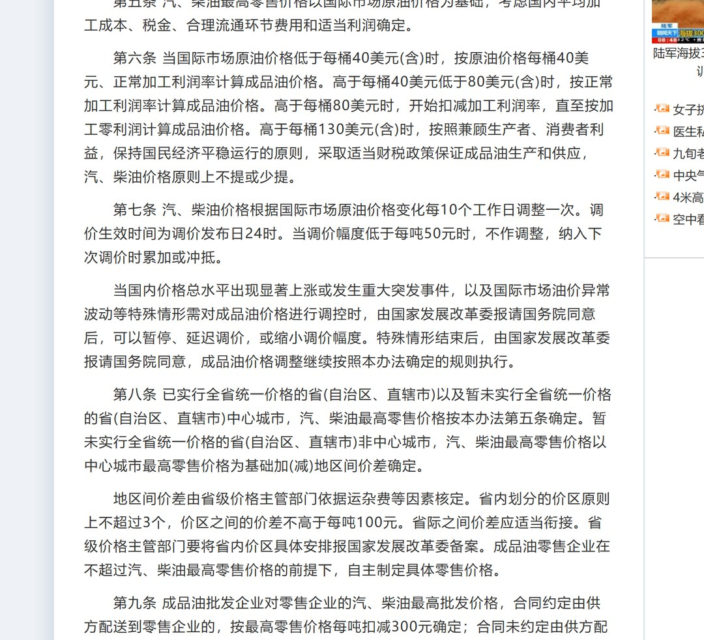
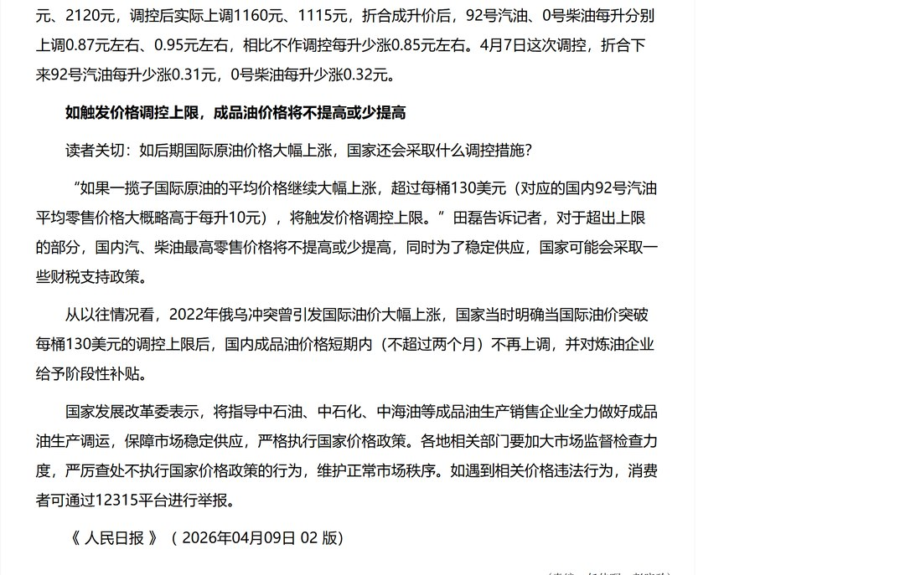
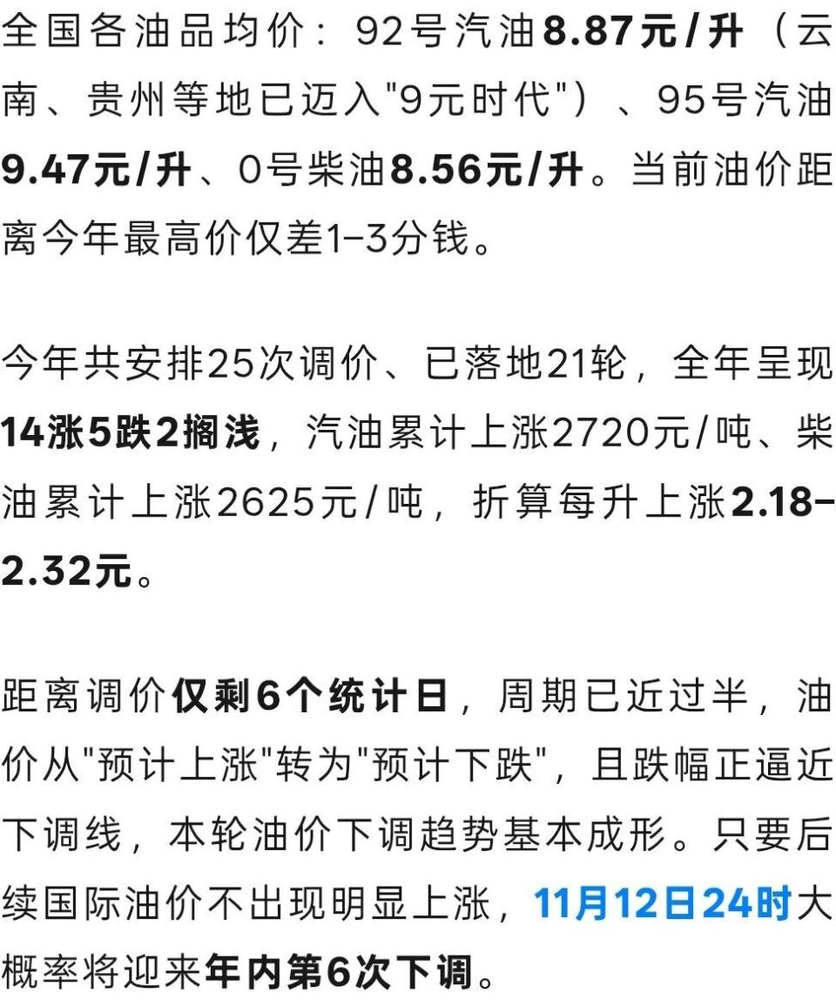

# 油价一周跌16%，为什么一箱油只省11元？

11 月 9 日，「油价一周暴跌超 16%」登上百度热点榜，抖音热榜也进了前十。

央视财经给了张数据卡：10 月 30 日到 11 月 6 日，布伦特原油主力合约跌 16.42%。

同一天，另一组数在传。11 月 12 日 24 时调价，92 号每升约降 0.22 元，加满 50 升省 11 元。

16% 对 11 元，看着不成比例。

我把两套数各算了一遍，这两个数不能放一起比。分母不同，时间窗也不同。

## 一、16.42%是哪一周

跌 16.42% 的是布伦特原油 2027 年 1 月合约，洲际交易所的主力盘面。

央视财经那张卡上标了时间，10 月 30 日到 11 月 6 日，一周。

同一周，纽约 WTI 12 月合约跌 12.76%，上海 INE 原油 SC2612 跌 11.68%。

11 月 6 日收盘，WTI 报 90.83 美元一桶，布伦特报 98.32 美元，INE 收 644.0 元一桶。

11 月 7 日盘中，纽约原油一度跌破 90 美元，布伦特一度跌破 97 美元。

三个市场，三个跌幅。标题里那个 16%，只是其中一张合约、一周的盘面。

拿它去要求国内零售价同比例下调，起点就错了。

下跌原因，央视财经和重庆日报的转载给了两条。一条是中东冲突升级预期降温，前期计入价格的地缘风险溢价回吐。

另一条是供应端。「欧佩克+」决定 12 月维持产量不变，沙特、阿联酋、伊拉克、科威特 10 月原油出口总量增长 10%，日均超过 1500 万桶。

这两条解释的是国际盘面，跟国内加油站的价牌之间，还隔着一套规则。

## 二、11元还没落地

11 元也不是定下来的数。

光明网 11 月 9 日的调价通知写得清楚。原油变化率 -5.10%，预计汽油下调 280 元一吨、柴油 270 元一吨。

折算到零售端，92 号约降 0.21 到 0.25 元一升，95 号约 0.24 元，0 号柴油约 0.23 元。

文末另有一句，预估数据只是机构测算，以发改委公告为准。

0.22 乘 50 升等于 11 元。我按这个口径复算过，对得上。

问题在计价周期还没走完，剩 3 到 4 个统计工作日。

我把这几天公开的测算排了一遍，这个数一直在动。

10 月 30 日，本轮头一个统计日，预估 92 号涨 0.08 元一升。11 月 2 日冲到涨 0.14 元。

11 月 3 日涨幅收窄。11 月 4 日反转，预估下调 40 元一吨，不到 50 元一吨的调价红线，算搁浅。

11 月 5 日，预估汽油下调 200 元一吨、柴油 195 元一吨，92 号降 0.16 元。11 月 6 日，0.22 元。

11 月 8 日有媒体预告，11 月 9 日会扩大到下调 340 元一吨、330 元一吨，92 号降 0.27 元。

11 月 9 日当天，光明网给的是 280 元一吨、0.21 到 0.25 元一升。

隔一天，同一轮调价，两个口径差 60 元一吨，每升差 5 分。

所以 11 元还只是测算值，加油站价牌没动。这轮降多少，等 11 月 12 日的发改委通知。

## 三、四层过滤

规则摆在这儿，16% 传到加油站要过四层。

国家发改委 2016 年印发的《石油价格管理办法》，第五、六、七条写得很直白。

第五条规定，汽、柴油最高零售价格以国际市场原油价格为基础，还要考虑国内平均加工成本、税金、合理流通环节费用和适当利润。

第七条规定，每 10 个工作日调整一次，生效时间为调价发布日 24 时。

同一条还有一句，调价幅度低于每吨 50 元时，不作调整，纳入下次调价时累加或冲抵。

第六条的区间分四档。低于每桶 40 美元按 40 美元算。

40 到 80 美元，按正常加工利润率。高于 80 美元，开始扣减加工利润率，直至按加工零利润计算。

高于 130 美元，汽、柴油价格原则上不提或少提。

人民日报 4 月 9 日的政策问答里，发改委价格成本和认证中心副处长吕指臣把机制归成三个词。

一揽子，指挂靠一揽子国际原油的平均价格，受多种而非一种原油价格影响。

平均价，指拿调价前 10 个工作日的一揽子均价，去比上次调价前 10 个工作日的均价。

区间调控，指一定情形下国家会采取价格调控措施。

前半周的高价还在窗口里。单周跌 16% 摊进十个工作日，剩下的只是一部分。

再叠加 50 元一吨的门槛、加工成本、税金和流通费用，落到零售端就成了每升两毛二。

四层下来，我算不出「该降 16%」这个结论。一周盘面跟十个工作日均价，分母不同。

## 四、年初到现在多花了多少

只看这一轮的 11 元，容易漏掉前面 21 轮。

今年计划 25 轮调价，到本轮前落地 21 轮，14 次上调、2 次搁浅、5 次下调。

和年初比，汽油累计每吨上调 2720 元，柴油 2625 元，折算每升涨 2.18 到 2.32 元。

按 50 升算，加满一箱比年初多花 109 到 114 元。

这轮省 11 元，相当于把多付的部分还回来一成。

这套机制涨跌两头都在用。

按办法第七条，今年 3 月 23 日和 4 月 7 日，国家两次启动临时调控，缩小上调幅度。

4 月 7 日那轮，按机制汽柴油每吨应上调 800 元、770 元，调控后实际上调 420 元、400 元。

折成升价，92 号每升少涨 0.31 元，0 号柴油少涨 0.32 元。

3 月 23 日，应上调 2205 元、2120 元，实际上调 1160 元、1115 元，92 号每升少涨 0.85 元左右。

人民日报同一篇给了三年记录。2023 年 10 涨 12 降 3 不调，2024 年 9 涨 9 降 7 不调，2025 年 7 涨 12 降 6 不调。

三年合计 26 涨 33 降 16 不调，降的次数比涨的多。

所以 16% 换来 11 元，写不成「国内不跟跌」。发改委按十个工作日算一次，这一轮还没算完。

我更在意今年这串数：14 次上调摆在那儿，一轮 11 元抵不掉。

## 五、加油前问三句

这轮降多少，11 月 12 日通知出来才知道。我今天算不出来。

调价生效时间是发布日 24 时，12 日白天进站，价牌还是旧的。

办法第八条还有一句，成品油零售企业可在不超过最高零售价格的前提下，自主制定具体零售价格。

降没降看最高零售价，便宜多少看具体站点，两件事分开看。

我把以后看这类消息要问的三句记在下面。

看到的是哪张盘面、哪几天。是布伦特单周，还是一揽子十个工作日的均价。

读到的是机构测算，还是发改委通知，哪天 24 时生效。

省下的钱，跟年初以来多付的比一比，为它绕路值不值。

第三句容易漏。11 元不多，油箱见底该加就加，别为它专程排一次队。

---

参数是我按公开资料算的，欢迎在评论区指正。
