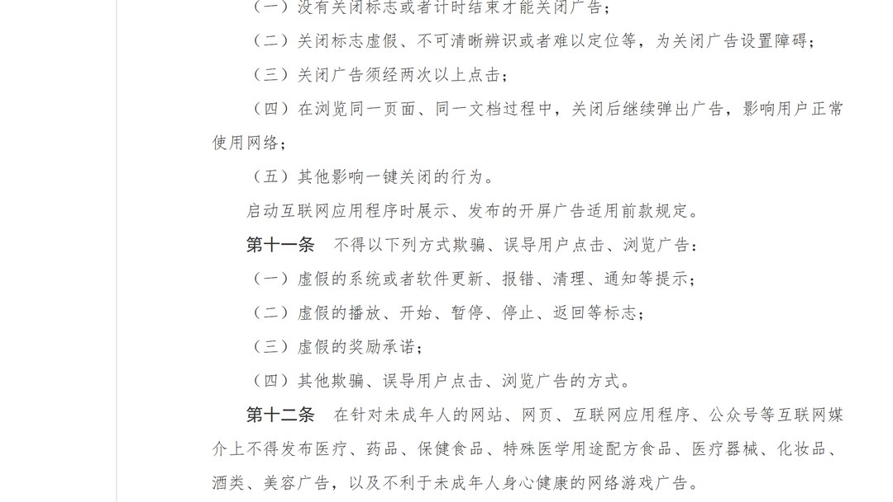
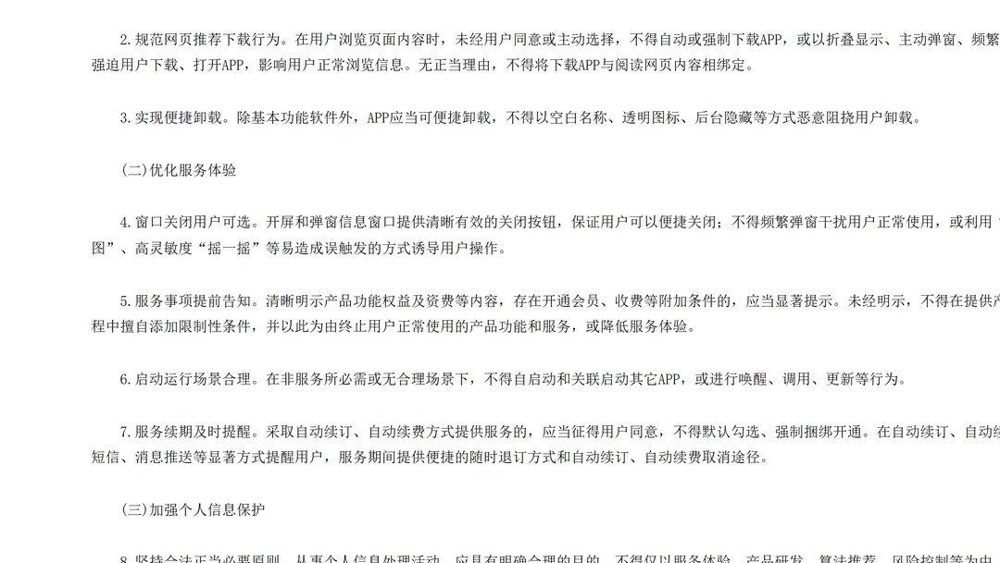
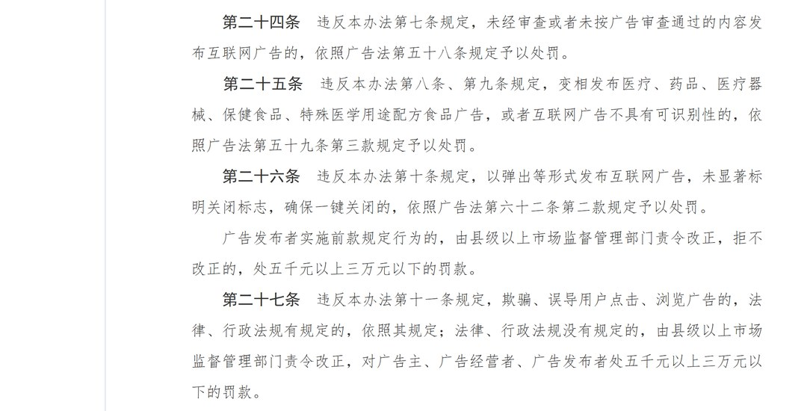
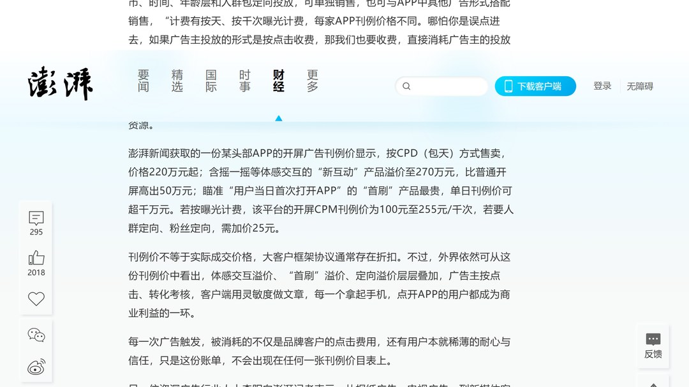
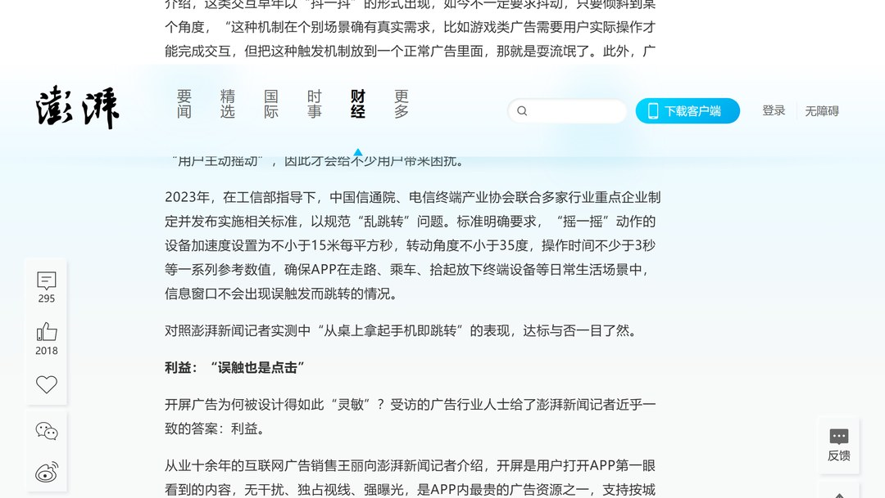

# 拿起手机就跳广告，3万元罚款只有50万差价的6%

11 月 9 日，澎湃新闻发了一组实测。

手机平放在桌上，没点，没滑，只是拿起来，开屏广告就完成了跳转。

手机没坏。开屏广告读的是陀螺仪和加速度传感器，把一段设备姿态变化换算成一次「点击」。

你抬手这个动作，在广告后台等于一次主动点击。

微博那次更直接。记者误触后弹出「是否进入淘宝」，点了「取消」，页面照样跳到淘宝。

再试一次，结果相同。

## 一、规定写得比想象中细

我先把三份文件翻出来，本来想找漏洞，发现漏洞不在这头。

《互联网广告管理办法》2023 年 2 月 25 日由国家市场监督管理总局以第 72 号令公布，5 月 1 日施行。

第十条列了五种不许做的事。

没有关闭标志，或者计时结束才能关。关闭标志虚假、不可清晰辨识、难以定位。关一次要点两次以上。

还有一条：关闭后继续弹出广告，影响用户正常使用网络。

第十条末句另写了一句：启动互联网应用程序时展示、发布的开屏广告适用前款规定。

开屏也被算进去了，2023 年就写好了。

工信部信管函〔2023〕26 号，2023 年 2 月 6 日印发。

第 4 条叫「窗口关闭用户可选」，要求开屏和弹窗信息窗口提供清晰有效的关闭按钮，用户可以便捷关闭。

后半句更准：不得利用「全屏热力图」、高灵敏度「摇一摇」等易造成误触发的方式诱导用户操作。

同一份通知还写了两条。

一条是「实现便捷卸载」，不得以空白名称、透明图标、后台隐藏等方式恶意阻挠用户卸载。

一条是自动续订、自动续费前 5 日以显著方式提醒，不得默认勾选、强制捆绑开通。

2023 年，工信部指导下，中国信通院、电信终端产业协会联合多家企业定了量化门槛。

「摇一摇」的设备加速度不小于 15 米每平方秒，转动角度不小于 35 度，操作时间不少于 3 秒。

三秒，三十五度。把手机从桌上拿起来，两个都不够。

## 二、实测里，取消键是摆设

澎湃记者测了 20 余款常用 App，覆盖资讯、视频、音乐、地图、天气、工具、电商，数日多轮。

百度地图：手机放桌上，打开 App，再拿起来，开屏广告完成跳转。

百度网盘：手稍微倾斜，也跳。WiFi 万能钥匙的摇一摇同样灵敏。

掌通家园是一款家园共育 App，轻微倾斜或步行中打开就能触发。

从广告页返回后，首页再弹一次。有时点关闭按钮无应答，有时又跳一次。

优酷、网易云音乐、腾讯新闻、酷狗音乐也出现过倾斜即跳转，灵敏度稍弱。

没跳的那几个也记一下。抖音、快手、拼多多，加上开心消消乐、欢乐斗地主、2345 天气王，测试期间没有开屏广告。

京东、淘宝偶有开屏，形式是上下滑动按钮。

同一套手机系统，有的跳，有的不跳。

澎湃自己写了一句克制的说明：开屏广告千人千面，不同用户、不同时段看到的并不相同，实测结果未必与其他人的体验一致。

这句我照录，不替它扩大。

## 三、顶格 3 万，对上 50 万

第二十六条：违反第十条，责令改正，拒不改正的，处五千元以上三万元以下的罚款。

第二十七条对欺骗、误导用户点击，也是五千到三万。

「责令改正、拒不改正」这八个字要留意。罚款要等这道程序走完才落地。

再看澎湃记者暗访拿到的那份头部 App 开屏广告刊例价。

按 CPD 包天售卖，普通开屏 220 万元起。

含摇一摇等体感交互的「新互动」产品，270 万元，比普通开屏高出 50 万元。

瞄准「用户当日首次打开 App」的「首刷」产品，单日刊例价可超千万元。

按曝光计费，开屏 CPM 刊例价 100 元至 255 元/千次，人群定向、粉丝定向再加 25 元。

我自己算了三遍。

3 万 ÷ 50 万 = 6%。顶格罚款只有体感交互单日刊例价差的百分之六。

3 万 ÷ 220 万 ≈ 1.36%。摊到普通开屏的单日刊例价，连百分之二都不到。

3 万 ÷ 1000 万 = 0.3%。对着「首刷」，连百分之一都不到。

270 − 220 = 50 万，50 ÷ 220 ≈ 22.7%。加一个体感交互，报价涨两成多。

CPM 100 元至 255 元/千次，折下来每次展示 0.10 元到 0.255 元。按 100 元那一档，定向再加 25 元，等于加价四分之一。

这几个数得带上口径。

刊例价与实际成交价之间还有折扣，大客户框架协议通常有，澎湃原文写明了。

50 万是单日刊例价差，跟平台当天利润无关。我比的是报价单上的量级和罚则上的量级，没碰利润表。

人民日报的评论是，这个数额与弹窗广告带来的巨额收益相比，成本实在太低。

两位受访的广告行业人士说得更直白：3 万元顶格罚款与收益相比近乎「毛毛雨」，风头一过，灵敏跳转就卷土重来。

## 四、消失一周，账落在谁身上

今年 6 月，一位百万粉丝博主说，自己驾车时语音唤醒导航 App，全程没碰手机，弹窗突然跳转让他分心，险些追尾。

舆论发酵后，网友发现导航 App 的开屏广告「消失」了。

持续不到一周，摇一摇开屏广告卷土重来。

澎湃另一篇调查里，受访者给了一个解释：应用送审时可以一次都不弹窗，上架后再按机型、区域、时段定向触发。

同月，工信部信息通信管理局开专题会，要求强化 App 信息窗口呈现方式的规范管理，严禁违规呈现信息窗口，建立在线巡查机制。

受访的技术人员给澎湃的判断就一句：「技术上面，没有任何难度。」

他补了一句：「广告关不掉也可以被设计，一样没有难度。」

从 2023 年 5 月 1 日办法施行，到今年 6 月的会，再到 11 月 9 日的实测，中间隔了三年半。

这三年里针对「摇一摇误触」的顶格罚单，我没查到一手源，这个数先空着。

澎湃另一篇调查里，一位 80 多岁老人的手机桌面被红包、小游戏、清理软件占满。

孙子回家花了 40 多分钟，删掉 130 多个应用。删除过程中广告还在弹，有些应用找不到删除入口。

记者以「弹窗」「老年人」检索黑猫投诉平台，410 条投诉去重后剩 387 条有效信息。

其中 285 条涉及弹窗广告诱发消费，占 73.6%。另有 98 条正文出现「误触」「误点」这类表述。

有老人点开「走路领红包」，误以为是领奖流程，输入密码后被扣 199.07 元，商户已失联。

有老人误触后被开通「终身会员」，未享受任何权益，申请退款遭客服拒绝。

第十一条禁止「虚假的奖励承诺」。工信部通知要求自动续费前 5 日提醒、不得默认勾选。

条文对着的就是这些场景。

## 五、下次遇到，问三句

先问，点「取消」之后跳没跳。

跳了，就对照第十条「关闭标志虚假」和第二十七条「误导用户点击」。截图、录屏，打 12315。

再问，家里老人手机的免密支付和自动续费翻没翻。

微信、支付宝的支付设置逐项核对，陌生商户的扣款留住订单。应用乱跳转可以走 12321。

还要问，能不能从系统层把动作数据关掉。

10 月 27 日推送的 iOS 27.2 里，进「设置—隐私与安全—运动与健身—限制动作数据」，把常跳广告的 App 加进限制名单。

安卓找「设备动作与方向」权限，各品牌菜单名不同。

澎湃 11 月 2 日实测，百度网盘加进限制名单后，摇一摇广告依然跳转。别把这一步当万能。

前两问是取证，后一问是止损。

---

参数是我按公开资料算的，欢迎在评论区指正。
