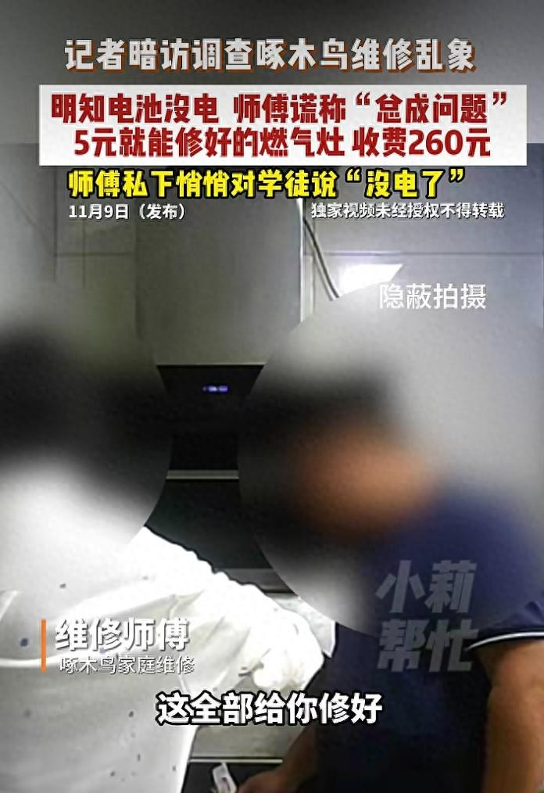
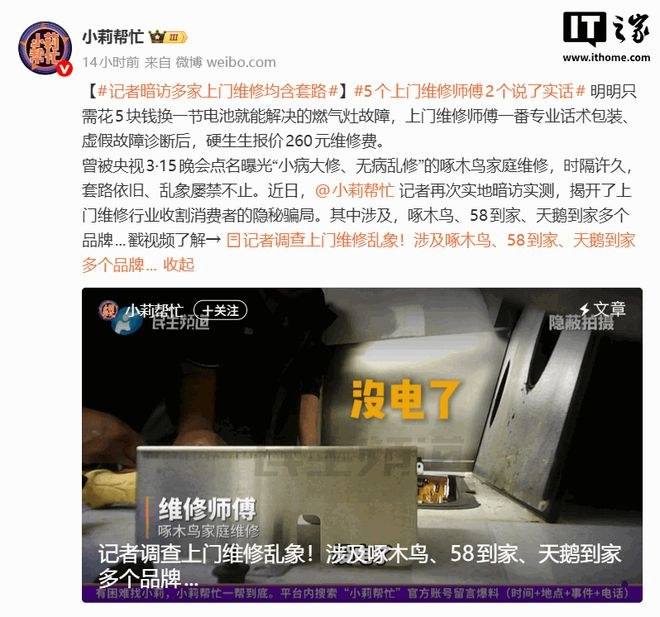
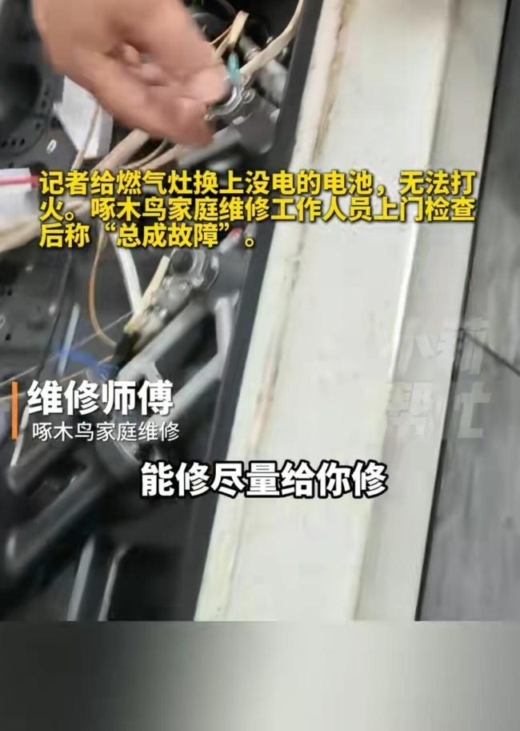
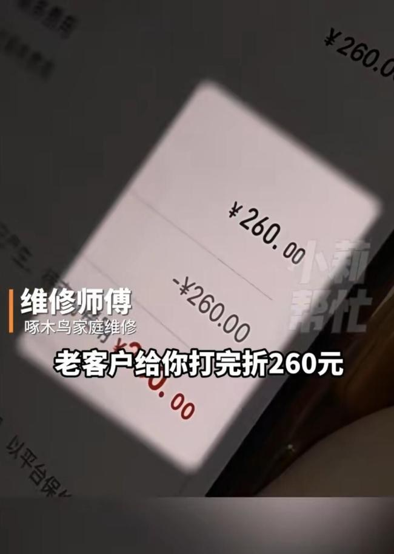
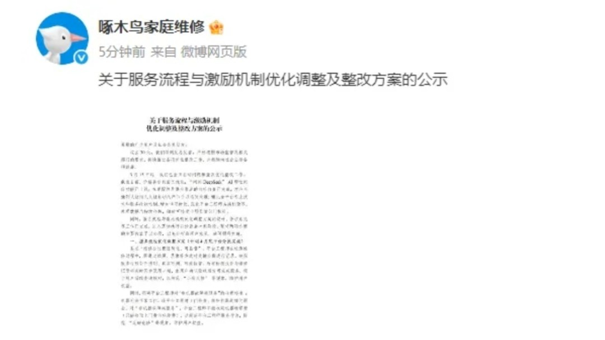
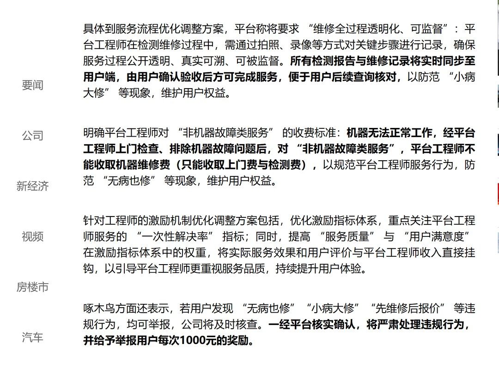
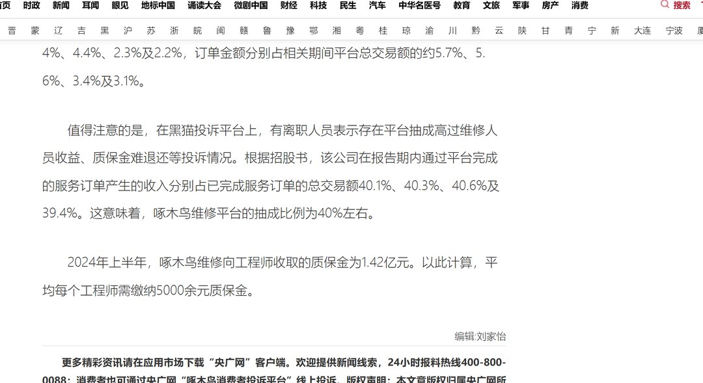
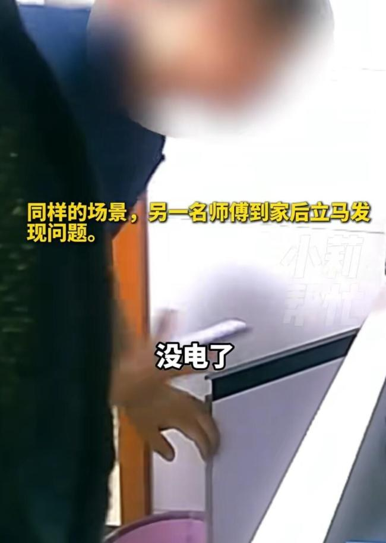

# 5元电池收260元，2025年整改条款为什么没拦住？

11 月 11 日，微博热搜第 2 位挂着「5 个上门维修师傅 2 个说了实话」，热度 35 万出头。

河南广播电视台《小莉帮忙》的记者找来一台完好的燃气灶，做了两处改动。一节电池换成没电的，燃气自闭阀关上。

然后在几个平台下单，请师傅上门。同一台灶，五个人给出五个价：260 元、244 元、160 元、30 元、30 元。

这个实验设计得干净。两处假故障都能零成本复原，谁在演，镜头一拍就清楚。

我看完先记下的不是那三张报价，是一句被拍到的话。记者借故离开厨房，报 260 元那位掀开灶盖，跟学徒说了三个字：「没电了」。

他知道。

## 一、260 元那张账单

先算这一单。报价单上写 316 元，师傅说「老客户给你打完折 260 元」。

316 减 260 是 56 元，折让 17.7%。真实成本是换一节电池，栏目自己写的是 5 块钱。

260 除以 5，52 倍。

五位师傅里，两位一眼看出问题。一位把阀门拨开，收了 30 元上门费，还说了句「你这 30 块花得冤枉」。

另一位看出电池没电，也只收 30 元。260 除以 30，8.67 倍。同一台灶，同一个故障，差价来自谁开口。

我把三张虚报的账单加起来，260 加 244 加 160，664 元。若按 30 元上门费各收一次，是 90 元。中间差 574 元。

这 574 元换回来的，是一句「总成坏了」。

## 二、2025 年那条公示

2025 年 3 月 15 日，央视 3·15 晚会点过同一家平台。画面里有两笔账：客户洗衣机水龙头没开，师傅上门拧开，收 100 多元；燃气灶电池帽没取，换个成本约 20 元的点火器，收 250 多元。

晚会还拍到，成本 91 元的塑料电机收了 659 元，旧电机转手再卖 60 元。659 减 91 加 60，628 元。

一个月后，平台在微博挂出整改方案公示。我逐字读了收费那一条。

上门检查并排除机器故障之后，这类服务按「非机器故障类服务」处理。原文接着写，「平台工程师不能收取机器维修费（只能收取上门费与检测费）」。

同一份公示还要求，检测报告与维修记录实时同步到用户端，由用户确认验收后才能完成服务。举报「无病也修」「小病大修」查实，每次奖励 1000 元。

拿这条对照这次暗访：电池没电、阀门没开，两处都算非机器故障。260 元收的是「更换开关总成」的机器维修费。

我查了那句「只能收取上门费与检测费」，没找到后来作废或修订的公开说明。这个先标一下口径。

## 三、招股书里的四成

这套报价为什么能反复出现，招股书里有一组公开数字。

央广网 2025 年 3 月 16 日引述招股书：报告期内通过平台完成的服务订单产生的收入，占已完成订单总交易额 40.1%、40.3%、40.6% 及 39.4%。文中直接写「抽成比例为 40% 左右」。

按四成算一遍分账。报 260 元，平台拿走约 104 元；报 30 元，平台拿走 12 元。差 92 元。

同一位师傅，跑同样一趟，说实话和报「总成坏了」，平台一侧差 92 元。

招股书还给出每单平均交易额：2021 年 231.8 元，2022 年 243.5 元，2023 年 250.2 元，2024 年上半年 238.6 元。三年涨 18.4 元，约 7.9%。

同一篇报道写到，2024 年上半年平台向工程师收取质保金 1.42 亿元，平均每人 5000 余元。

澎湃 2025 年 3 月那篇解读列过毛利率，2021 年至 2024 年上半年在 80.5% 到 84.2% 之间。同期销售及营销开支占总收入 44.3% 到 48.9%。

我不打算把「抽成四成」直接说成这次报价的动机，招股书没写因果。两组数摆在一起，方向看得出来。

## 四、改了流程没改分账

2025 年 7 月，厦门广电做过一次回访。平台公示了 88 个产品、6758 个服务项价格，也上线了 AI 问价。

记者试用后发现，AI 给的是区间报价，仍建议联系维修人员拿准确价。同期仍有消费者反映上门费和检测费双重收取、多次报价。

这次事件里，平台相关负责人张晓刚的回应是「全面排查、对工单进行全部溯源，如情况属实会严肃处理」。天鹅到家说发现就解除合作。

郑州市花园路、未来路、德化街三个市场监管所已介入调查。

我把 2025 年那份公示和这次回应并排放，改动落在流程上。拍照录像、记录同步、举报奖励、事后排查，分账那条没出现在任何一份公开材料里。

这里得说句公道话。两位说实话的师傅只收 30 元，其中一位还提醒客户这钱花得冤。

上门维修是一次性生意，师傅修完就走，没有回头客约束。判断权在拆机那个人手里，验证成本在站他身后的那个人身上。

这个位置换谁来坐，结果都差不多。整改只动流程，报价那张表照旧，一年八个月后同样的灶、同样的电池，台词从「点火器」换成「总成」，价格从 250 多变成 260。

## 五、下次上门先做四件事

打不着火时先自查两处，电池仓的电池与绝缘帽，燃气自闭阀的提钮复位。这两个动作不花钱。

闻到燃气味就关阀、开窗，到室外打燃气公司电话，别拆机。

动手前要一张工单，写清故障原因、换什么件、工时费与配件费各多少。坚持「修好再算」或者含糊故障名称的，换一家。

换下来的旧件自己留着。平台 2025 年承诺过检测报告与维修记录同步到用户端，可以直接要，由你确认验收再付款。

付款走平台，别私下扫码。大件先查保修期，过保也先打品牌官方售后比一次价。

若要维权，《消费者权益保护法》第五十五条写着欺诈可要求退还服务费并主张三倍赔偿，增加赔偿不足 500 元按 500 元算。

260 元的增加赔偿是 780 元。30 元那档算下来只有 90 元，按条文取 500 元。

律师提示要留维修单据、付款记录、沟通记录，以及能证明实际故障与所报故障不符的检测证据。

征得同意后全程录像，重点拍师傅对故障的初始判断、报价过程、实际操作部位。

记者暗访那单能不能按三倍赔，钱江视频采访的陈松涛律师说不一定。暗访是工作手段，法院可能认定不属于生活消费。

行政举报的门槛低一些，不要求举报人具备消费者身份。

---

参数是我按公开资料算的，欢迎在评论区指正。
