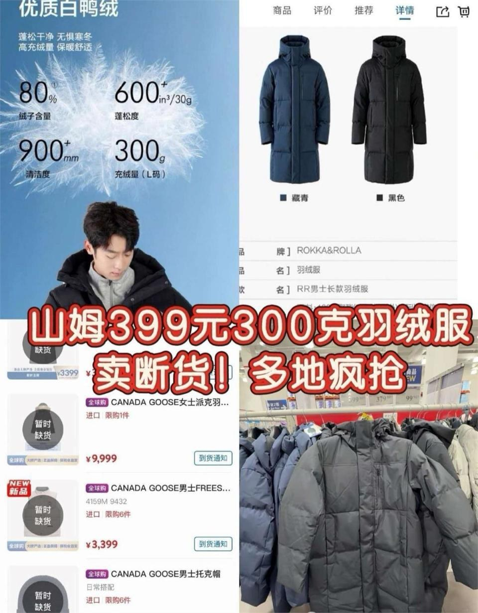
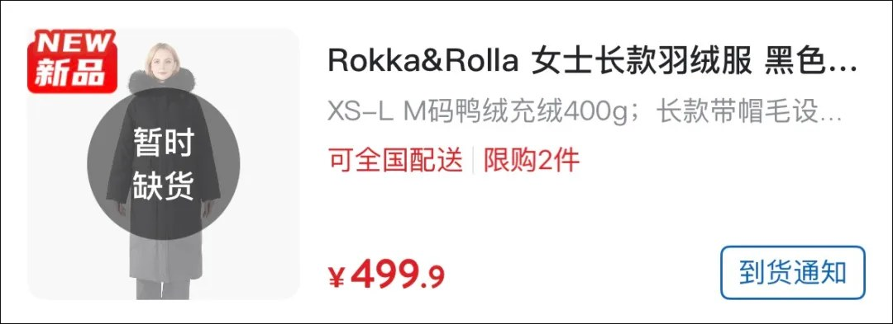
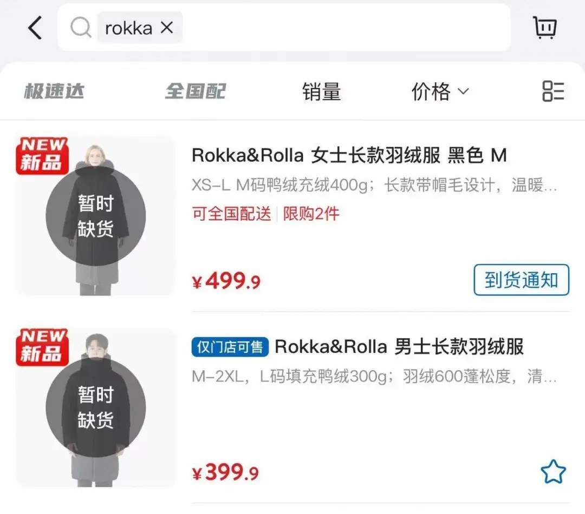
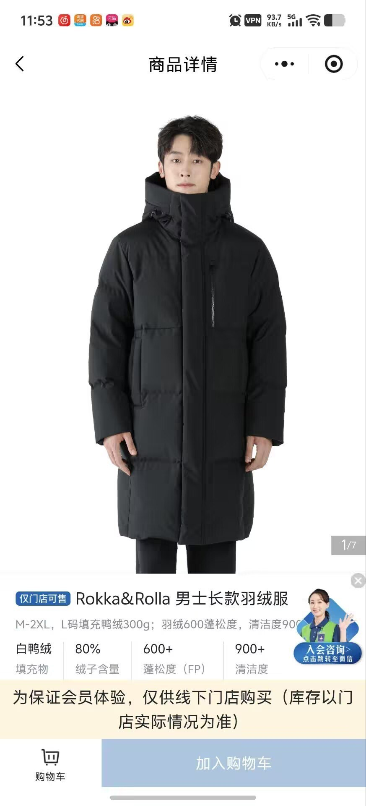
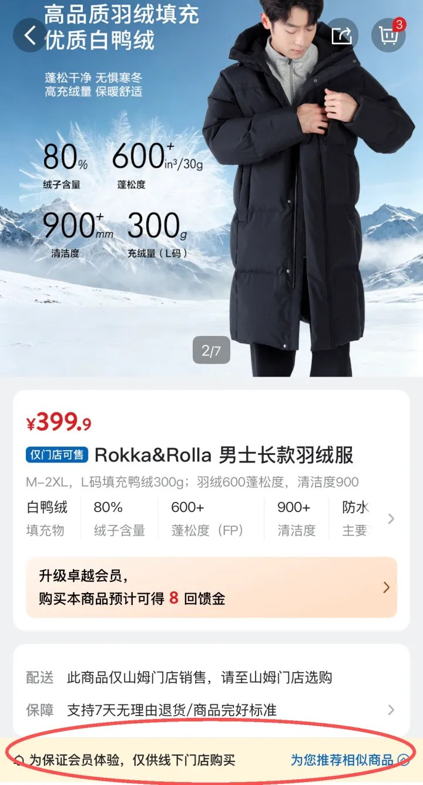
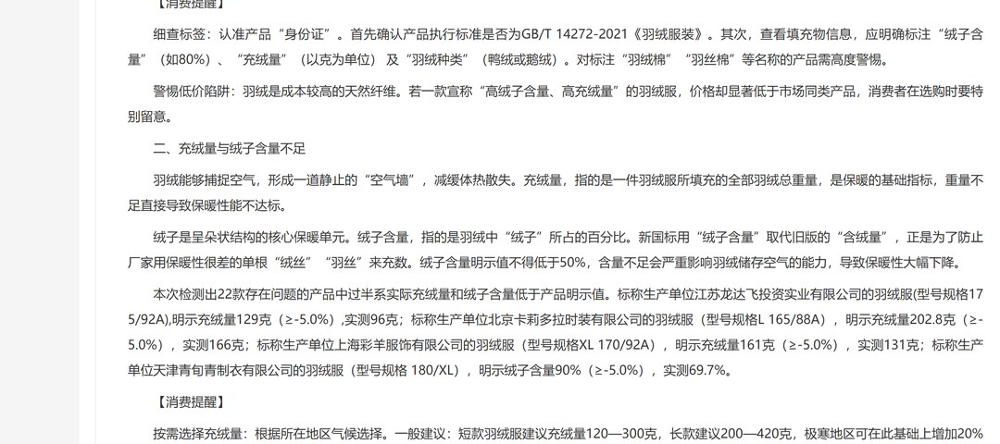
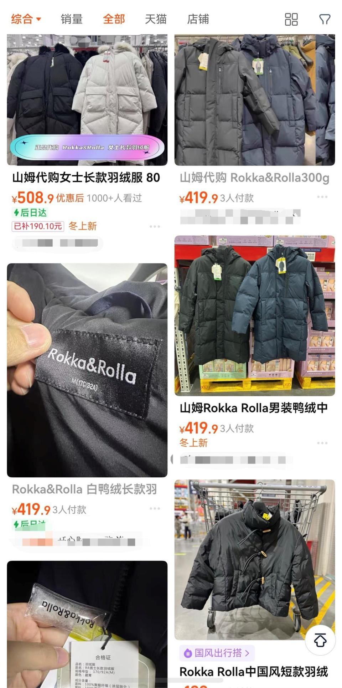
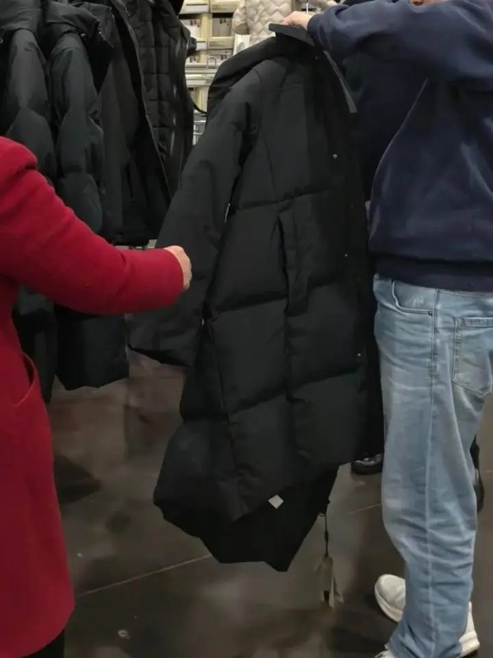

# 山姆399元羽绒服断货：300克是L码，绒子约240克

11 月 11 日，「山姆 399 元充绒量 300 克羽绒服断货」上了微博热搜。第二天它排到百度热搜第 2 位，热度 771 万。

我 12 日上午打开山姆小程序，男女两款都写「暂时缺货」，男款下面还挂着「仅供线下购买」。

价格确实好看。399.9 元，长款，白鸭绒，绒子含量 80%，蓬松度 600+，清洁度 900+。四张参数卡摆在商品页上，比不少品牌写得齐。

门店工作人员说女款已全部售完，男款只剩 M 码。社交平台上有人问哪里有货，代购已经挂出链接。

## 一、300克后面跟着L码

热搜那句话把价签和吊牌压成一个等式，399 元，300 克。

我把商品页逐行看完，参数卡上写的是「充绒量（L 码）300g」。括号里三个字符，转发时基本被省掉。

详情页写得更直白，「M-2XL，L 码填充鸭绒 300g」。300 克对应男款的一个尺码，换到 M 码或 2XL，这个数就不作数。

同一个搜索页还有另一件。女款 499.9 元，XS-L，M 码鸭绒充绒 400g，限购 2 件。

女款页写「可全国配送」，男款页写「仅门店可售」，两款都挂着「到货通知」。

399 元和 300 克讲的是同一件男款的一个尺码，跟 499.9 元那件 400 克没关系。

吊牌还有一行，大身及袖子填充白鸭绒，帽子等其他部位填聚酯纤维。帽子那块，羽绒是 0 克。

面料与里料也都是聚酯纤维。这一条不算问题，长款羽绒服用聚酯面料是常规做法。我拎出来说，是因为它划出了 300 克的边界，这 300 克只在大身和袖子里。

## 二、绒子约240克

第二个被省掉的词是「充绒量」。它和「绒子」两个概念，各管一头。

按 GB/T 14272-2021，充绒量指一件羽绒服填充的全部羽绒总重，里面有绒子，也有绒丝、羽丝和毛片。绒子含量指绒子在这堆填充物里占的百分比。

2022 年 4 月 1 日实施的新国标把「含绒量」换成「绒子含量」，为的是不让单根绒丝凑数。绒子含量明示值不得低于 50%。

照吊牌的 80% 算，300 克里绒子约 240 克，其余约 60 克是绒丝、羽丝、毛片这类成分。这个数是我按明示值折算的，没有拆过衣服。

国标还规定，标称绒子含量在 50% 到 90% 之间时，绒丝加羽丝不得超过 10%。保暖靠绒子和蓬松度，那 60 克帮不上多少。

安徽省消保委给过一个参考，绒子含量超过 75% 之后，保暖提升曲线会趋平，70% 到 80% 通常性价比更高。80% 卡在这段里。

长款建议充绒量 200 到 420 克。300 克落在中段，够用，谈不上把整件衣服塞满。

安徽那份报告还写了一句，克重高的衣服未必更暖。同等充绒量下，蓬松度高的更能锁住空气。

这款标的是 600+，单位是 in³/30g。山西省消协的提示写，蓬松度到 600 就能提供不错的保暖，大于 800 才算高品质。

600+ 属于前一档，离 800 还差一截。

内蒙古消协把两个词的差别写得更清楚。旧口径「含绒量」把绒子和绒丝一起算，新口径「绒子含量」只算能锁住空气的绒朵。

## 三、70款里22款不达标

我翻了安徽省消保委 2 月那次比较试验。70 款样品里 22 款不符合 GB/T 14272-2021，占 31.4%。

过半问题出在同一个地方，实际充绒量和绒子含量低于明示值。

明示 129 克实测 96 克，202.8 克实测 166 克，161 克实测 131 克。还有一款明示绒子含量 90%，实测 69.7%。

国标给的允差是 -5.0%。标 300 克，实测 285 克才算踩线合格。129 克那款少了 33 克，约 25.6%，是允差的五倍。

这里标一下口径。那 70 款里没有山姆这一件，我没查到这款的第三方检测报告。上面这组数说的是吊牌数字与实物之间能差多远，跟这一件有没有问题无关。

消协另有一句提醒，宣称高绒子含量、高充绒量却价格偏低的，选购时多留一步。落到手上是一按、二拍、三搓。按下去看回弹，拍绗缝看钻绒，搓面料摸毛梗。

原料那边也能算。禽网 11 月 5 日那期行情，80% 白鸭绒 444.72 元一公斤，走的是 GB/T 14272-2021 口径。

中国羽绒信息网 10 月 30 日那期，90% 白鸭绒 528.3 元一公斤，比上期下调 2.7%。

潮新闻写 11 月初 90% 白鸭绒约 54 万元一吨，比 58 万元的峰值回调约 7%。我拿 58 减 54 再除 58，得 6.9%，对得上。

按 444.72 元一公斤算，300 克羽绒原料约 133 元，占 399.9 元的三分之一。这个价只含羽绒，面料、辅料、加工、物流、渠道都没算进去。

同一周 90% 白鸭绒 535.62 元一公斤，比 80% 贵 20.4%。绒子含量定在 80，成本先替它做了选择。

## 四、账挪到了代购那边

12 日上午极目新闻记者在电商平台上查到几个代购。女款标价 699 元，比山姆价高约 200 元，优惠后实付 524 元，不支持 7 天无理由退货。

另一家女款 549.9 元，写「代购商品不退不换」。男款实付 429.9 元，比 399.9 元多 30 元，这家支持 7 天无理由。

山姆客服给了两条回应。这个系列属于第三方品牌入驻，并非山姆自营。网上代购与山姆无关，质量没法核实，建议走正规渠道。

吊牌上的制造商也接了电话，说只给客户供货，不直接面向消费者零售，这一款只在山姆卖。

把两款按克折一下。女款 499.9 除以 400，约 1.25 元一克。男款 399.9 除以 300，约 1.33 元一克，差 6%。

这个比法只能在同一渠道里用，代购那 699 元不进这张表。

我更在意另一件事。潮新闻把这套定价叫引流品，砍掉品牌溢价和商场租金，用羽绒服把人拉进会员店，利润从卖得贵挪到让你年年回来。

热搜把两个 SKU 的价和克数压成一句「399 元 300 克」，代购再拿这句去加价。链条里少掉的是尺码、部位和绒子含量三个限定词，多出来的是 200 元。

## 五、下次翻吊牌问四句

一，这个克数对应哪一码、哪一款。吊牌写 L 码，手里若是 M 码或 2XL，300 克就跟你对不上。

二，绒子含量多少，允差多少。国标给 -5.0%，22 款问题样品里过半属于实测低于明示值这一类。

三，哪些部位没有羽绒。帽子、毛领、门襟常被填成聚酯纤维，大身和袖子之外的部分单独问。

四，执行标准写没写 GB/T 14272-2021，蓬松度标没标，代购加价后谁负责退换。这款标了 600+ 和 900+，四项都写在商品页上。

这四句问完，价签没变，能核对的参数多了四个。

---

参数是我按公开资料算的，欢迎在评论区指正。
