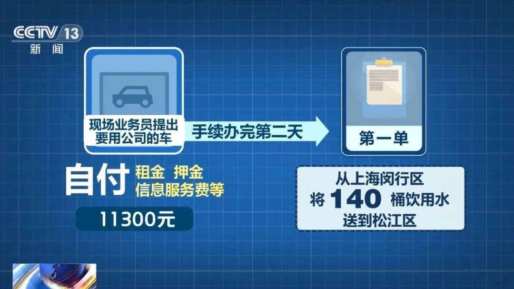
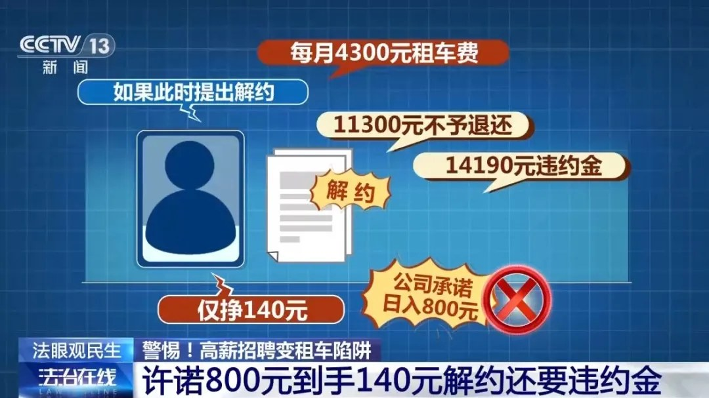
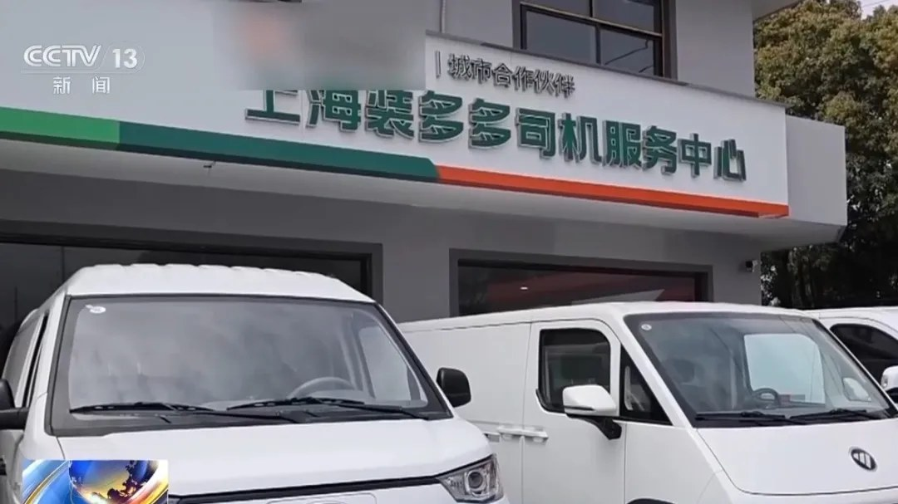
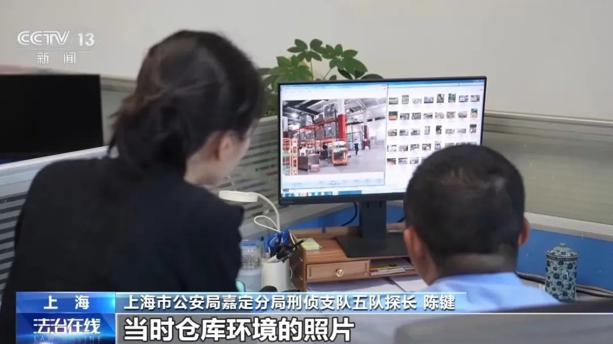
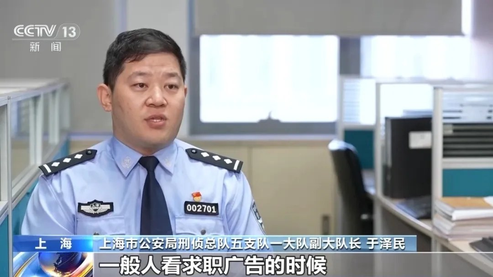
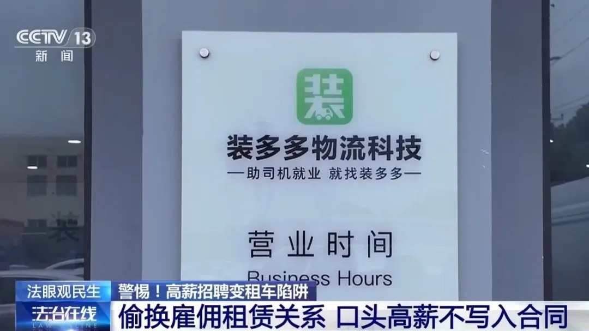

# 日入800元的司机招聘，6小时只挣140元

「车你哐哐开，钱就哐哐来。」

今年3月，货车司机沈先生在招聘网页上看到这句广告。上海嘉定一家物流公司招货运司机，公司配车，包住宿，日入800元左右，月入过万。

他第二天就去应聘了。

## 一、先交11300元再上岗

现场业务员说，要用公司的车得先自付一笔：租金、押金、信息服务费，一共11300元。

手续办完第二天，公司派出第一单。从上海闵行区把140桶饮用水送到松江区。

沈先生在电话采访里说，早上七点过去，装完、送过去、给人卸好，下午一点，给了140元。「装四千斤、卸四千斤，身心疲惫。」

日入800元，六小时到手140元。我算了一下，140除以6，时薪23.3元；要凑够800元得跑5.7单，按一单六小时算，是34.3小时。

一天只有24小时。

## 二、合同没写工作内容

他回公司交涉，对方拿出他刚签过字的合同。十几项条款，没有一条写明工作内容。

想解约，此前缴的一万多元不退，还要另付14190元违约金。想继续干，每个月还得付4300元租车费。

沈先生只能赔钱退出，前后损失两万五千余元。

上海市公安局刑侦总队五支队一大队副大队长于泽民说，能赚钱的承诺只当面讲，不会落到字据上。落到字据上的，是硬性的租金押金、没做满三个月要赔多少。

我把两组数摊开看。11300元是进门先交的，14190元是出门再赔的，加起来25490元。挣到手的那一单，140元。

4300元月租按140元一单算，一个月得先跑30.7单才够付租车费，剩下才算自己的。

## 三、民警上门只能调解

嘉定分局戬浜派出所民警徐洁说，现场了解下来，就是租赁司机做不下去了要退车，公司以违约为由扣押金。公司拿得出正规合同，民警按退费纠纷现场调解。

门店、营业执照、合同、收款码，都是真的，扣款一分不多。

后来同辖区类似警情接连冒出来，手法一致，线索才串到同一家公司。

嘉定分局刑侦支队五队队长朱旗说，警情里指向的公司叫「捷路兴」。门店招牌写的是「装多多」，司机扫码付款的收款方又是第三家公司。三家都由杜某一手注册。

这么安排是为了混淆报案人。报案人只记得一个名字，证据取不出来，追踪就断在半路。

探长陈键说，向求职者展示的仓库照片是从网上下载的，仓库和这家公司没有任何合作关系。

警方查了资金流水。这家公司自2025年8月开户以来，没有一分物流收入，退款率80%多。

朱旗说，他们声称是物流公司，主要资金却来自司机缴的租车费、押金和违约金。派单和车辆都是道具，出租车辆大多为低价外租。

警方专门解释，沈先生拿到的140元是公司在派单后支付给司机的单次运费，不是公司承接物流业务挣来的收入。

3月31日，嘉定警方集中收网。朱旗说，进现场第一排是引流组，一排坐开，每个人手里握着58同城、BOSS直聘的账号在发广告。当时正好有人来找工作，也有人来申请退费。

截至目前，查实受骗司机70余人，涉案金额300余万元，18名犯罪嫌疑人被依法采取刑事强制措施。

300万除以70，人均约4.3万元。这个数是涉案金额摊到人头，不等于每人实际损失，我只能拿来量级对照。

## 四、被换掉的那两个字

网上写的是「招聘司机」，到线下签的是租车合同。

于泽民说，看到「招聘司机」，感觉是有公司雇我、还交五险一金；到了线下变成租车，风险全归了司机。

「公司雇你」换成「你租公司的车」，一句话，钱的方向反了：本该公司发工资，变成司机先给公司交钱。

《中华人民共和国劳动合同法》第九条写着，用人单位招用劳动者，不得要求劳动者提供担保或者以其他名义向劳动者收取财物。第八十四条给的罚则，是每人500元以上2000元以下。

我拿它量了一下：2000元上限摊到沈先生两万五千余元的损失上，占8%。口径要写清楚，2000元是行政罚则的上限，不是这起案子的定性，警方按的是刑事案件。

雇佣关系一旦被写成租赁关系，第九条那句「用人单位招用劳动者」就先要过一道认定。民警上门只能调解，原因也在这里：合同摆在那儿，扣款一分不多。

一个人的两万五叫纠纷，七十个人的三百万才叫案子。中间隔的是警情串并的成本。

于泽民还有一句我记下来了：很多求职者可以吃苦，为了挣钱愿意付出，注意力都在工资那一栏。团伙打广告时把工资打得特别高。

## 五、下次看招聘问三句

谁先掏钱。《劳动合同法》第九条和《就业服务与就业管理规定》第十四条都写着，招人不得以担保或者其他名义向劳动者收取财物。租金、押金、信息服务费换个名字，还是先掏钱。

合同抬头是雇佣还是租赁。名字一换，雇主变出租方，风险就跟着换到求职者身上。

赚钱的承诺有没有落到纸面。日入800元、月入过万、只要租车就能拿1.5万，这些话只当面讲，纸上一条没有；纸上有的是4300元月租和14190元违约金。

再补一个笨办法：进门先交的钱除以一单挣的钱。11300除以140，约81单才回本，还不算每月4300元的租车费。按一天一单，要连着干将近三个月，一分不歇。

三句里我更信第三句，口头的话留不下证据。

---

参数是我按公开资料算的，欢迎在评论区指正。
