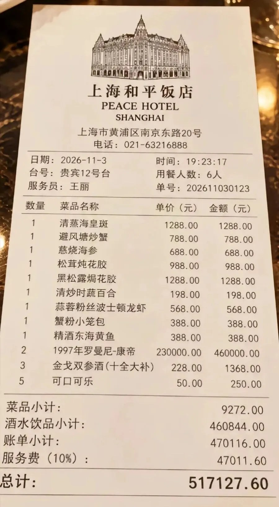
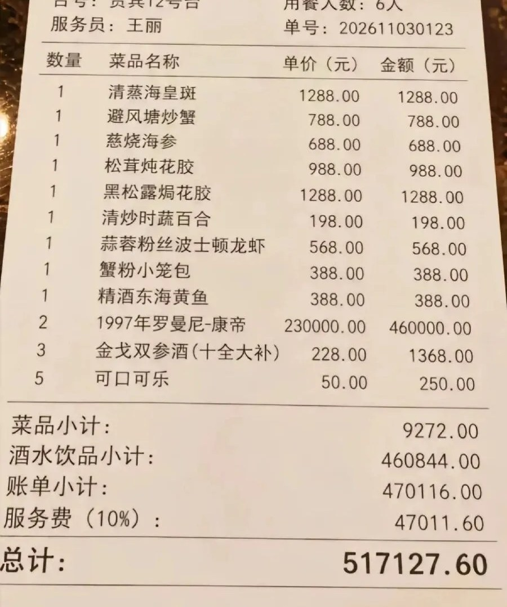
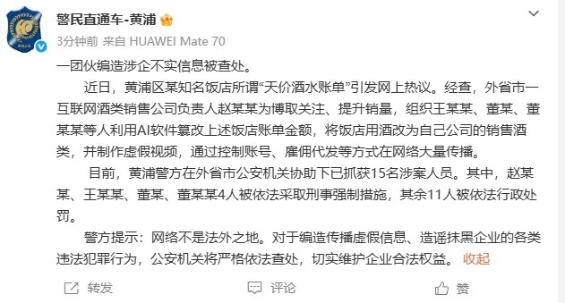
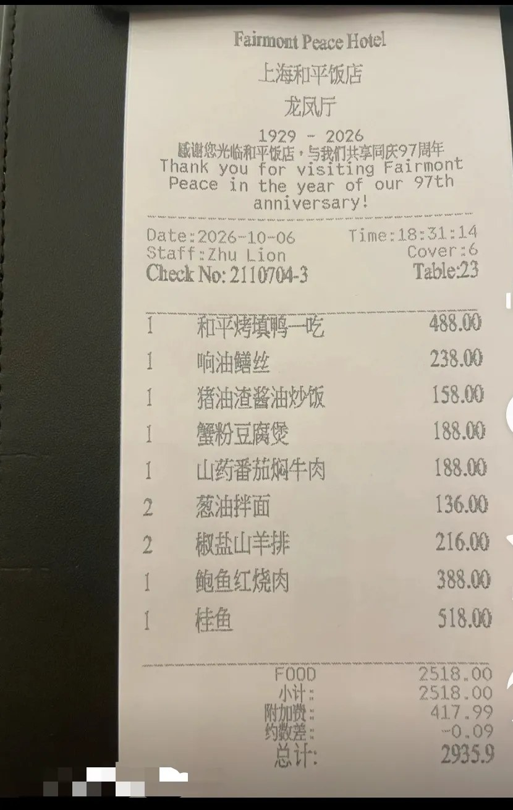
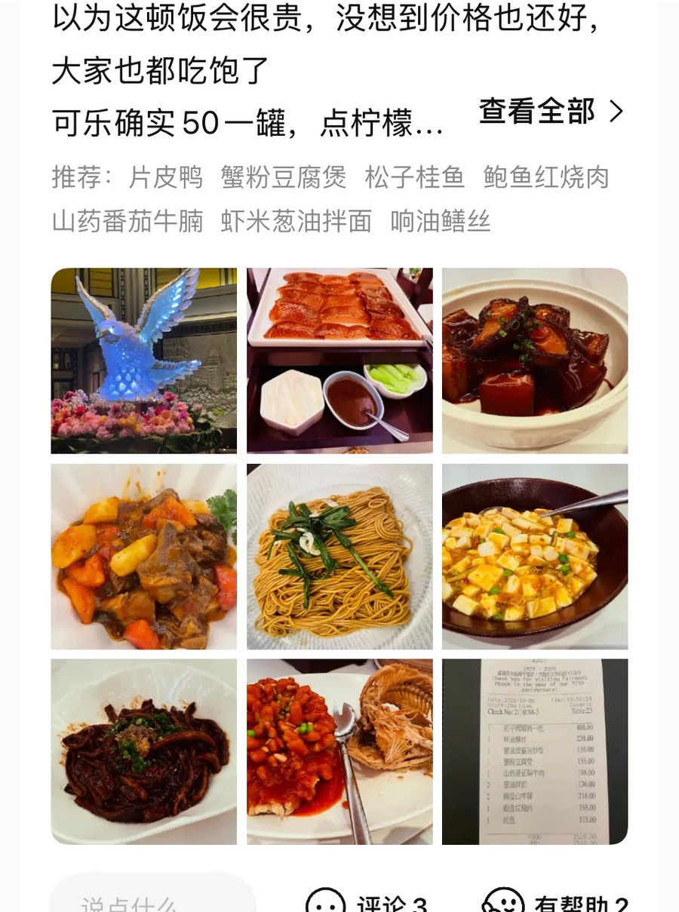
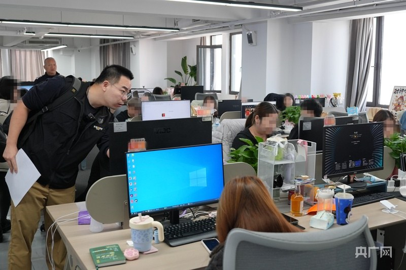
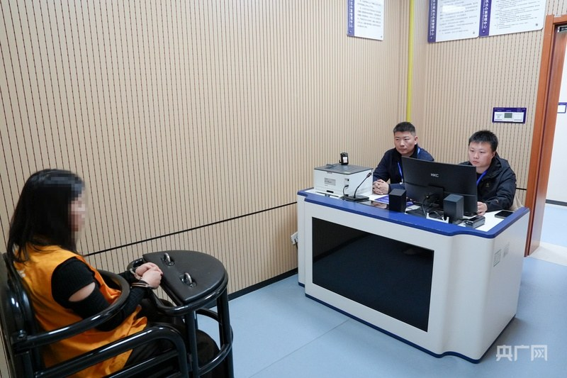
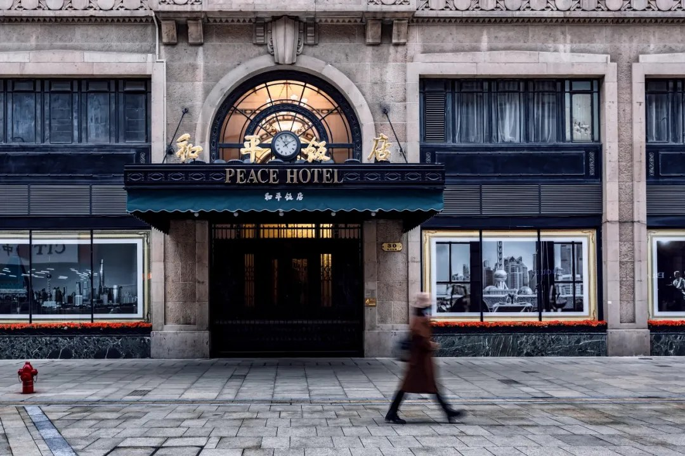

# 和平饭店51.7万小票，9道菜9272元，钱去哪了？

11月8日，一张消费小票在社交平台传开。票面抬头写着上海和平饭店，用餐6人，合计517127.60元。

9道菜，3样酒水，服务费单列一行。两瓶「1997年罗曼尼-康帝」单价23万元。

和平饭店原名华懋饭店，1929年开业，在外滩南京东路20号。地标配天价，这张纸不用多解释就有人转。

起初我也当成了真事。骂饭店的、算自己得攒多少年才吃得起一顿的，评论区两边都热闹。

## 一、先把51.7万拆开

央广网11月13日把票面逐项拆过。9道菜品小计9272元，单价到顶的一道1288元，3样酒水小计460844元，另列服务费47011.60元，账单小计470116.00元。

这几个数，我自己加了一遍。

9272加460844，等于470116，和账单小计对得上。470116乘10%，等于47011.60，和服务费对得上。470116加47011.60，等于517127.60，和总计对得上。

三层汇总，一个数不差。做这张纸的人算过账。

明细再往下翻。不对。

9道菜的金额逐项相加，1288、788、688、988、1288、198、568、388、388，合计6582元。票面写9272元，中间差2690元。

3样酒水逐项相加，460000加1368加250，得461618元。票面写460844元，差774元。

「金戈双参酒」那一行，数量3、单价228元，金额栏却是1368元。3乘228是684，正好差一半。

几个差都是我按票面数字自己加的，只说明明细和小计对不上，推不出饭店真票长什么样。

## 二、11月13日通报来了

11月13日13时许，@警民直通车-黄浦发布警情通报。

通报的原话，我拆成四段看。

「外省市一互联网酒类销售公司负责人赵某某为博取关注、提升销量」。

「组织王某某、董某、董某某等人利用AI软件篡改上述饭店账单金额」。

「将饭店用酒改为自己公司的销售酒类」。

「并制作虚假视频，通过控制账号、雇佣代发等方式在网络大量传播」。

黄浦警方在外省市公安机关协助下抓获15名涉案人员。赵某某、王某某、董某、董某某4人被依法采取刑事强制措施，其余11人被依法行政处罚。

15人里，4人刑事、11人行政，占26.7%和73.3%。人民公安报11月13日从公安部网络安全保卫局拿到的是同一组数字。

此前饭店回应过三轮。11月8日和9日，记者两次致电，工作人员说网络上这些天价消费小票均不真实，系网友虚构。11月10日，饭店说相关小票并非餐厅出具，已向警方求助。

上海市光明律师事务所律师付永生对央广网说，依据治安管理处罚法第29条，散布谣言、故意扰乱公共秩序的可处拘留并罚款。

伪造小票并在网上传播，若饭店社会评价降低、商誉受损，依据民法典第1024条涉及名誉权。饭店可要求停止侵害、赔礼道歉并索赔经济损失。

他还提到两条。造谣严重扰乱社会秩序，可能触犯编造、故意传播虚假信息罪。借机敲诈企业或从中牟利，还可能构成敲诈勒索罪。

接到被侵权方投诉后平台应及时核实处置，否则依据民法典第1195条，对损失扩大部分承担连带责任。

## 三、露馅的地方不止一处

动手比对的不只是警方。

光明网11月13日转述网友的发现。这张小票与某点评APP上其他网友发布的小票，版式、细节差得很明显。9个菜中有7个都是海鲜，不合常理。

两张票，我并排看过。点评平台那张抬头写「Fairmont Peace Hotel」和「龙凤厅」，日期2026-10-06，Cover:6，菜品单价从136元到518元，FOOD小计2518.00元，附加费417.99元，总计2935.9元。

假票抬头是「PEACE HOTEL SHANGHAI」，写「服务费（10%）」，台号「贵宾12号台」，服务员「王丽」。

两张纸不是一套单据。假票上9道菜从198元到1288元，菜价量级倒是抄得像，破绽落在别处。

再看金额结构。460844除以517127.60，酒水占89.1%；两瓶酒460000元，占总计89.0%；9道菜9272元，占1.79%；服务费47011.60元，占9.09%。

6个人平摊，人均86187.93元。两瓶酒460000元，够点357道单价1288元的菜。服务费是9道菜钱的5.07倍。

一顿饭的钱，九成压在两瓶酒上。

## 四、换掉的那一行是酒

通报里「将饭店用酒改为自己公司的销售酒类」这句，我认它是这件事的题眼。

造假的是一家互联网酒类销售公司，改的是饭店用酒，动机写的是「提升销量」。小票负责把人引过来，46万那两瓶负责让人记住，货排在后面。

那两瓶酒写着年份和名字，单价23万元。9道菜写着菜名和单价，从198元到1288元。造假者没去发明一套新价格，用的是这家店真会有的东西，再往里塞一个不存在的场景。

大家吵的是贵不贵、该不该这么宰客。少有人先问一句，这张纸是谁打的。

贵不贵是价格判断，真不真是事实判断。事实判断本该排在前面，这回没人先问。

央广网采访里还有个细节。警方抓获涉案人员的照片由黄浦公安提供，办案画面里是办公区和电脑。

造假那头，一句提示词加一段视频。核实这头要打电话、走流程、跨省协作。

11月8日曝光，11月13日通报，中间隔了5天。这5天里，那张纸已经把活干完了。

## 五、下次先算三样

先看分项占比。这回是菜9272元、酒460844元，1.79%对89.1%。钱压在哪一项，想卖的通常就是那一项。

再把明细加一遍。9行金额自己加是6582元，票面写9272元。真账由收银系统算，明细和小计联动，不会差2690元。酒水那三行也一样，逐项加461618元，票面写460844元。

末了等一手回应。11月8日饭店就否认了，11月13日警方通报才落地。发布者有没有完整的消费场景，还是只有一张孤零零的截图。

三条里我更信把明细加一遍这条。不用懂酒，也不用认识那家饭店，加法就够了。

再记一句笨办法。抬头、台号、服务费口径，拿同店另一张票并排看。这回真票抬头是 Fairmont Peace Hotel，假票写的是 PEACE HOTEL SHANGHAI。

---

参数是我按公开资料算的，欢迎在评论区指正。
