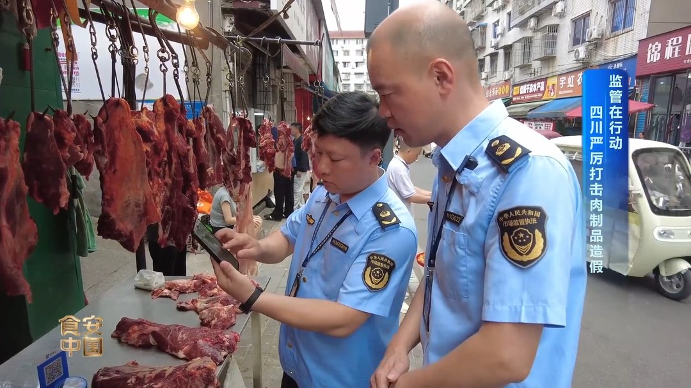
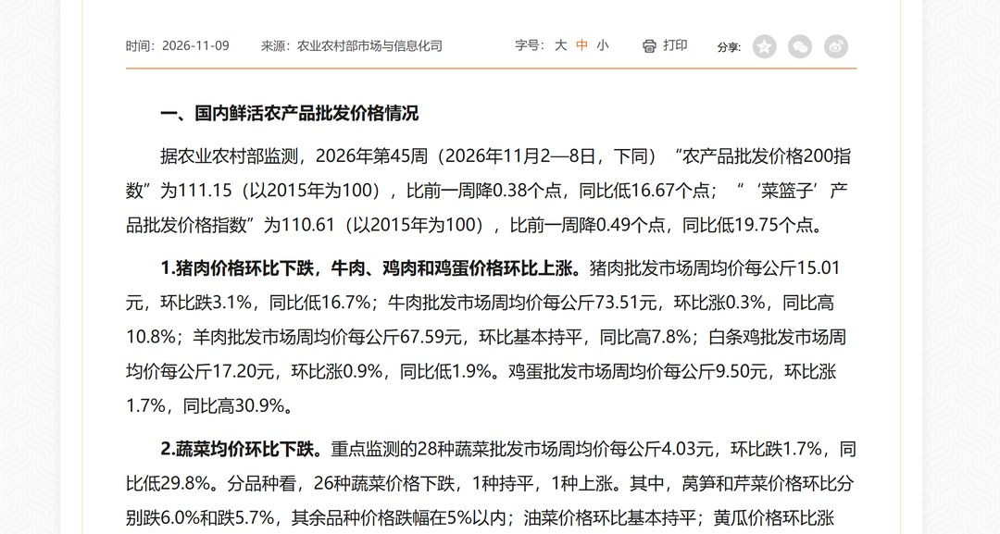
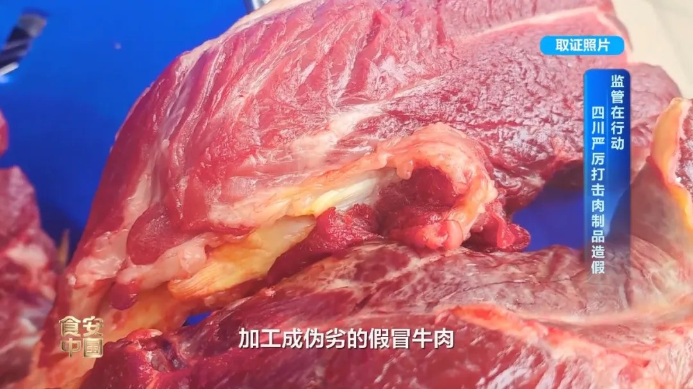
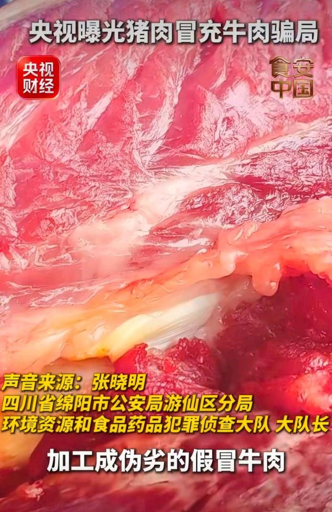
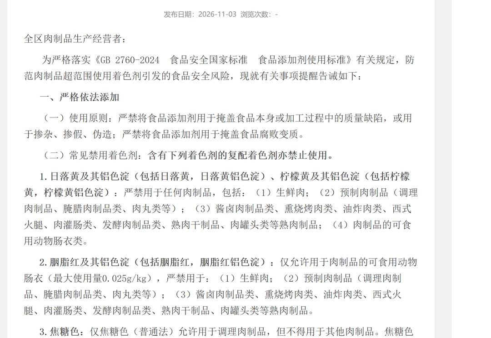
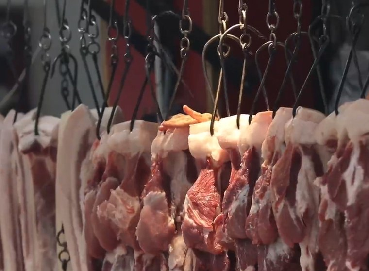
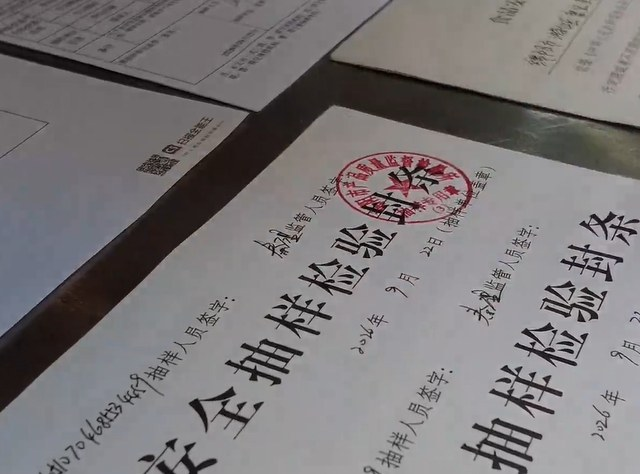
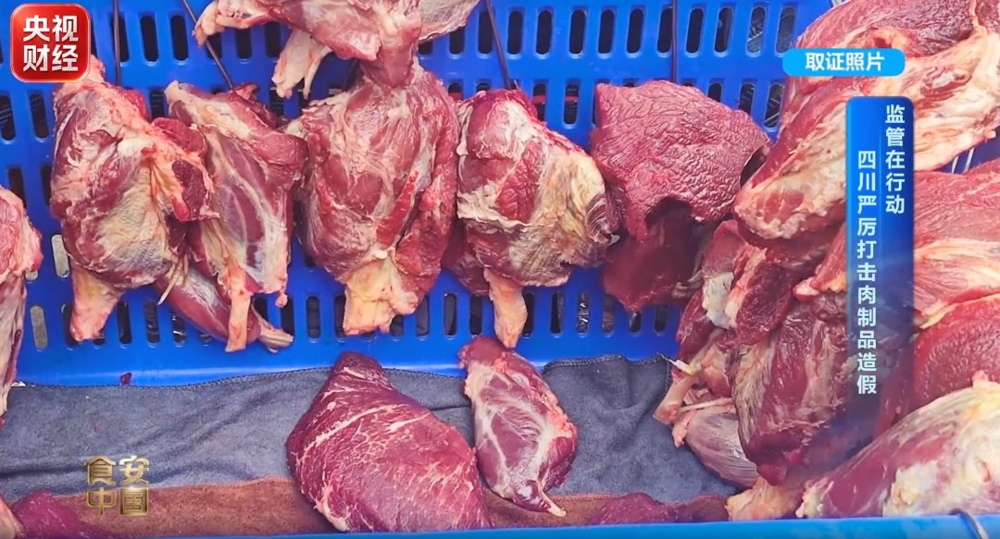

# 10元猪肉冒充30多元牛肉，买前先算三个价

今年 5 月，四川绵阳市游仙区市场监管部门做食品安全巡检。市场里一辆手拉车上摆着大量色泽红润的鲜肉。

执法人员要摊主出示肉制品合格证和检验检疫合格证。摊主说证件就近可取，转身走了，再没回来。

这时候有个围观的人上前问，这牛肉多少钱一斤。执法人员听出问题。摊主刚才说的是猪肉，问价的人却当成牛肉。

再细看，肉品筋膜着色深浅不均。消费者说，摊贩卖 30 元到 35 元一斤，比市场牛肉便宜。

## 一、四个疑点里有一个是数字

无证经营、弃货跑路、价格异常、疑似人工染色。央广网 11 月 15 日转央视财经的报道，把执法当天的关键写成这四条。

前三条里两条是行为，一条是外观。只有「价格异常」是能自己算的数。

公安调监控，两小时锁定轨迹，在居民区的窝点把人控制住。开门时嫌疑人正在清理生产工具。

我先把价格这一条摊开。摊贩卖 30 元到 35 元一斤，报道写的是「明显低于市场牛肉价格」。低多少，报道没给。

## 二、真牛肉的批发价压不到 30 元

农业农村部 11 月 9 日发布 2026 年第 45 周监测数据。这一周是 11 月 2 日至 8 日，牛肉批发市场周均价每公斤 73.51 元，猪肉每公斤 15.01 元。

一公斤两斤。牛肉折合每斤 36.755 元，猪肉折合每斤 7.505 元。

摊贩卖 30 元，比牛肉批发均价低 6.755 元。卖 35 元，还低 1.755 元。换算成比例，30 元是批发均价的 81.6%，35 元是 95.2%。

零售端要经过批发、运输、分割、摊位，价格通常高于批发均价。这里反过来，摊贩的售价压在批发均价下面。

我得先把口径说清楚。这组价格是 2026 年 11 月 2 日至 8 日的全国周均价，案子发生在今年 5 月，两者不是同一时点。

我拿它当今天买肉的参照线，不当作案发那天的成本证据。案发时的绵阳本地牛肉价，我没查到一级源。

同期还有一组集贸市场价。11 月第 1 周采集日为 11 月 5 日，全国牛肉平均价格每公斤 78.36 元，折合每斤 39.18 元；猪肉每公斤 20.11 元，折合每斤 10.055 元。

按这个口径，30 元连集贸牛肉价的八成都不到。而猪腱子肉的进价每斤 10 元到 14 元，正好落在猪肉价这一档。

## 三、柠檬黄这一笔，标准是零

涉案的手法在报道里叫「三重伪装」。原料是低价猪腱子肉，柠檬黄人工上色修饰筋膜纹理，喷牛肉香精改掉气味，表面再抹一层牛油盖住猪肉本身的特质。

这三招分别对着买肉人的三种判断，看颜色、闻味道、看纹理。三样都能造，肉眼这条路就断了。

GB 2760-2024 的规定更硬。惠州市惠阳区市场监管局的提醒告诫书写得明白。

柠檬黄及其铝色淀严禁用于任何肉制品，包括生鲜肉、预制肉制品、酱卤肉制品、熟肉干制品。含有该着色剂的复配着色剂同样禁用。

同一段还有一条使用原则：严禁将食品添加剂用于掩盖食品本身或加工过程中的质量缺陷，或用于掺杂、掺假、伪造；严禁用于掩盖食品腐败变质。

柠檬黄这一步，讨论「加了多少」没有意义。标准给的是零，不限量使用的情形根本不存在。

周至县、太谷区、甘孜州、谷城县几地市场监管局的通告口径一致。

周至县那份 2026 年 9 月 15 日发布，写明柠檬黄、日落黄在所有肉制品类别一律禁止使用，不存在任何限量使用情形。

我查这几份通告，是想确认这是全国统一的国标口径，不是某地临时加码。四地文本措辞几乎一样，都指向 GB 2760-2024。

## 四、DNA 和法条把结论钉住

公安机关通过 DNA 物种鉴定确认，涉案肉制品全部为猪肉。这一步不看颜色，不看气味，直接查物种。

内江另有一案，廉价鸭肉干换装贴标冒充风干牦牛肉。DNA 检测鸭肉源性占比 97.23%，牦牛肉成分差 2.77 个百分点，当事人判有期徒刑十个月。

绵阳这起，罗某某、翁某某从 2025 年 5 月起在屠宰场买猪肉，一年多获取暴利一百多万元。

法院一审按生产、销售伪劣产品罪判。罗某某有期徒刑七年并处罚金，翁某某有期徒刑三年、缓刑三年并处罚金。

我把进价和售价相减，每斤赚 16 元到 25 元。按 10 元进、30 元出算，毛利率 66.7%；按 14 元进、35 元出算，毛利率 60.0%。

中国人大网公布的刑法第 140 条按销售金额分四档。

销售金额五十万元以上不满二百万元的，处七年以上有期徒刑。罗某某判七年，落在这档的下沿。

这里我不做换算。报道写的是「获利一百多万元」，法条用的是「销售金额」，两个口径不同，判决书全文我没查到。

硬把获利当销售额去套档位，就成了我自己要拆的那种算法。

四川铺开的专项整治，量级也不小。今年以来全省查办肉制品领域行政违法案件 3769 起，侦办刑事案件 810 起，抓获 1706 名，捣毁窝点 306 处，涉案总金额 1.8 亿余元。

《中国市场监管报》10 月 9 日报道四川省食安办 9 月 29 日发布会，另给出罚没金额 1500 余万元，其中 18 件案件依托群众举报线索侦办。

## 五、能被自己用上的只有价和票

执法人员当天没有先做 DNA。让他起疑的是摊主拿不出两证、转身跑掉，以及那个低得不对的价。

摊主把价定在 30 元到 35 元，我理解是卡在一个窗口里。低于真牛肉的价，让人觉得捡了便宜；高于猪肉的价，留出足够利润。

这个窗口正好是「比批发均价低、比猪肉价高」的一段。低得离谱这件事，本身就是线索。

外观能造，气味能喷，纹理能染。价格和票据要跟着货走，造起来麻烦得多。下次在菜市场，我先算这三笔。

一问单价再换算。农业农村部每周发布批发均价，牛肉 73.51 元每公斤约合 36.755 元一斤。鲜牛肉零售报到 30 元及以下，先停一下再决定。

二要两证。肉制品合格证和检验检疫合格证当场拿得出来才继续谈。摊主说证件在附近、转身去取，这案子里就是这么走的。

三留票据和样品。四川今年有 18 件案子靠群众举报线索侦办，能追查的前提是有凭证。真发现问题，拨 12315。

还有一条可以顺手看，颜色过分红润均匀，或者筋膜着色深浅不均。生鲜肉不得添加任何着色剂，这两样都不该出现。

---

参数是我按公开资料算的，欢迎在评论区指正。
