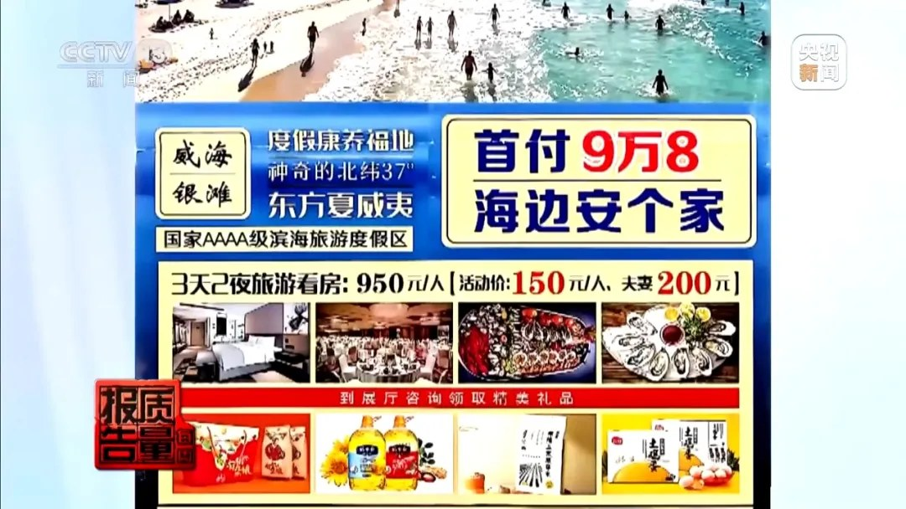
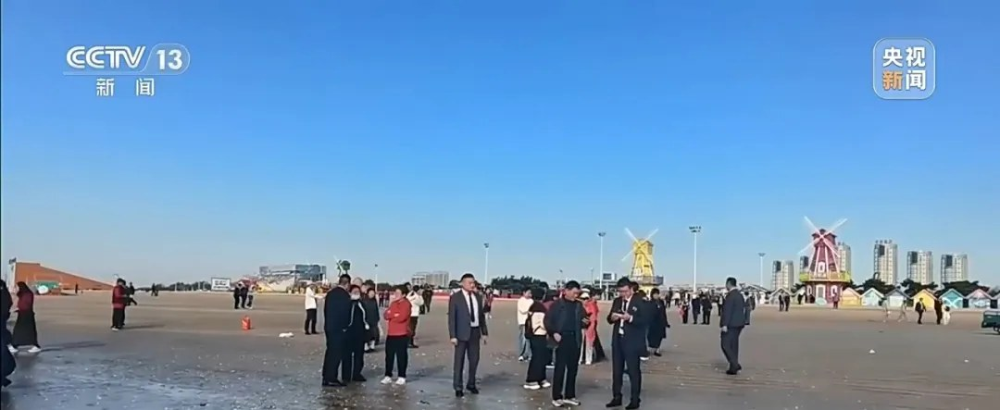
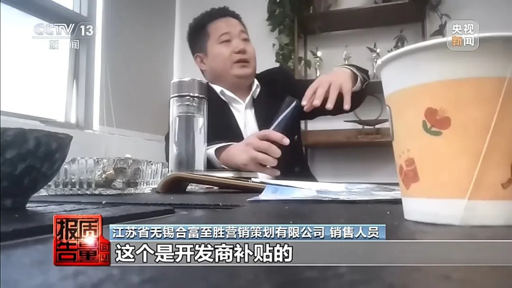
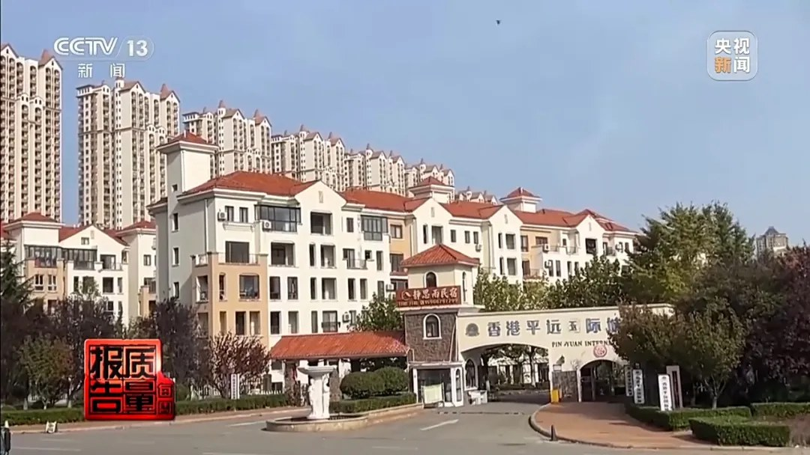
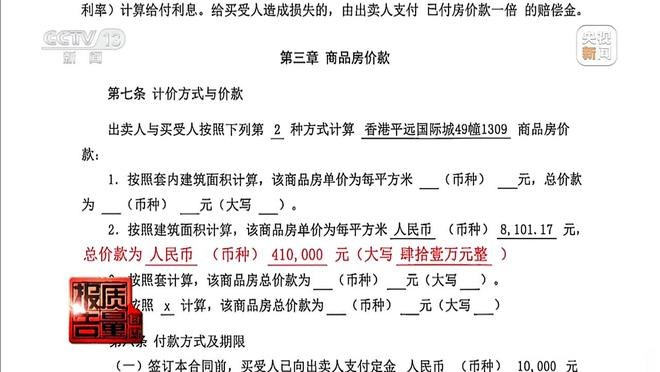
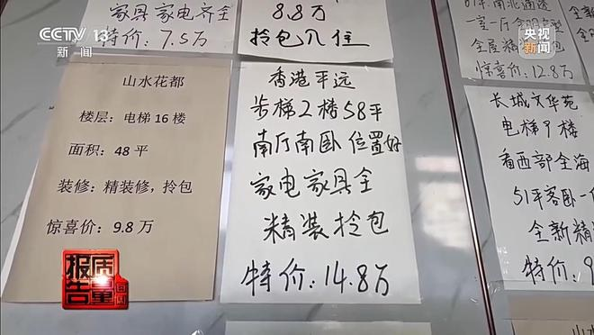
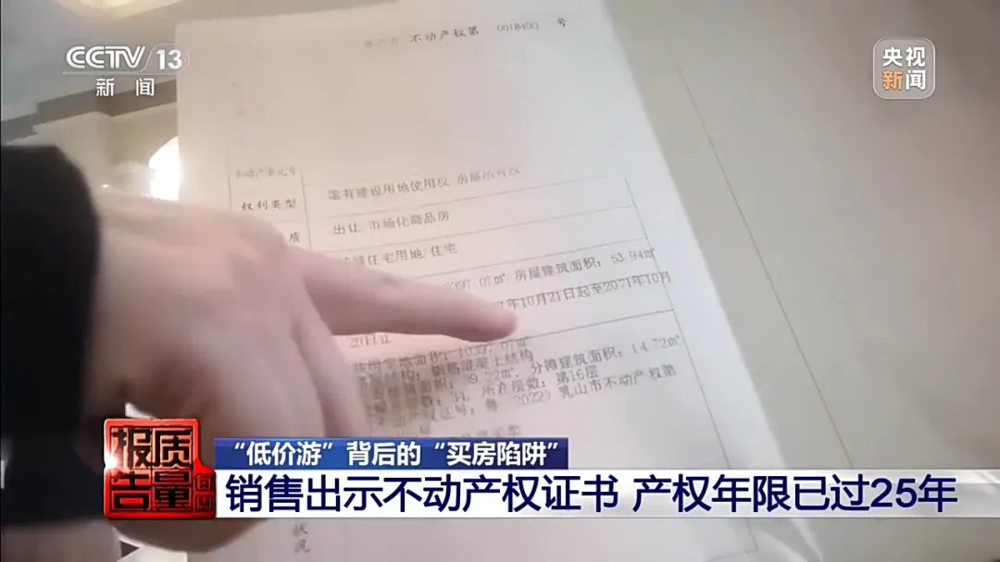
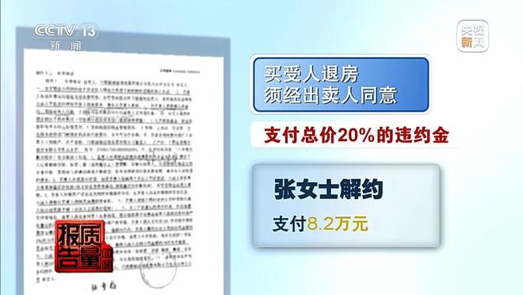

# 41万的房同栋楼不足9万，200元看房团先别报名

200 元，三天两夜，包吃住，从江苏无锡坐大巴到山东威海乳山，还能看海景房。

单程超过 700 公里。这个价连车费加食宿都盖不住，我拿它跟销售自己报的数对了一遍。

11 月 15 日，央视《每周质量报告》播了这趟车的后半段。有人下车时签下 41 万元的购房合同，同小区、同栋楼、同等面积的毛坯房，二手房市场价不足 9 万元。

## 一、200 元买的是名额

海报把价目写得很全。3 天 2 夜旅游看房，950 元一人，活动价 150 元一人，夫妻同行 200 元。

记者交 200 元上了车。无锡合富至胜营销策划有限公司的销售说，这是开发商补贴的，实际费用是一个人 680 元。

我算了一下三个价。950 减 150 是 800 元，活动价是标价的 15.8%。680 减 150 是 530 元，这 530 元由开发商出。

夫妻交 200 元，两个人按 680 元算是 1360 元成本，差额 1160 元。

从无锡到乳山单程 700 多公里，三天两夜包吃住，200 元无论如何覆盖不了。这句判断是节目原话。

海滩「观光」停了不到半小时，大巴就开往鼎泰臻寓楼盘。几乎每位老人身旁都跟着一到两名深色西装的销售。

销售说，旺季一个礼拜能来三四百辆大巴。这个数我没查到独立统计，只当作他自己的说法。

获客成本 530 元一人。这笔钱有个出处。往后看合同。

## 二、41 万与不足 9 万

江苏丹阳的张女士今年 8 月参团，去的是香港平远国际城。

这套房 50.6 平方米，原价 60 多万元，经 12 万元托管费和「一万抵五万」团购活动减免，合同房款 41 万元。

节目放出了合同原件。第七条按建筑面积计价，单价 8101.17 元一平方米，总价款 410000 元，大写肆拾壹万元整，定金 10000 元。

8101.17 是单价，我一开始当成总价。乘 50.6 约 41 万，合同自洽。

记者到乳山市不动产登记大厅查档案。香港平远国际城早在 2013 年就取得预售许可，张女士这套房当时备案均价 7430 元一平方米，2021 年转现房后未更新备案价。

8101.17 减 7430 是 671.17 元，一平方米差 671.17 元。按 50.6 平方米算，多付 33961 元。

小区周边多家二手房中介，记者挨家走访。同小区、同栋楼、同等面积毛坯房，市场价不足 9 万元。

节目截帧里的价目牌可以自己读。7.5 万、8.8 万、9.8 万、12.8 万、14.8 万，户型从 48 平到 58 平。

41 万减 9 万是 32 万。41 除以 9 约 4.6 倍，而「不足 9 万」是个上限，真实倍数只会比 4.6 更高。

这个口径要写清楚。价目牌是二手房挂牌价，不是评估价，也不是同套房的一手成交价。

产权上还有一处落差。销售出示的《不动产权证书》写着，国有建设用地使用权 2001 年 10 月 21 日起至 2071 年 10 月 20 日。

70 年产权，到 2026 年已过 25 年，买方拿到手只剩 45 年，缩水 35.7%。节目字幕给的是「产权年限已过25年」。

记者核实到，涉事楼栋前身为早期开发商品房，如今以度假康养海景新房的名义卖给对当地楼市不了解的看房客。

## 三、返租 3 万谁在付

售楼处的话术是购房后酒店每年固定返租 3 万元，足够覆盖月供，还能赚养老收益。3 万除以 12 是 2500 元一个月。

另一个楼盘鼎泰臻寓给出的「以租养贷」是另一组数。销售说月供 1500 元每月，租金也 1500 元，拿租金还月供就行。

同一套逻辑，两个楼盘两组数，一组刚好打平，一组每月还多 1000 元。

香港平远国际城的样板间开价又是另一套。54 平方米总价 67 万余元，单价 12400 多元，另称可一次性结算 5 年托管租金 134000 元。

134000 除以 5 是 26800 元一年，跟 3 万也对不上。节目把这一层叫「虚高标价、再做折扣」的数字游戏。

事后张女士找到香港平远国际城售楼处，销售主管否认「以租养贷」承诺，说托管要去找酒店，这个事情不归销售部管。

签约时对方称合同是统一版本，没必要看，催着签字。字刚签完，所有纸质合同就被收走。

次日一早，张女士被带到中国建设银行乳山支行办贷款面签。中介现场教她，银行问婚姻状况就说离异，只有离异或丧偶才能办个人贷款。

直到 2026 年 11 月 4 日，她才从开发商处拿到合同原件，距签约快 3 个月。

合同上的出卖人是日照丽城建设发展有限公司乳山山译分公司。

全国企业破产重整案件信息网显示，这家公司的总公司在 2023 年 11 月已被法院裁定宣告破产，销售推销时没有提。

补充协议还写着，因买受人原因提出退房，须经出卖人同意，并按合同总价款的 20% 支付违约金。

41 万乘 20% 是 8.2 万元，节目给的也是这个数。张女士说，首付 12 万是她全部积蓄，月供指望返租收益，那是她的养老钱。

## 四、两地开始核查

11 月 16 日，乳山市组织住建局、市场监管局、文旅局、公安局成立整治专项工作组。现场核查鼎泰臻寓、香港平远国际城的低价游购房与虚假宣传问题。

通报还写明，要对全市在售楼盘和房产中介拉网式排查，整治以旅游看房为名诱导购房的同类乱象。

同日，江苏无锡文旅部门联合市场监管、公安及属地开展现场核查，将依法依规严肃查处。

节目里那句「异地揽客、本地成交」，说的是无锡管组团、乳山管卖房，中间隔着 700 多公里。张女士从江苏到山东，从售楼处到职能部门，维权至今没有得到答复。

乳山法院 2022 年发布的数据是，仅 2021 年一年该院受理涉海景房案件 1397 件，占全院受理案件总量的 10.67%。

按这两个数反推，全院当年受理案件约 1.3 万件。这是我算的，不是法院公布的数。11 月 16 日的核查结论我还没看到，处置结果得等通报。

## 五、下次遇到先算三笔

头一笔算团费。标价 950 元、活动价 150 元、销售说成本 680 元，差额 530 元一人。问一句谁补的，补钱的一方一定在终点等你。

第二笔查同小区同栋楼同面积的二手房挂牌价。别看售楼处的「原价 60 多万」和「一万抵五万」。41 万和不足 9 万之间，隔着 32 万。

第三笔看合同原件。单价 8101.17 元、总价 410000 元、违约金 20%，这三个数决定了退房要付 8.2 万元。合同没到手，定金先别交。

再加两个能自己查的日期。产权起算日去不动产登记大厅问，出卖人主体状态去全国企业破产重整案件信息网查。2001 年 10 月 21 日和 2023 年 11 月，节目里都给了。

---

参数是我按公开资料算的，欢迎在评论区指正。
