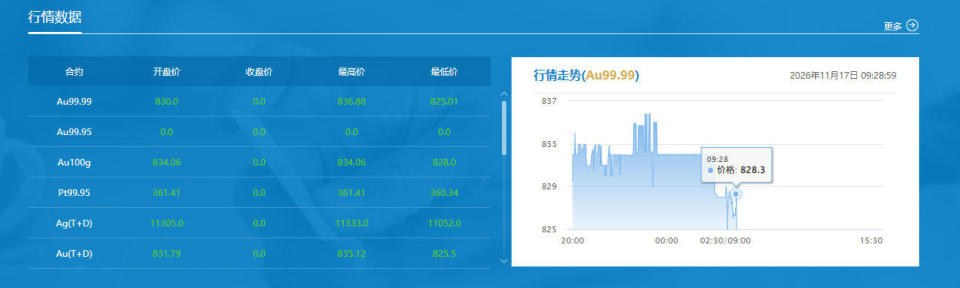
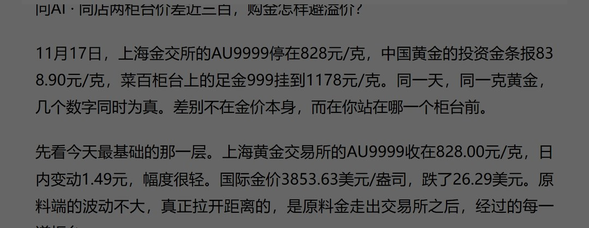
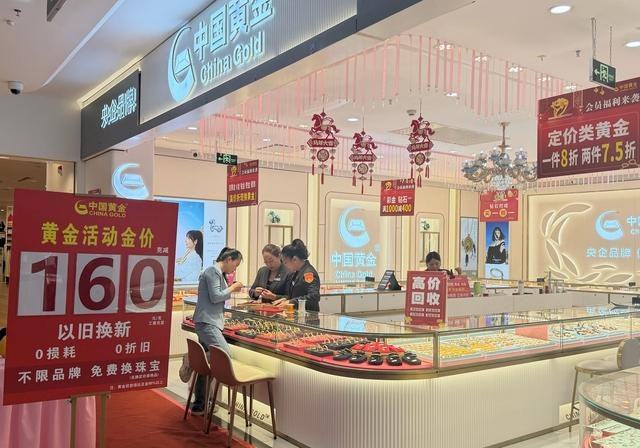
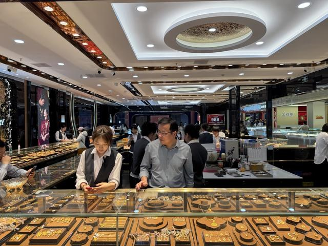
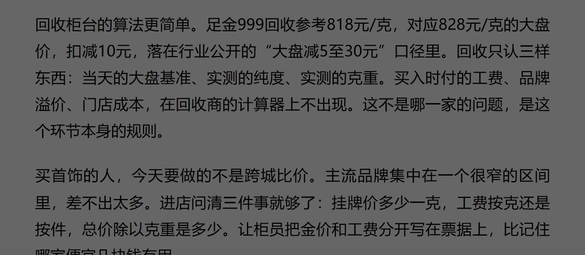
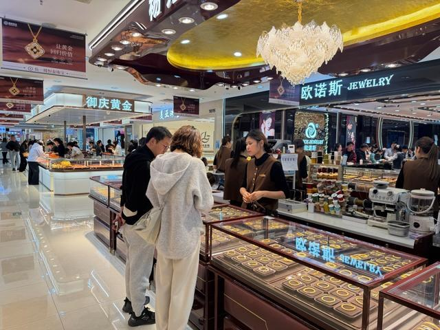
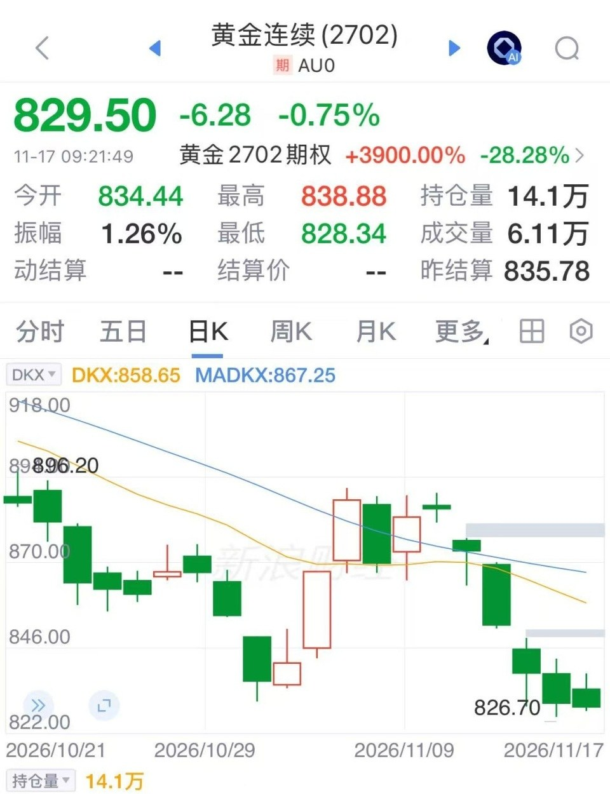
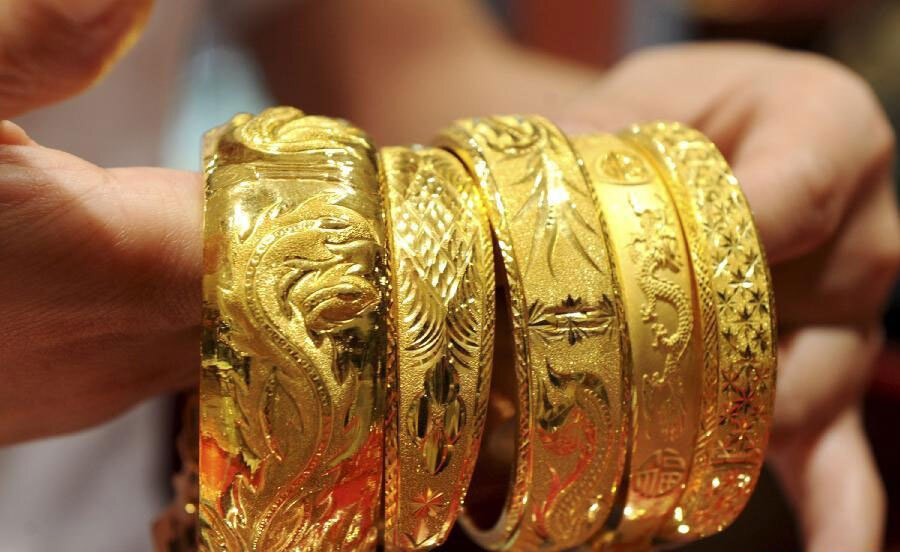

# 828元的金价，1169元买进凭什么只按818元回收？

11 月 17 日，微博热搜第 10 位挂着「金价创今年以来新低」。同一天上海黄金交易所 Au99.99 报 828.3 元/克，跌回 830 元下方。

前两天金店已经挤过一轮。21 世纪经济报道 11 月 16 日写上海紫锦城，六楼一家店二十分钟响了五次收款提示，其中一笔 6 万元。店员喊的是「现在买到就是赚到」。

跌得确实猛。财联社 11 月 16 日给的数，周生生足金从 1 月 29 日的 1708 元/克回到 1165 元/克，回撤超过 540 元。50 克的金镯，比年初峰值便宜约 2.7 万元。

## 一、三个价同一天

11 月 17 日，同一克黄金，至少有三个公开可查的数。

上海金交所 Au99.99 收在 828.00 元/克，原料基准价。大象新闻当天 9 点 28 分的实时报价 828.3 元/克。上金所官网当天的上海金早盘价 830.96 元/克。

周大福、周大生、潮宏基、谢瑞麟的足金饰品挂牌 1169 元/克，菜百 1178 元/克，老凤祥 1163 元/克。多家报价页都注明「不含工费」。

足金 999 回收参考 818 元/克。

三个数都真。差别在你站在哪一个柜台前。

我一开始把 828 当成去金店能买到的价。查完发现对不上。828 是交易所里原料金的报价，金店柜台上没有这个价签。

## 二、351元的三笔钱

1169 减 818，351 元/克。

30 克手镯，买入 35070 元，当天按回收参考价卖回 24540 元，中间 10530 元。351 除以 1169 是 30.0%，接近三成。

这 351 元不能全算成商家多赚的钱，我得先把这句写清楚。品牌挂牌价里叠着三笔，原料金、工费、品牌与门店成本。

新浪财经 10 月 29 日那篇拆过一次。当时上金所 Au99.99 约 869 元/克，品牌足金挂牌 1216 到 1218 元/克，工费品牌店 50 到 100 元起一克，差约 350 元/克，约等于柜台价的 29%。

那天和 11 月 17 日的两个数不能相加，日期差了十九天，口径也不同。我引它只为说明结构。柜台价比原料价高出的那一截，主要不由金价决定。

工费不会因为金价跌了就跟着跌。北京日报 11 月 13 日走访首开福茂，中国黄金柜台摆着「克减 160 元」的海报，优惠后折算 998 元/克。

周大生「克减 188 元」，店员说叠加双十一和会员权益成交价低至 933 元/克。

天雅珠宝城的店员给记者算，一只 30 克普通素圈手镯总价约 3.05 万元。

998 元、933 元、3.05 万元，都是店里的成交口径，和 828 元那个口径对不上。这个区别要记牢。

## 三、回收只认三样

新浪 11 月 17 日那篇把回收规则写得很直白。足金 999 回收参考 818 元/克，对应 828 元/克的大盘价扣减 10 元，落在行业公开的「大盘减 5 至 30 元」口径里。

回收只认三样东西，当天的大盘基准、实测的纯度、实测的克重。买入时付的工费、品牌溢价、门店成本，在回收商的计算器上不出现。

这句我读了三遍。哪家店都一样，规则在回收这个环节本身。回收按纯度称重，牌子与款式都不进公式。

同一家店里还有第二组对照。中国黄金的 999 黄金挂牌 1143 元/克，同品牌投资金条 838.90 元/克，金条回收参考 819.90 元/克。

1143 减 838.90 是 304.10 元/克。838.90 减 819.90 是 19 元/克。

首饰柜台与投资金条柜台隔着 304.10 元，投资金条买卖两头只隔 19 元。想存金子的人，看的应该是后一个数。

## 四、跌的是哪个价

新浪财经 10 月 29 日写「原料金已经跌到 8 字头」，跌的是原料基准价。柜台挂牌价从 1708 元回落到 1165 元，跌的也是挂牌价。这两个价都不改变 351 元/克的结构。

财联社 11 月 16 日按挂牌价差测算，周生生 11 月 10 日 1243 元/克，11 月 16 日 1165 元/克，一周每克少 78 元。买 50 克金镯一周内少花 3900 元。

这个 3900 元是真的。前提是同一时点、同一计价规则、同一件货。

另一层落差在水贝。21 世纪经济报道 11 月 16 日记上海紫锦城二楼，14 日普通足金报价 900 元/克，古法金和硬金 920 元/克，较月初下降 68 元/克。品牌挂牌接近 1170 元/克。

900 与 1169 差 269 元/克，实际成交还要算工费。

渣打中国财富方案部首席投资策略师王昕杰的原话，我照抄一遍。

「金饰属于消费品，价格里含加工费和品牌溢价，回收时通常按原料金价折价，不适合当投资品。」

他后一句更短，「喜欢、要用就买，别指望靠它赚价差。」

2013 年那轮抢金，媒体复盘给出的建仓成本在 1350 到 1400 美元/盎司。算上加工费，解套线在 1450 美元以上。直到 2019 年 6 月，COMEX 才重新站上 1400 美元。这组数我没查到交易所原始记录，只作参照。

还有一组数值得看。21 世纪经济报道与财联社 11 月 16 日都引世界黄金协会，2026 上半年国内金饰消费量同比下降 30% 至 136 吨，消费金额反倒增长 5% 达 1440 亿元。

三季度金饰消费量环比回升 30% 至 66 吨，金额 608 亿元。

金饰买得少了三成，花出去的钱反倒多了 5%。跌的是克价，柜台价里那 351 元的结构没跟着跌。

## 五、进店问三句话

新浪 11 月 17 日那篇给的三句，我原样搬过来。

挂牌价多少一克。工费按克还是按件。总价除以克重是多少。

让柜员把金价和工费分开写在票据上，比记住哪家便宜几块钱有用。想攒金子的人先问回购规则、手续费、实际到手成本，再决定走向哪一条柜台。

我按上金所 828 元/克、品牌 1169 元/克、回收 818 元/克这三个当天公开数算了一遍。351 元/克是账面上的一买一卖差，只在当天卖回时成立。长期拿着，金价涨上去能盖住这一截。

判断标准就三条。这个价是原料价、挂牌价，还是回收参考价。工费怎么收，回收算不算。自己买的是戴在手上的，还是放进抽屉的。

---

参数是我按公开资料算的，欢迎在评论区指正。
