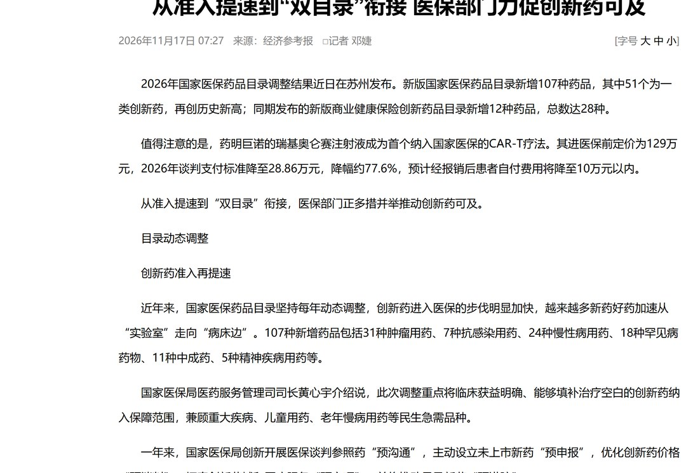
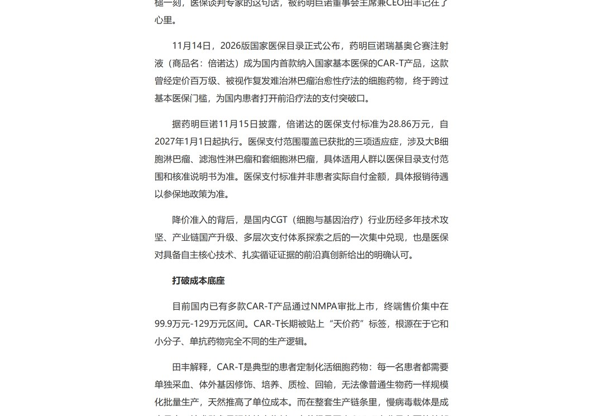
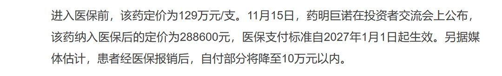
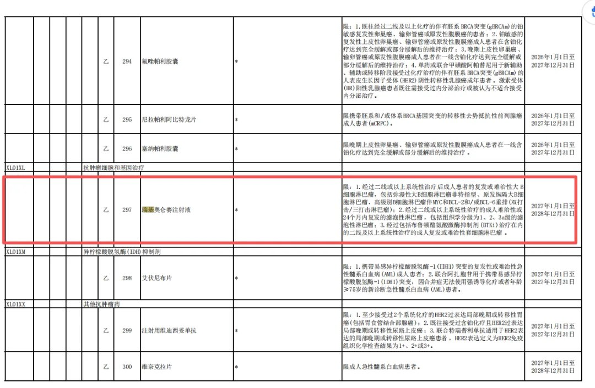
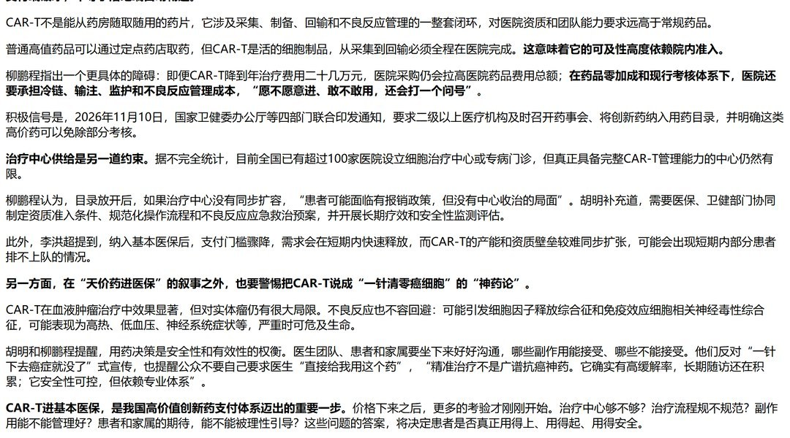
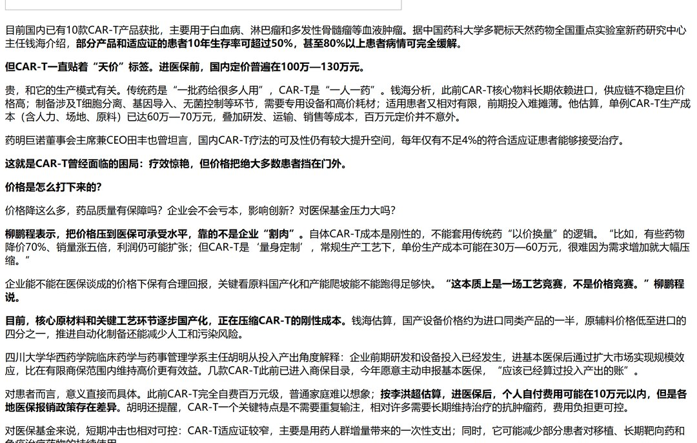
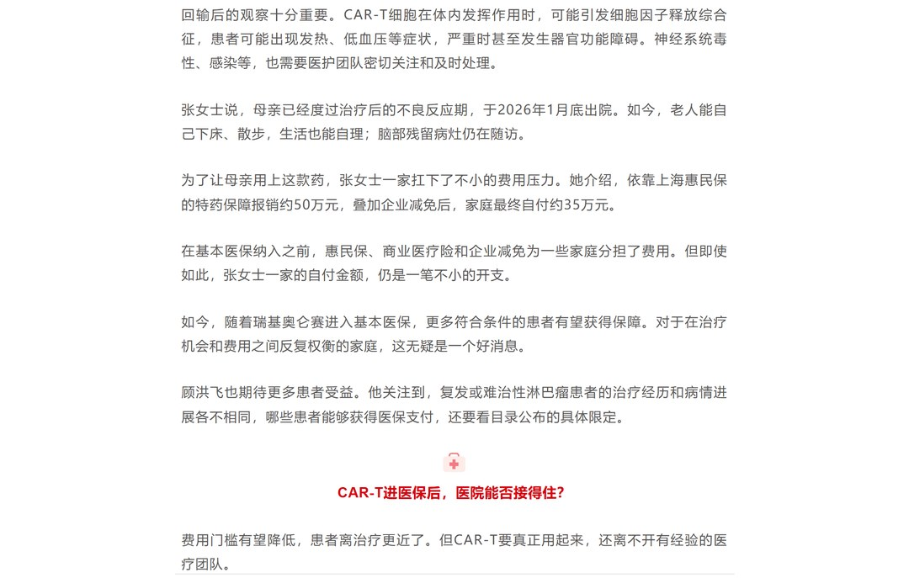

# 129万降到28.86万，能报的只有三种淋巴瘤

11 月 14 日，苏州，2026 创新药高质量发展大会。国家医保局医药服务管理司司长黄心宇在会上宣布，药明巨诺的瑞基奥仑赛注射液进了 2026 年版国家基本医保药品目录。

这是国内首款进基本医保的 CAR-T。热搜词条写「129 万一针抗癌药进医保」，下面跟着「降了 100 万」「自付 10 万以内」。

降价是真的。这一针进医保前定价 129 万元/支，经济参考报 11 月 17 日写的谈判支付标准是 28.86 万元，降幅约 77.6%。

我自己除了一遍。129 减 28.86 是 100.14 万，100.14 除以 129 等于 77.63%。这个数对得上。

事情到这里都挺好。往下读，三个数开始打架。

## 一、三个数，三套口径

129 万是进医保前的定价，不是这次要付的钱。

28.86 万是医保支付标准。11 月 15 日药明巨诺投资者交流会公布的是 288600 元，同一个数，自 2027 年 1 月 1 日起生效。

中国金融信息网 11 月 18 日写得很直白，「医保支付标准并非患者实际自付金额，具体报销待遇以参保地政策为准。」

10 万又是另一回事。它出自中国药科大学李洪超的估算，原话带着「可能」和「各地医保报销政策存在差异」。

北青报 11 月 16 日写的是「据专家估算」「具体因各地医保政策和个人情况有所差异」。中国经济网用的是「预计」。

把这三个数连成「129 万降到 10 万」，中间跳过了两道口径。医保付多少，和个人掏多少，目录里没有写成同一个数。

10 万当承诺去查，我没查到官方给过这个数。药费之外的住院、回输前处理、监护、毒性处理，一级源里也没给金额，我不替它算。

## 二、目录 297 号写了什么

热搜里的「抗癌药」三个字，容易读成广谱。我翻了目录条目的截图。

编号 297，乙类，瑞基奥仑赛注射液，有效期 2027 年 1 月 1 日至 2028 年 12 月 31 日。限定支付范围列了三项。

其一，经过二线或以上系统性治疗后成人患者的复发或难治性大 B 细胞淋巴瘤。

其二，经过二线或以上系统性治疗的成人难治性或 24 个月内复发的滤泡性淋巴瘤，含组织学分级 1、2、3a 级。

其三，经过包括 BTKi 治疗在内的二线及以上系统性治疗的成人复发或难治性套细胞淋巴瘤。

三项都是淋巴瘤，三项都卡在二线及以上。肺癌、胃癌、肝癌这些实体瘤不在这张纸上。

北青报的措辞是「该药只对特定血液肿瘤有效，对实体瘤仍有局限」。21 财经列的支付范围也是大 B 细胞淋巴瘤、滤泡性淋巴瘤、套细胞淋巴瘤这三种。

我数了一下，国内已上市的 CAR-T 约 10 款，进基本医保的只有这 1 款。标题说「能报的只有三种淋巴瘤」，指的就是这张目录。

## 三、谁在泼冷水

「一针清零癌细胞」这个说法，媒体自己也在打。

新京报 11 月 15 日写过，「也要警惕把 CAR-T 说成『一针清零癌细胞』的『神药论』」。胡明和柳鹏程反对「一针下去癌症就没了」式宣传。

北青报写得更具体，患者和家属容易把它当成「抗癌神药」，甚至要求超适应证使用，用药前要经过多个科室医生共同评估。

不良反应那边有一串名字。细胞因子释放综合征，免疫效应细胞相关神经毒性综合征，表现可能是高热、低血压、神经系统症状，严重时危及生命。

北青报另给了一组数，复发、难治性淋巴瘤多轮治疗后 5 年无病生存率约 40%，较早使用可达 60% 以上。

这些是血液肿瘤里的数据，不是所有癌症的。经济参考报那个 77.6% 是降幅，RELIANCE 研究里还有一个 77.6%，两者碰巧同数。

## 四、降一百万靠的是什么

我原以为企业把成本砍下来了，查完发现没那么简单。

西南证券 2023 年 6 月的研报估算，单份 CAR-T 总成本约 78489 美元，约合人民币 52 万元；制造周期一般 2 至 4 周，制备失败率 2% 至 14%。

钱海估单例生产成本 60 万至 70 万元。柳鹏程给的常规工艺区间是 30 万至 60 万元，他的判断是「自体 CAR-T 成本是刚性的，不能套用传统药『以价换量』的逻辑」。

52 万这个 2023 年的估算，比 28.86 万的支付标准还高。两套数不是同一套成本口径，一个按当年的产线算，一个是 2026 年的支付价，我没有把它们相减。

中国新闻周刊翻了药明巨诺 2026 年中期报告，收入约 1.114 亿元，倍诺达产品收入 1.112 亿元，毛利率从 51.1% 到 51.8%，研发开支从 9200 万元减 45.9% 至 4980 万元，归母净利润 -5042.6 万元。

11 月 15 日的投资者交流会上，管理层预计国产替代与规模效应推动单位生产成本持续下降超 65%。慢病毒载体自研是田丰反复提到的那条。

我的理解是，这一百万里，有工艺、有规模预期，也有进医保之后放量摊薄销售开支的账。财报没写因果，我不替它补。

## 五、几道关，三句话

田丰给过一个数。每年仅有不足 4% 的符合适应症患者能够接受治疗。反过来算，符合适应症的人里，一年超过 96% 没能用上。

新京报写全国已有超过 100 家医院设立细胞治疗中心或专病门诊，但真正具备完整 CAR-T 管理能力的中心仍然有限。

柳鹏程的说法是「患者可能面临有报销政策，但没有中心收治的局面」。

医院那头还有账。药品零加成、药占比、DRG/DIP 考核之下，采购会拉高药品费用总额，冷链、输注、监护、不良反应管理都要成本。柳鹏程的原话是「愿不愿意进、敢不敢用，还会打一个问号」。

11 月 10 日，国家卫健委办公厅等四部门印发通知，要求二级以上医疗机构及时召开药事会。1 类新药不计入「一品两规」，不纳入部分绩效监测指标，还支持「特例单议」。

CAR-T 是活细胞制品，从采集到回输必须全程在医院完成。王三斌判断「不会是所有三级医院都能做」。

进医保之前的一个真实账单，医学界记下来了。患者家属张女士的母亲 78 岁，2022 年确诊淋巴瘤，6 次化疗，2025 年 5 月复发并累及脑部。

2025 年末老人在上海市同济医院血液科接受瑞基奥仑赛治疗。上海惠民保特药保障报销约 50 万元，叠加企业减免后，家里实付约 35 万元，2026 年 1 月底出院。

50 万除以 129 万是 38.8%，35 万除以 129 万是 27.1%。这是 2025 年、经惠民保和企业减免之后的一家人的账，不是 2027 年的报销比例，两个数别串着用。

先问病种和线数。是不是目录 297 号里那三种淋巴瘤，是不是二线及以上治疗后复发或难治。

再问时间和参保地。2027 年 1 月 1 日才生效，本地报销比例多少，28.86 万是支付标准，不等于自己要掏的数。

末了问医院。有没有 CAR-T 资质和处理 CRS、神经毒性的救治能力，药费之外的住院与监护怎么结。

田丰那句「进医保是 CAR-T 走向普惠化的关键节点，但普惠化是一个循序渐进的长期过程」，我抄在这里，比「降了 100 万」更接近能打到什么。

---

参数是我按公开资料算的，欢迎在评论区指正。
