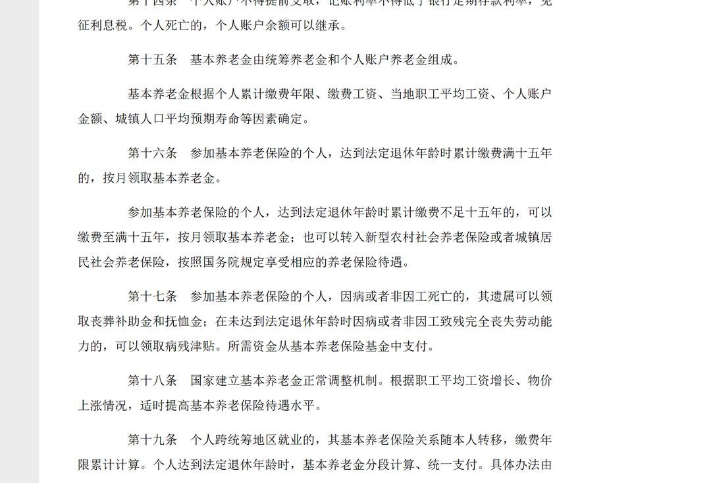
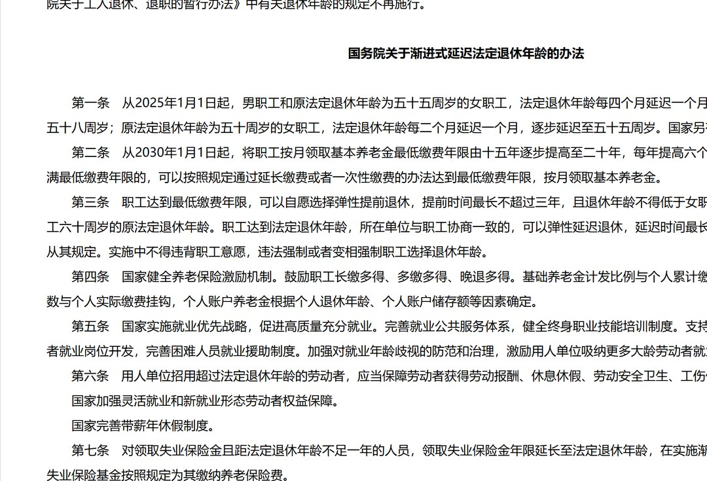
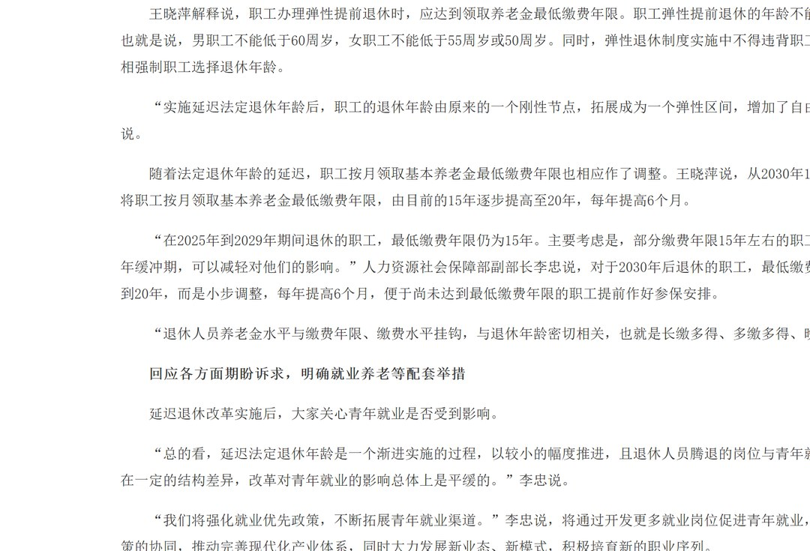
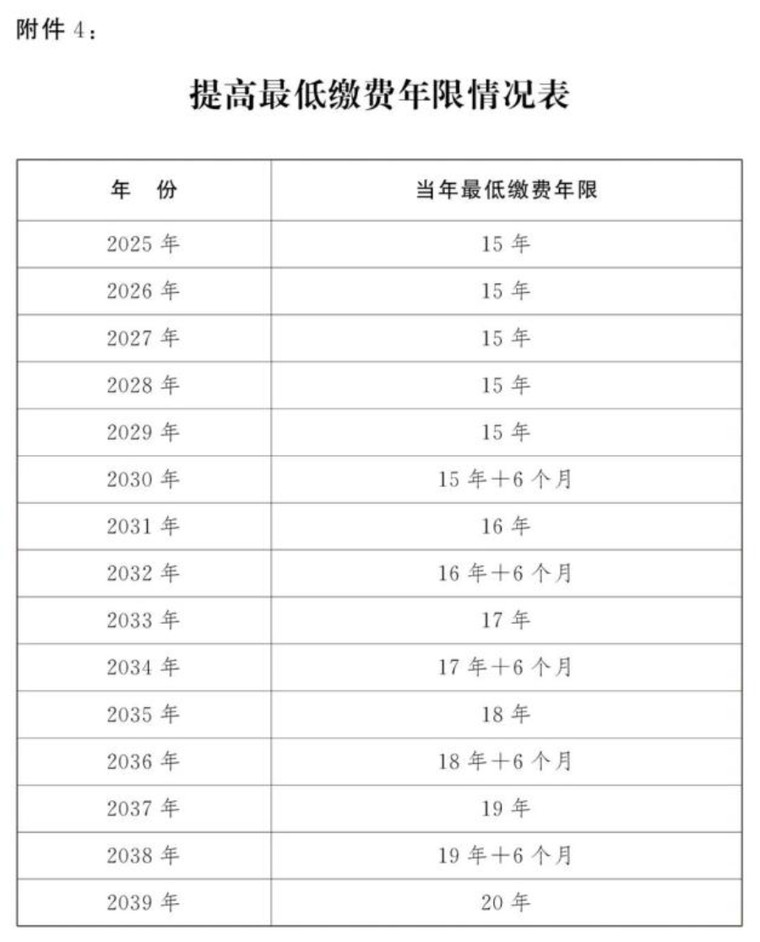
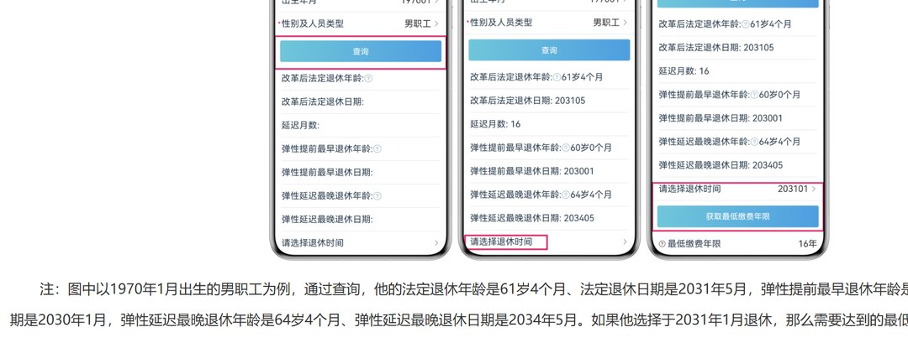
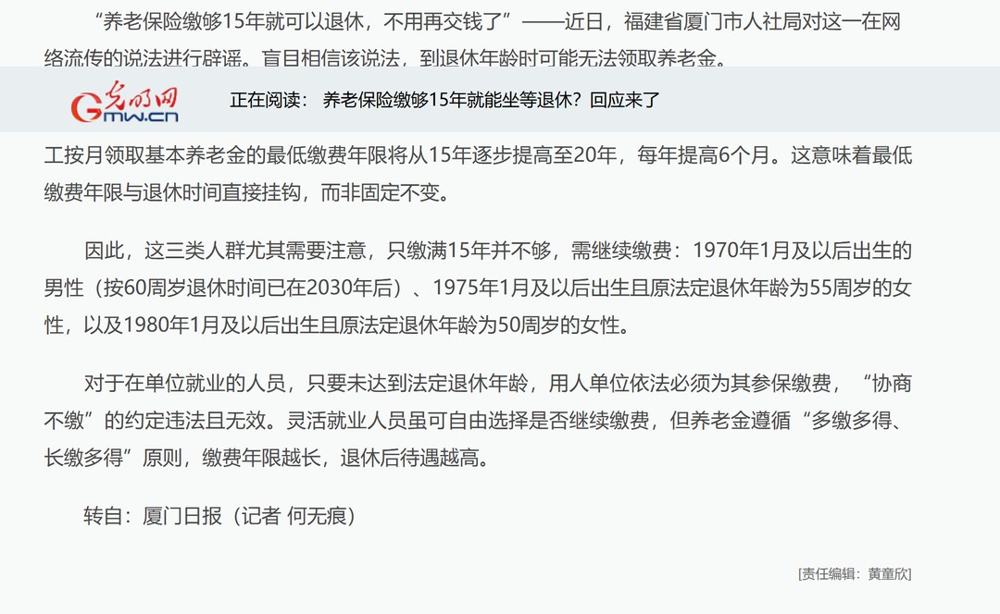
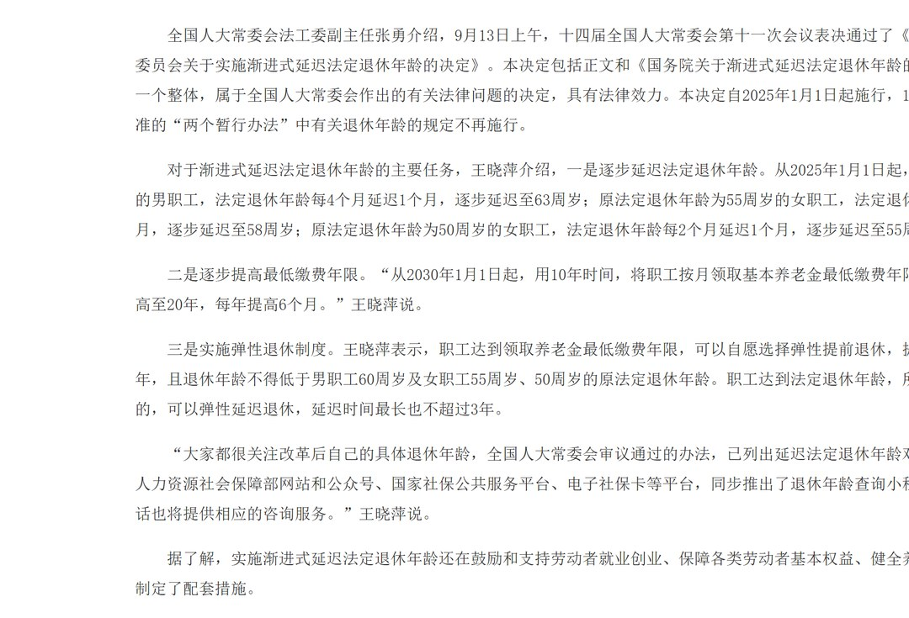

# 缴满15年先别停缴：2039年退休要满20年

11 月 19 日，三个平台都挂了这条辟谣。腾讯新闻当天的标题直接用了「上热搜」三个字。

被辟的是这句话，说养老保险缴够 15 年就可以退休，不用再交钱了。

福建省厦门市人社局 11 月 18 日回应，厦门日报记者何无痕写的稿，光明网、金羊网、腾讯新闻都转了。

我先把法条翻出来看。《社会保险法》第十六条，中国人大网上的原文一个字没改。

## 一、这话有出处

第十六条第一款写的是，参加基本养老保险的个人，达到法定退休年龄时累计缴费满十五年的，按月领取基本养老金。

2011 年 7 月 1 日施行，第十六条没改。

网传那句不算凭空编。出处是一条现行法律，只是少了前半句。

少了的部分要紧。「达到法定退休年龄时」是头一个条件，「累计缴费满十五年」是另一个。

两个都满足，才谈得上按月领养老金。传言只留了后面那个。

第十六条还有第二款，说的是缴费不足十五年可以接着缴到满十五年。

「缴费至满」四个字，说的也是接着缴。

## 二、法条没改，年份改了

2024 年 9 月 13 日，十四届全国人大常委会第十一次会议通过《关于实施渐进式延迟法定退休年龄的决定》。

同一次会议批准了《国务院关于渐进式延迟法定退休年龄的办法》，2025 年 1 月 1 日起施行。

全国人大常委会法工委副主任张勇在当天发布会上讲，决定包括正文、办法和 4 个附件，是一个整体。

这个决定属于常委会作出的有关法律问题的决定，具有法律效力。

办法第二条把起点定在 2030 年 1 月 1 日，最低缴费年限由十五年逐步提高至二十年，每年提高六个月。

人社部部长王晓萍在同一场发布会上给了时间表，从 2030 年 1 月 1 日起，用 10 年时间，由 15 年逐步提高至 20 年，每年提高 6 个月。

人社部副部长李忠补了一句更要紧的。在 2025 年到 2029 年期间退休的职工，最低缴费年限仍为 15 年。

理由是部分缴费年限 15 年左右的职工已经临近退休，设 5 年缓冲期，减轻影响。

我把这两句并起来读。「缴满 15 年就够」在 2025 到 2029 年退休的人身上成立。

2030 年起退休的人，门槛一年比一年高。一句话过没过期，只看你哪一年退。

## 三、把年限表自己算一遍

办法的附件 4 叫「提高最低缴费年限情况表」，逐年列了 15 个数。

2025 到 2029 年，每年都是 15 年。2030 年是 15 年＋6 个月，2031 年是 16 年，2032 年是 16 年＋6 个月。

往后每年加半年，2033 年 17 年，2035 年 18 年，2037 年 19 年，2039 年 20 年。

自己验一遍。15 到 20 差 5 年，也就是 60 个月；每年提高 6 个月，需要 10 年。

2030 到 2039 正好 10 个年份，跟王晓萍说的「用 10 年时间」对得上。

标题里那句「2039 年退休要满 20 年」，就是这张表末行。

诸暨市人社局 2025 年 7 月挂过一个查询教程，用的是浙里办里的「退休小管家·弹性退休测算」。

教程举的例子是 1970 年 1 月出生的男职工，法定退休年龄 61 岁 4 个月，法定退休日期 2031 年 5 月。

如果他选 2031 年 1 月退休，需要达到的最低缴费年限是 16 年。

2031 年对应附件 4 的 16 年。附件和这份教程是两份各自发布的官方材料，数对上了。

厦门人社局点出的三类人，也能自己算。1970 年 1 月及以后出生的男性，按原 60 周岁退休，退休年份落在 2030 年及以后。

1975 年 1 月及以后出生、原法定退休年龄 55 周岁的女性，1975 加 55 是 2030。

1980 年 1 月及以后出生、原 50 周岁退休的女性，1980 加 50 还是 2030。

三个算式都指向 2030，正是门槛开始抬高的那一年。

## 四、在职的人停不下来

厦门人社局的回应里还有一句，转发时常被漏掉。

在单位就业的人员，只要未达到法定退休年龄，用人单位依法必须为其参保缴费。

回应里写得很直白，「协商不缴」的约定违法且无效。

《社会保险法》第十条也写着，职工应当参加基本养老保险，由用人单位和职工共同缴纳基本养老保险费。

在职职工手里没有「停缴」这个选项。跟单位商量不缴，约定本身无效。

灵活就业人员可以自己选。选了停，后面按「多缴多得、长缴多得」计发。

办法第四条写的是，基础养老金计发比例与个人累计缴费年限挂钩。年限短一截，这一项就少一截。

还有一处容易漏，弹性提前退休同样要求达到领取养老金最低缴费年限。

王晓萍在发布会上讲，职工办理弹性提前退休时，应达到领取养老金最低缴费年限。

提前时间最长不超过 3 年，且不低于原法定退休年龄。提前退，也得先把年限缴够。

真到了退休年龄年限还不够，办法第二条给的出口是延长缴费或者一次性缴费。

第十六条第二款也写着可以缴费至满十五年。

## 五、这类说法，问三句

第一句，我哪一年哪一月退休。这一句定的是查哪一行表，跟我已经缴了几年无关。

第二句，那一年对应的年限是多少。附件 4 逐年列着，电子社保卡、掌上 12333 里的法定退休年龄计算器也能查。

第三句，我是在职还是灵活就业。在职的不用考虑停缴，灵活就业的停了要自己算后面的账。

我判断这类传言好拆的地方，不在有没有这条法条。法条在，第十六条的十五年在，写得清清楚楚。

要拆的是这句话到哪一天还成立。十五年只管领取门槛，管不了停缴。2030 年起门槛还要往上走。

---

参数是我按公开资料算的，欢迎在评论区指正。
