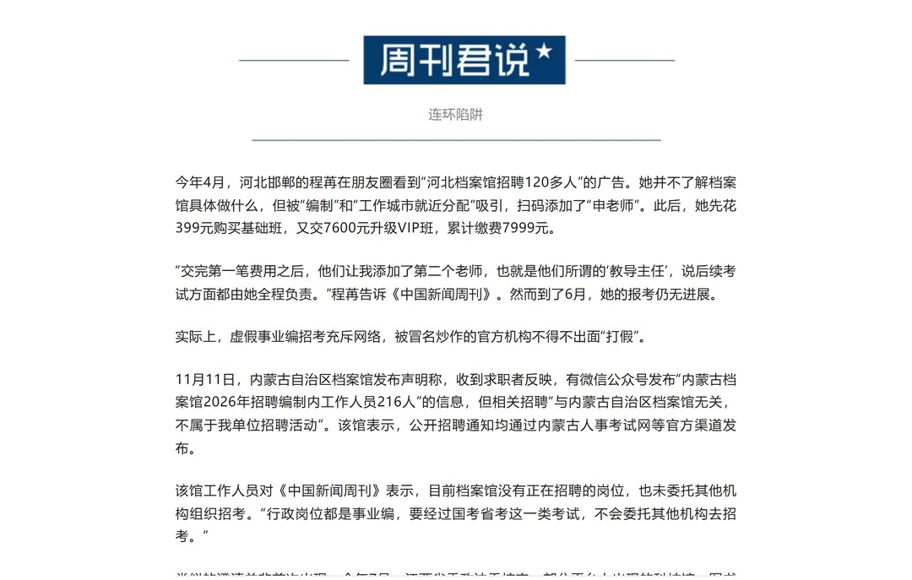
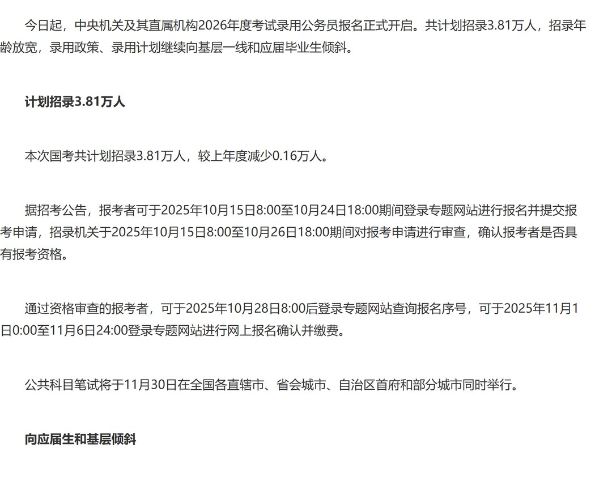
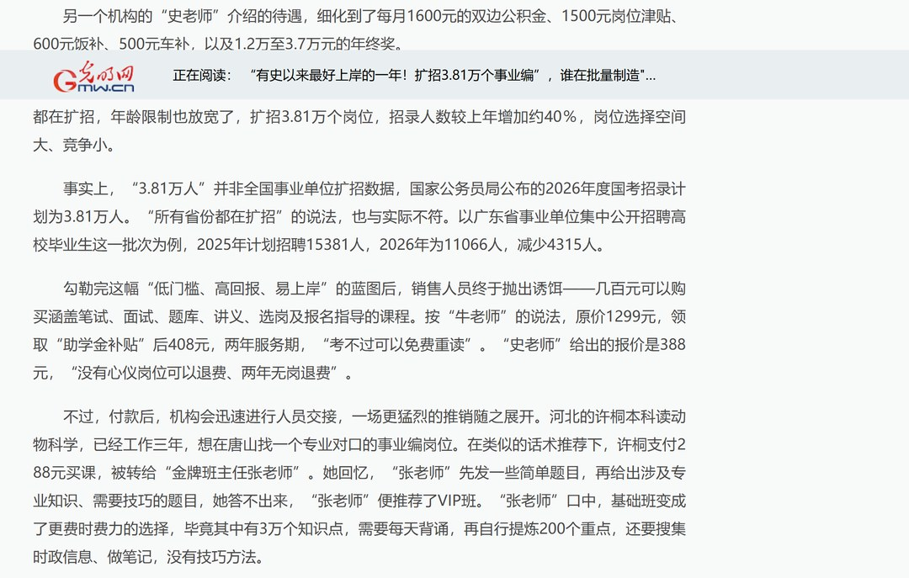
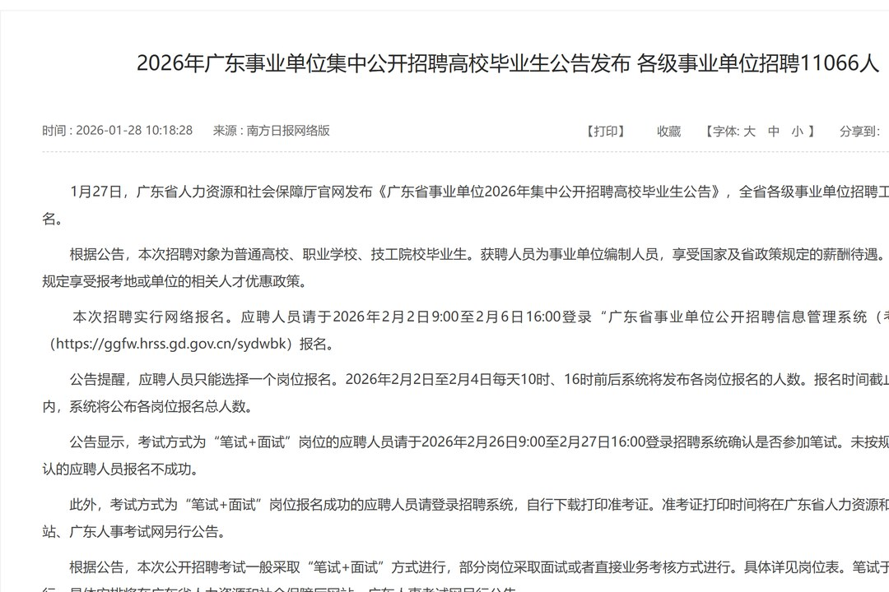
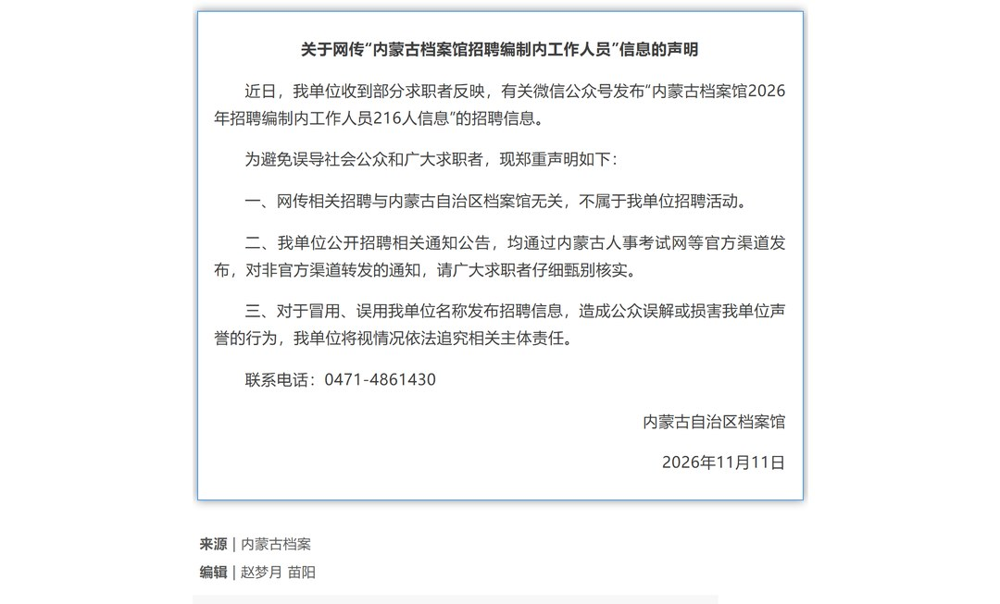
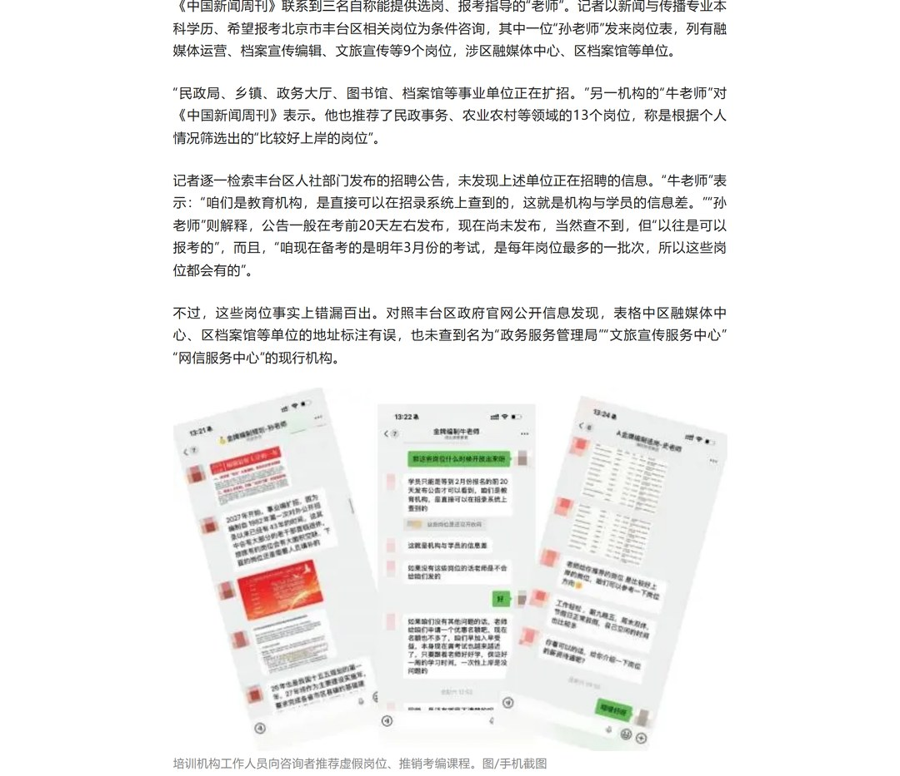
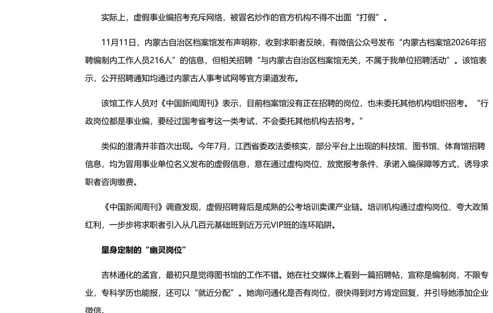
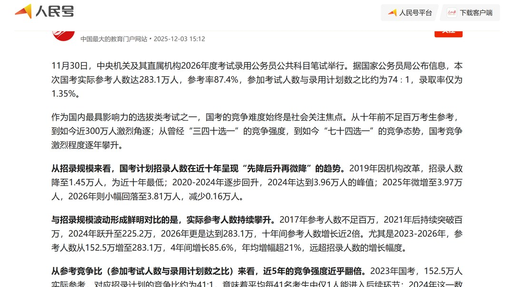

# 交7999元买编制课，3.81万是国考招录人数

11 月 20 日，光明网、中国经济网同日刊出《中国新闻周刊》的调查。销售人员说，2026 年上岸比往年都容易，全国事业编扩招 3.81 万个岗位，招录人数比上一年多约四成。

河北邯郸的程苒信了。今年 4 月她看到「河北档案馆招聘 120 多人」的广告，扫码加了「申老师」，先付 399 元买基础班，又付 7600 元升级 VIP，一共 7999 元。到 6 月，报考没有进展。

3.81 万这个数我查了。数真的存在，只是说的不是这件事。

## 一、3.81万是哪来的

国家公务员局 2025 年 10 月 15 日发布 2026 年度国考公告，计划招录 3.81 万人，较上年度减少 0.16 万人。中新网当天转述了这句话。

3.97 万减 3.81 万，差 1600 人。1600 除以 39700，约 4.03%。方向朝下，与「增加约四成」相反。

培训机构把几件真事拼到了一起。国考招 3.81 万人，报考年龄从 35 岁放宽到 38 岁，应届硕博放宽到 43 岁，计划继续向基层和应届生倾斜。

这几件都属于中央机关及其直属机构的公务员招录。

事业编是另一套。公告由各地用人单位、主管部门和人事考试网分别发，没有全国一个总数，也没有谁统一宣布扩招。

还有一层更简单的账。「扩招 3.81 万个岗位」和「增加约 40%」，两句话放一起就对不上。

若 3.81 万是今年的招录总量，按增加四成倒推，上一年约 27214 人，增量约 10886 人。

若 3.81 万本身就是扩招出来的增量，今年总量得比它更大。两种读法里，同一个数都不能既当总量又当增量。

我倾向于不带恶意的解释。这个数没被编出来，只是从「国考计划招多少人」搬到了「事业编扩招多少岗位」。口径一换，数还是那个数，意思全变了。

## 二、查省份，数字朝下

「所有省份都在扩招」这句，光明网给了一个能自己查的名字，广东省事业单位集中公开招聘高校毕业生这一批次。

2025 年 1 月 24 日的公告写 15381 名。2026 年 1 月 27 日的公告写 11066 名。15381 减 11066 等于 4315，4315 除以 15381 约 28.05%。

这一批次不等于广东全年事业单位招聘总盘。我拿它只回一句，至少有一个省份的这一批次在往下走。

2025 年那份公告第十条还写着，本次招聘不指定考试教材，不举办、也不委托任何机构举办考试辅导培训。

社会上任何以命题组、专门培训机构名义办的辅导班、保过班、协议班，均与招聘组织方无关。

销售人员说能在招录系统上查到，还把这称作机构与学员的信息差。公告里没有对应项。

## 三、档案馆否认216人招聘

11 月 11 日，内蒙古自治区档案馆发声明。

网传「2026 年招聘编制内工作人员 216 人」与本单位无关，不属于本单位招聘活动。

公开招聘通知均通过内蒙古人事考试网等官方渠道发布。

该馆工作人员对《中国新闻周刊》说，目前没有正在招聘的岗位，也未委托其他机构组织招考。

行政岗位都是事业编，要经过国考省考这一类考试，不会委托其他机构去招考。

记者以新闻与传播专业本科学历、希望报考北京市丰台区相关岗位去咨询。「孙老师」发来 9 个岗位，「牛老师」推荐 13 个，都说是筛选过的好上岸岗位。

记者逐一检索丰台区人社部门发布的招聘公告，一条都没找到。

对照丰台区政府官网，表格里区融媒体中心、区档案馆的地址标错了。

也查不到「政务服务管理局」「文旅宣传服务中心」「网信服务中心」这几家现行机构。

216 与 0，9 与 0，13 与 0。这几组数不用换算，摆在一起就够了。

## 四、钱怎么收，退费怎么算

课程报价分几档。「牛老师」说原价 1299 元，领助学金补贴后 408 元；「史老师」报 388 元。许桐先付 288 元买课，再付 6880 元升级 VIP，合计 7168 元。

1299 减 408 等于 891，降了约 68.6%。门槛压到几百元，付款之后立刻换人接手。

「张老师」说基础班有 3 万个知识点，得自己提炼 200 个重点。200 除以 30000 约 0.67%。VIP 班通过率被说到 98%，这个数我没查到一手出处，先标一下口径。

程苒要退费，机构说扣 80% 成本；孟宜要退，对方说扣 70%。按这两个比例反推，7999 元退两成是 1599.8 元，7168 元退三成是 2150.4 元。

这是按机构口径算的，不是两人实际拿回的钱。

孟宜查缴费记录才发现，对接人的企业微信主体是山西一家教育科技有限公司，收款商户是河南另一家。

记者接触的三名「老师」分别对应三家公司，经营范围都注明不含涉许可审批的教育培训活动。

新京报 11 月 20 日的快评把这类交易定性为涉嫌诈骗，这是媒体判断。我在公开材料里没查到司法机关对这几家机构的定性，也不替它下结论。

北京市国达律师事务所胡文友的说法更贴这件事。普通培训纠纷围绕课程质量和效果，而这里作为缔约基础的岗位从不存在。

## 五、这类说法，问三句

这个数是总量，还是比上一年多出来的增量。

它说的是国考、省考还是事业单位，发布单位是谁。

去人事考试网搜岗位名称，搜不到就先别付钱。

2026 年度国考 2025 年 11 月 30 日笔试，实际参考 283.1 万人，参考率 87.4%，参考人数与录用计划数之比约 74 比 1，录取率 1.35%。

这些数出自国家公务员局，写在 2025 年 12 月 3 日的报道里。

开头那句上岸比往年都容易，和 74 比 1 放一起，对不上。

新京报快评还有一句可以记下来。

公职类、事业单位所有招考信息，统一在人事考试官方平台公开发布、统一报名招录，不存在私下招录、三方代理、内部捷径上岸。

---

参数是我按公开资料算的，欢迎在评论区指正。
