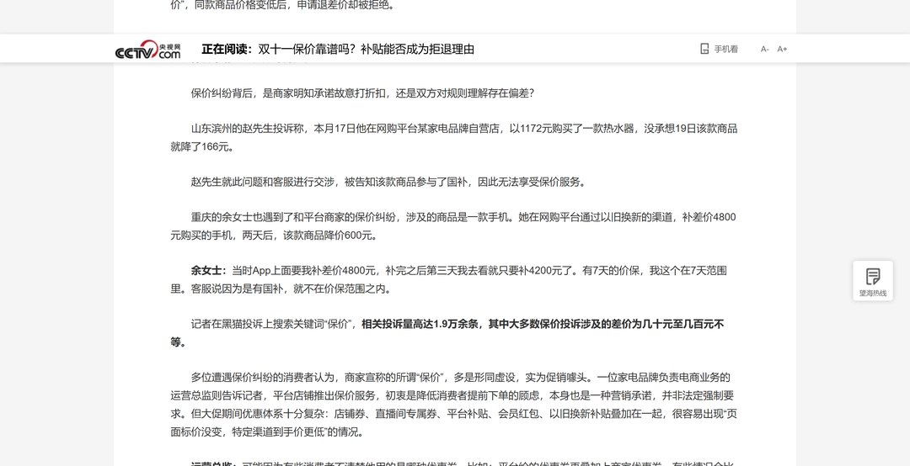
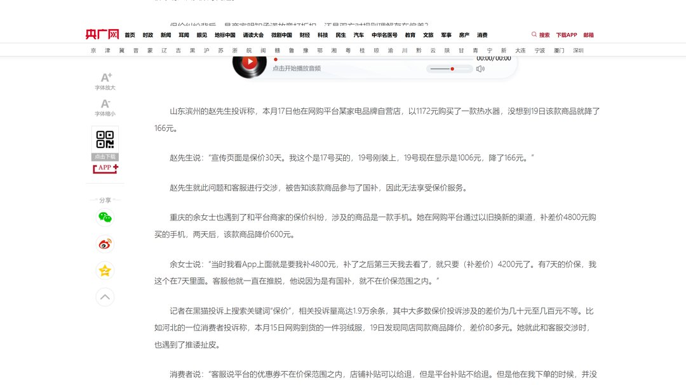
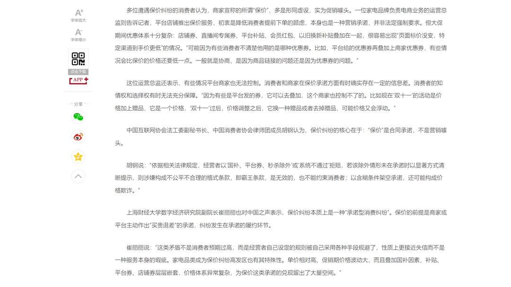
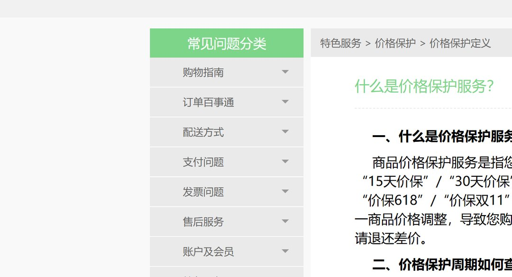
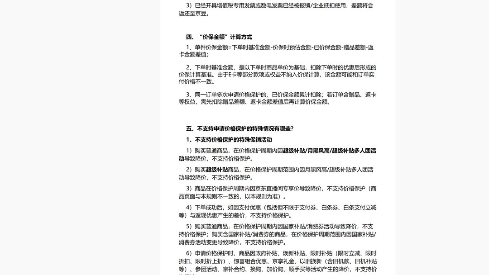
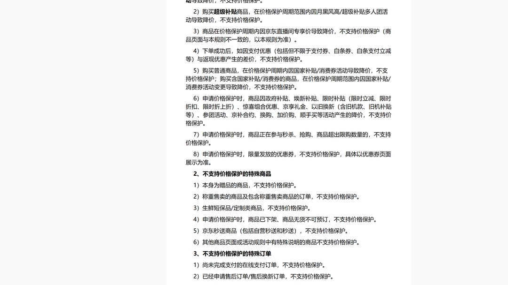
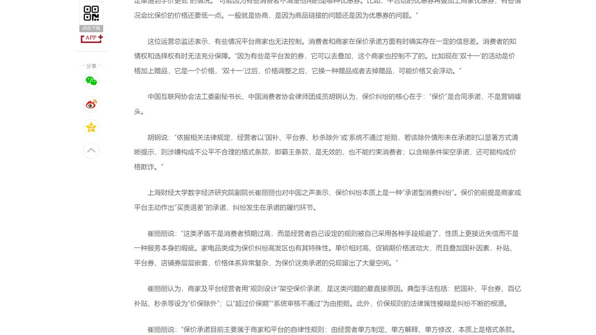
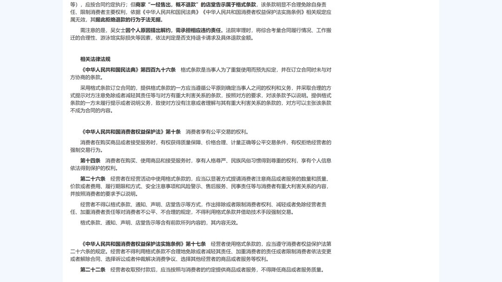

# 买贵166元不给退，页面保价30天到底保什么价？

双 11 下单页上那行「保价 30 天」，很多人当真。

写在商品标题下面，看着像一条规矩。

11 月 17 日，山东滨州的赵先生在某家电品牌自营店花 1172 元买了台热水器。19 日刚装上，同款页面显示 1006 元。

两天，166 元。他去申请退差价，客服说这款参与了国补，不能保价。

## 一、两天降166元，7天价保也没用

重庆的余女士差得更多。她走以旧换新，补差价 4800 元买的手机，第三天再看只要补 4200 元。

600 元，落在她那单 7 天价保期内。客服还是那句，有国补，不在价保范围。

河北一位消费者 15 日到货的羽绒服，19 日同店同款降价 80 多元。她得到的解释是店铺补贴能退、平台补贴不退，可下单时没人告诉她。

记者在黑猫投诉搜「保价」，相关投诉 1.9 万余条，多数差价几十元到几百元。

我盯着的不是 166 元和 600 元谁更大。两单都在承诺的保价期内，页面都写着保价，拒退理由都是同一句「有国补」。

## 二、保价不是法定权利

一位家电品牌电商运营总监对央广网说了句实话。平台推保价，初衷是降低消费者提前下单的顾虑，本身是营销承诺，并非法定强制要求。

这句得划出来。多数人把保价当成买东西自带的一项权利，翻遍法律也找不到对应的强制条款。它由商家自愿给，规则也由商家自己定。

他说大促期间优惠叠得复杂。店铺券、直播间专属券、平台补贴、会员红包、以旧换新补贴堆在一起，「页面标价没变，特定渠道到手价更低」很容易出现。

同一篇报道里，他还承认消费者和商家之间「确实存在一定的信息差」，知情权和选择权有时无法充分保障。

拒退差价的客服未必在耍赖。他手里那张规则表，可能真写着国补订单不保。

## 三、我翻了平台的价保规则

我去查了京东帮助中心的《什么是价格保护服务？》，把相关条款逐条读完。

定义写得很清楚。带「7 天价保」「30 天价保」等标识的商品，因同一商品价格调整、导致「京东价」发生降价，才能在价保周期内申请退还差价。

关键词是「京东价」三个字。保的是商品页面标价，不是你实付的到手价。

价保金额的算法也单列了一节。单件价保金额＝下单时基准金额－价保时预估金额－已价保金额－赠品差额－返卡金额差值。

基准金额「以下单时商品单价为基础，扣除下单时的优惠后形成」，规则自己补了一句，「该金额可能和订单实付价格不一致」。

我把这句读了两遍。平台在规则页里写明，算差价用的基准，跟你付的钱可以不是一回事。

再往下是「不支持申请价格保护的特殊情况」，分特殊促销活动、特殊商品、特殊订单三类。

第 5 条写着，购买普通商品在价格保护周期内因国家补贴／消费券活动导致降价，不支持价格保护。

第 6 条把政府补贴、焕新补贴、限时补贴、以旧换新、参团、换购、加价购一并列进去。

直播间专享价、限量优惠券、支付优惠，也各有单列。

按这张表，赵先生和余女士的降价，恰好落在被排除的那一类里。客服没编话术，规则确实这么写。

落差在这儿。商品页用大字给你「30 天保价」，规则页用小字把它限定成标价的下降，且补贴类降价不算。两页出自同一家平台。

## 四、规则写得下，法律未必认

中国互联网协会法工委副秘书长、中国消费者协会律师团成员胡钢对央广网表了态，「保价」是合同承诺，不是营销噱头。

他给了一条可执行的界线。

经营者以「国补、平台券、秒杀除外」或「系统不通过」拒赔。

若该除外情形未在承诺时以显著方式清晰提示，涉嫌构成不公平不合理的格式条款，即霸王条款。

后半句更硬，这样的条款「是无效的，也不能约束消费者」。以含糊条件架空承诺，还可能构成价格欺诈。

我去核了法条。

《民法典》第四百九十六条写明，提供格式条款一方未履行提示或者说明义务，致使对方没有注意或者理解与其有重大利害关系的条款。

对方可以主张该条款不成为合同的内容。

《消费者权益保护法》第二十六条要求，与消费者有重大利害关系的内容以显著方式提请注意。

格式条款含有排除限制消费者权利内容的，其内容无效。

《消费者权益保护法实施条例》第十七条同向。

上海财经大学数字经济研究院副院长崔丽丽把性质说得更直白。

保价承诺目前主要属于商家和平台的自律性规则，由经营者单方制定、单方解释、单方修改，她归为格式条款。

规则不透明、可随意增设除外条款，承诺就成了一纸空文。

她还提到一句我认为值得记下的，国补政策与平台规则衔接不畅，被商家滥用为挡箭牌，政策善意在零售末端被执行成了消费者权益的「减项」。

## 五、下次下单先查这四处

崔丽丽还算了一笔维权的账。

单笔差价往往几十到几百元，消费者却要举证「同一商品、同一时间、更低价格」，留存截图、比价录屏，在客服和平台之间反复拉锯。

AI 客服机械应答、转人工难，不少人就此放弃，这反过来降低了商家的违约成本。

我按这些材料整理出四条自己能做的。

一，下单前把商品页的「保价 30 天」连同旁边的小字规则一起截图，重点看有没有国补、平台券、以旧换新除外。

没截图，事后很难证明承诺时页面长什么样。

二，分清页面标价和到手价。价保兜底的是前者。若这单靠国补和以旧换新才便宜，别把降价必退差当默认。

三，真降了价，同一时间截同款同规格的页面价、自己订单的实付明细两样，越早越好。

换链接、改型号、赠品变动都会让「同一商品」不成立。

京东规则对同一商品列了七项参数，任一变化就不算。

四，客服拿「有国补」挡回来时，问一句这条除外在下单页面哪里显著提示过。

若答不上，《民法典》第四百九十六条和《消法》第二十六条是现成依据，可以直接引去平台申诉，再不行找 12315。

这四条未必退得回 166 元。能做的，是把「我以为有保价」变成「我留着证据」。

---

参数是我按公开资料算的，欢迎在评论区指正。
