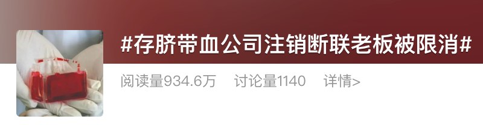
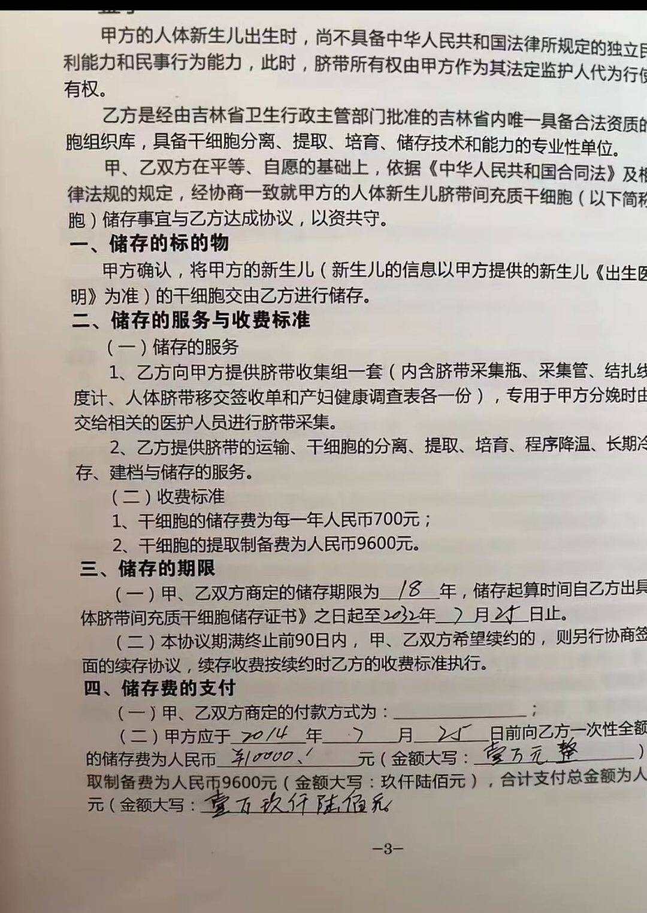
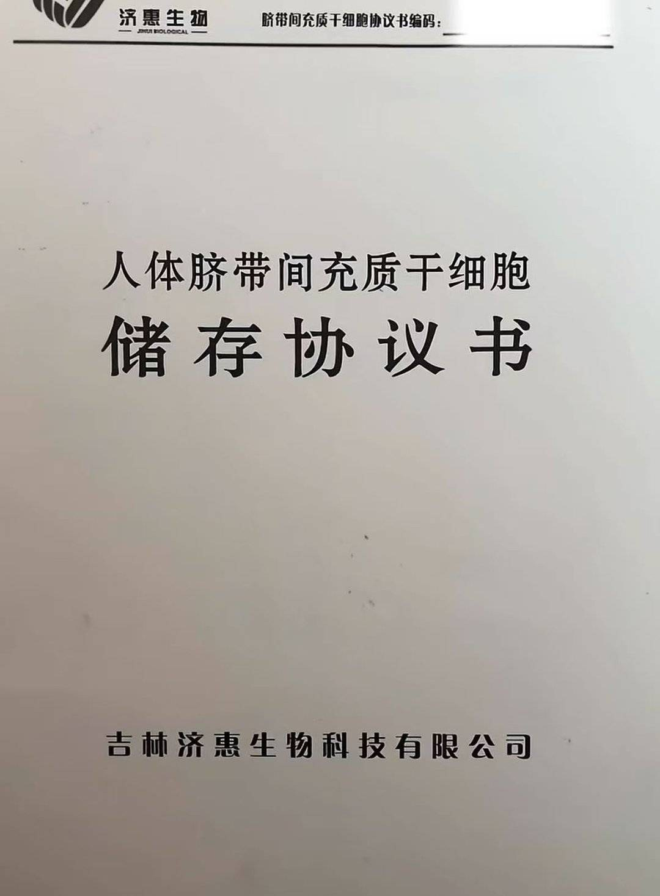
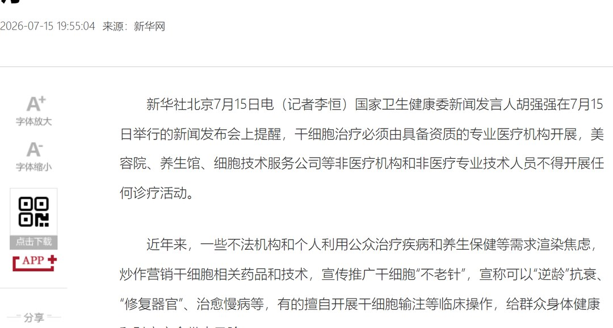
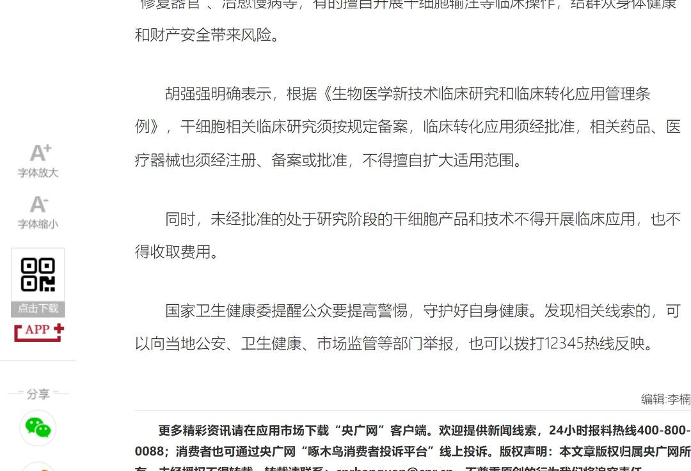
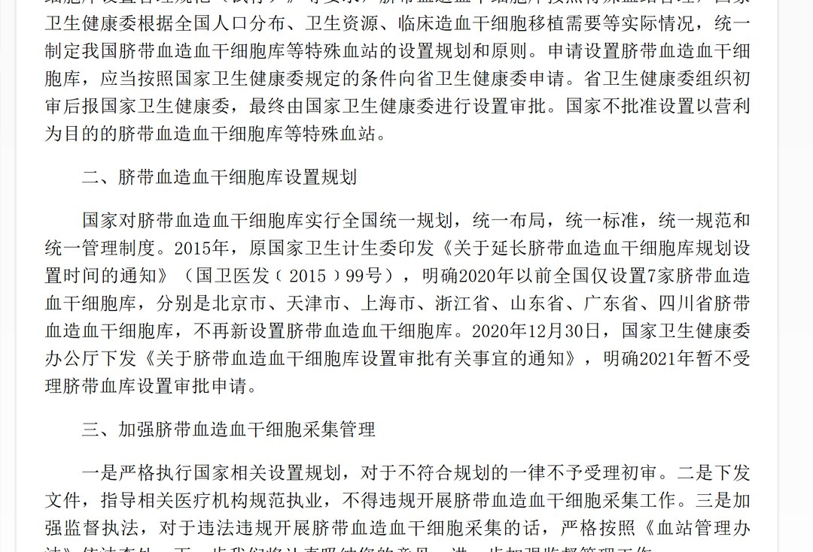
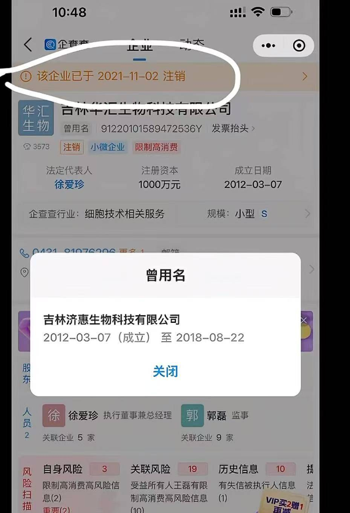
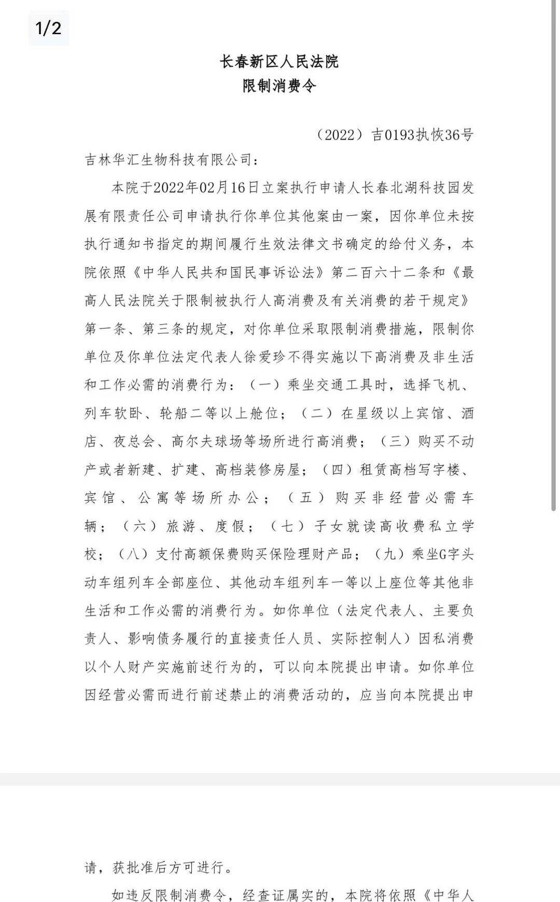

# 19600元存18年，协议写的不是脐带血

11 月 22 日，#存脐带血公司注销断联老板被限消# 挂在微博热搜上，阅读量 934.6 万，讨论量 1140。

吉林的曹女士 2014 年生完孩子，业务员找上门，说存一份，以后宝宝生病就多一份保障。她一次付了 19600 元，签约 18 年。

2026 年 11 月中旬她上网查这家公司，发现 2021 年 11 月就注销了，业务员联系不上，法定代表人被限制高消费。

热搜底下反复出现的一句是，我存的还在不在。

我更想先弄清另一件事，这 19600 元买的到底是什么。

## 一、先算这 19600 元

封面新闻记者拍到了协议原件，收费栏分两条。

干细胞储存费每一年 700 元，提取制备费 9600 元。付款栏是手写的，2014 年 7 月 25 日前一次性付清，储存费 10000 元，提取制备费 9600 元，合计 19600 元。

储存期限 18 年，自证书发放之日起至 2032 年 7 月 25 日止。

这两栏我对着算了一遍。按每年 700 元乘 18 年，该是 12600 元；实收的储存费是 10000 元，差 2600 元。

协议没写这 2600 元怎么减的，我没查到说明，先放在这里。

19600 元摊到 18 年，每年约 1088.9 元。买的服务是采集、分离、提取、培育、程序降温、长期冷存、建档。

## 二、协议里没有脐带血

业务员当年说的是存脐带血。宣传里那套说法我也抄了下来，脐带血里的造血干细胞能重建血液和免疫系统，能治 70 多种疾病，包括白血病。

协议封面写的是另一串字，人体脐带间充质干细胞储存协议书。

通篇没有「脐带血」三个字。标的那一栏写甲方新生儿的干细胞，服务里列的是脐带运输、脐带的干细胞分离提取。

脐带血是血，存的是造血干细胞。脐带是组织，存的是间充质干细胞。两类细胞，两条监管轨道。

封面新闻原文分了这两条线，脐带血按特殊血站管，关联造血干细胞移植，脐带组织不在这条线上。

我查国家卫健委的文件，管的是「脐带血造血干细胞库」，没有一份给「脐带间充质干细胞储存」设过国家层面的准入。

能查到的时间靠后的口径，是 2026 年 7 月 15 日。国家卫健委发言人胡强强在发布会上说，未经批准、处于研究阶段的干细胞产品和技术不得开展临床应用，也不得收取费用。

同一场发布会还点名，细胞技术服务公司等非医疗机构不得开展任何诊疗活动。

那份协议里，乙方自称「经由吉林省卫生行政主管部门批准的吉林省内唯一具备合法资质的细胞组织库」。

这句话我读了两遍。自称的是细胞组织库，脐带血库另一套资质。

## 三、7 家名单里没有吉林

国家规划里的脐带血库，是有名单的。

国卫医发〔2015〕99 号写得直白，2020 年以前全国设置 7 家，分别是北京市、天津市、上海市、浙江省、山东省、广东省、四川省，不再新增。

国家卫健委 2019 年 7 月的回应把来路也交代了。2001 年到 2002 年批过 10 家，重庆、甘肃、辽宁没按要求时限设置执业，国家卫健委取消了这三家的设置，验收执业的是 7 家。

《血站管理办法》给这 7 家定的性质是特殊血站，须取得血站执业许可，不得以营利为目的。

辽宁省卫健委 2021 年 6 月 9 日的答复里还有两句。国家不批准设置以营利为目的的脐带血造血干细胞库；2020 年 12 月 30 日之后，2021 年暂不受理设置审批申请。

吉林不在这 7 家里。

这里我要把话说准。拿 7 家名单去断言吉林这家公司「非法」，我做不了这个判断。协议自称的是地方批的细胞组织库，7 家管的是国家批的特殊血站，两套资质不是一回事。

能对上的只有一件事，业务员说的「存脐带血」，和协议给的「脐带间充质干细胞」，落不到同一套国家规则上。

能自己核的是这一条，国家批的、能存脐带血、能做移植用的，全国就那 7 家，不得以营利为目的。

## 四、第 7 年公司就没了

企查查那张截图，顶部一行橙字，该企业已于 2021-11-02 注销。

公司 2012 年 3 月 7 日成立，曾用名吉林济惠生物科技有限公司，用到 2018 年 8 月 22 日，后更名吉林华汇生物科技有限公司。法定代表人徐爱珍，注册资本 1000 万元，行业归类细胞技术相关服务。

从 2014 年 7 月 25 日付款，到 2021 年 11 月 2 日注销，是 7 年 3 个月。

18 年的合同走了约七年，剩下约十一年没有承接方。按 19600 元摊，已服务的这七年合到每年约 2800 元。

长春新区人民法院的限制消费令编号是 (2022)吉0193执恢36号，2022 年 2 月 16 日立案，申请人是长春北湖科技园发展有限责任公司。

令上列了九项禁止，包括坐飞机、住星级酒店、买不动产、子女读高收费私立学校。

封面新闻 11 月 20 日拨过官方预留的几个电话，都是空号。当天记者联系青岛那家医疗集团，负责标准化的人说不清吉林华汇是否归属集团，前台说搜集情况后上报。

到 11 月 22 日，我没查到监管部门的核查结论，也没查到这批样本的下落。这两处先留白。

## 五、下次签之前问四句

我把这件事拆下来，剩下一笔容易算错的账。一次收 18 年的现钱，卖的是一份还没有获批用途的东西，收钱的主体可以在第 7 年消失。

一问协议全称写的是「脐带血」还是「脐带间充质干细胞」。这两个词差一个「血」，标的是两类细胞。

二问机构在不在国家卫健委那 7 家名单里。不在，就问清它持的是哪一类资质、谁批的、批文号。

三问钱按几年收、一次性付清之后公司注销了谁承接、款项由谁监管。曹女士这份协议里，我没读到承接条款。

四问存下来的细胞现在有没有获批的临床用途。研究阶段的产品和技术，按 2026 年 7 月 15 日那个口径，不得开展临床应用，也不得收取费用。

再补一个动作。签之前去国家企业信用信息公示系统查一下主体状态，是存续还是注销，有没有失信被执行记录。这张截图曹女士是 2026 年 11 月才看到的。

---

参数是我按公开资料算的，欢迎在评论区指正。
