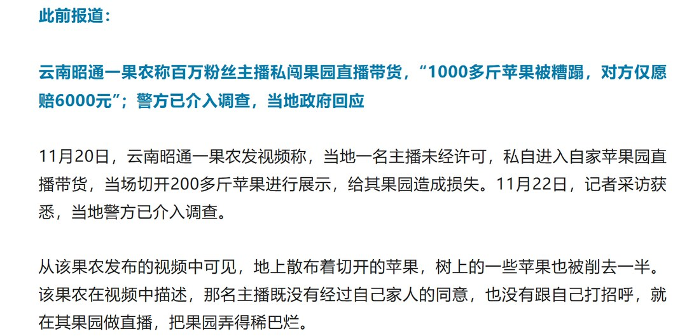
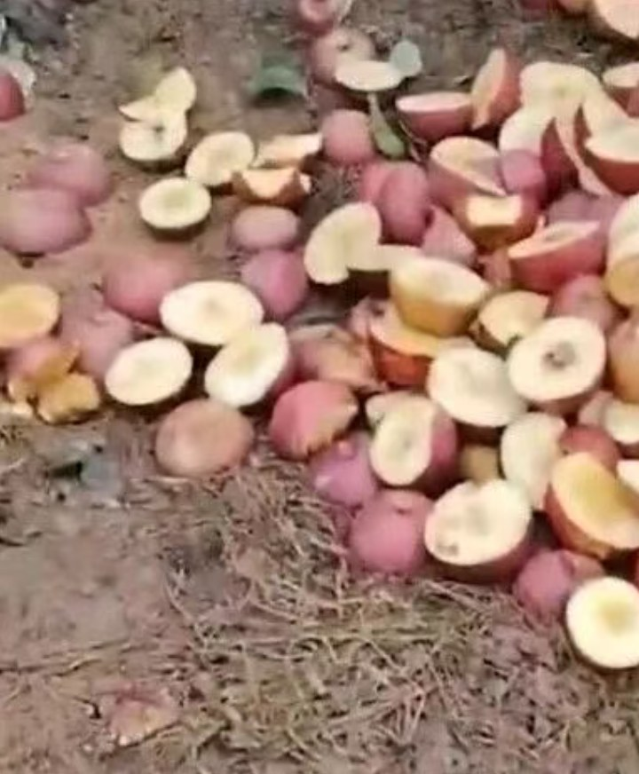
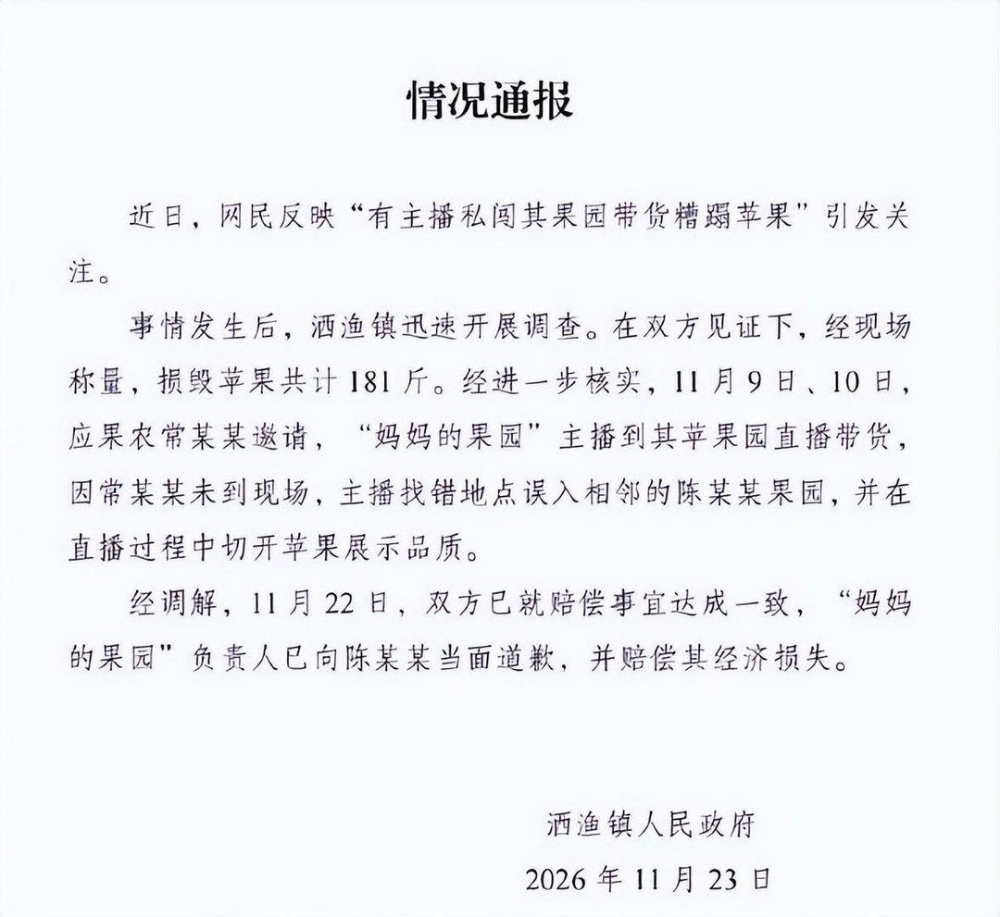
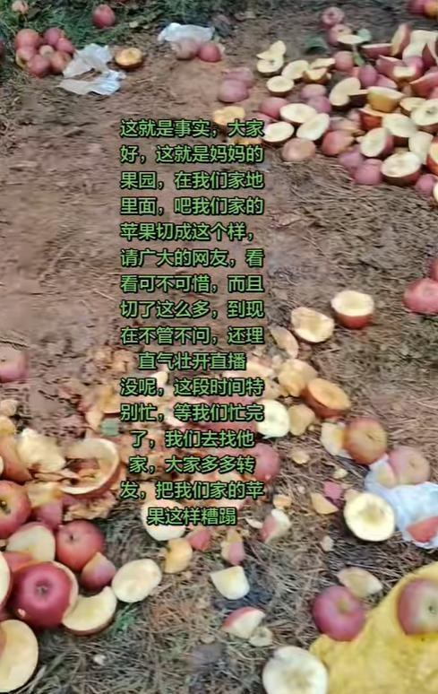
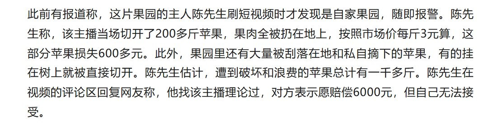
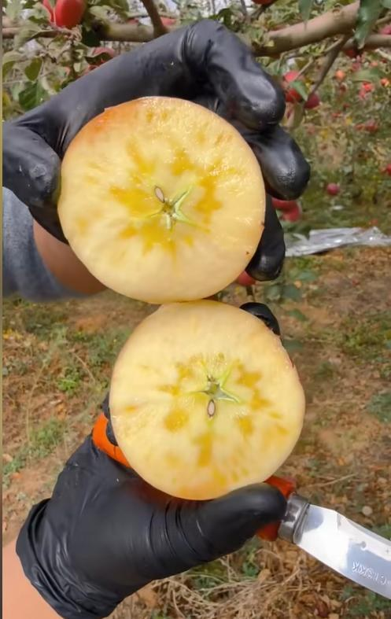
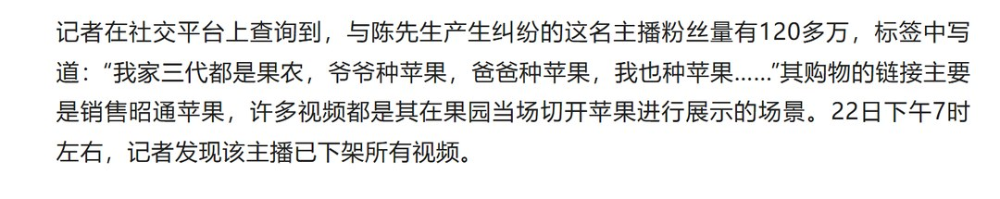

# 网传糟蹋一千多斤苹果，11月23日通报只称出181斤

11月22日，「主播私闯果园带货糟蹋一千多斤苹果」冲上热搜榜首。

传的版本很完整。百万粉丝主播没打招呼进了别人果园，为展示品质当场切开苹果，糟蹋一千多斤，只肯赔6000元。

果农的视频里，满地都是被切开的苹果。我看了一遍，那些切口是新的。

## 一、通报改了四个说法

11月23日凌晨，云南昭通市昭阳区洒渔镇人民政府发了一份《情况通报》。

通报开篇给的是数。在双方见证下，经现场称量，损毁苹果共计181斤。

一千多斤和181斤，差的不是一点。

往下写的是时间和人。11月9日、10日，应果农常某某邀请，「妈妈的果园」主播到其苹果园直播带货。

因常某某未到现场，主播找错地点误入相邻的陈某某果园，并在直播过程中切开苹果展示品质。

末一句写，经调解，11月22日，双方已就赔偿事宜达成一致，负责人已向陈某某当面道歉，并赔偿其经济损失。

我把通报读了三遍。它没写「私闯」，没写「一千多斤」，没写「只肯赔6000元」，也没写「拼接不实」。

## 二、两个斤数不是一回事

夸大没夸大，另说。这两个数我核对下来，量的不是同一件东西。

181斤前面有四个字，现场称量。通报还写了「在双方见证下」。

一千多斤前面是果农自己的词，估计。原话是「遭到破坏和浪费的苹果总计有一千多斤」。

这个估计里装了不少东西。切开扔在地上的，刮落在地和私自摘下的，挂在树上就被直接切开的，还有被摘掉的花芽和取消的订单。

果农还说，主播摘苹果时连花芽一并摘掉，严重影响来年产量。原本谈好的收购商取消了订单，理由是「好苹果都被摘掉了」。

花芽牵着来年产量，订单取消是另一笔账。这两样没法过秤，也进不了那181斤。

这里不能减。我不能拿181斤去减一千多斤，然后写「虚报819斤」。口径不同，这个减法不成立。

通报也没说果农报错了。它只给了自己称出来的那个数。

## 三、五个数摆在一起算

果农11月20日的自述里有几个能核的数，我把它们抄下来。

当场切开200多斤苹果，按市场价3块钱一斤算，损失600多元。这一笔是果农自己算的。

我按同一口径复算一次，200斤×3元=600元，和「600多元」对得上。

3块钱一斤是果农自己给的市场价，通报没有核定单价。我拿它乘181斤，只是让两个数能对照，不是替谁定价。

通报的181斤，也按3元一斤算，是543元。两个结果差57元，约9.5%。

果农讲「当场切开的那部分」，其实和称出来的量差不多。真正拉开距离的是后面那句估计。

再看6000元。按543元算，6000÷543≈11.05倍；按果农自己那600多元算，约10倍。

这个数我犹豫过要不要写。通报只说「赔偿其经济损失」，没公布金额，6000元是果农转述的「对方表示愿赔偿」，不等于落定的赔付额。

我只写，网传的那个报价是称量货值的十倍上下。至于11月22日实际赔了多少，通报没写，我没查到。

按「一千多斤」的下限1000斤算，1000÷181≈5.52。倍数能算，但也是两个口径在比，我不会把它当成一个精确的差。

## 四、「私闯」两个字怎么改的

通报给了一个此前没人提的人，常某某。

主播是应他邀请去的，他没到现场，主播找错了地块，进了隔壁陈某某的园子。

这条把「私闯」改成了「找错地点误入」。我觉得这个改动有依据，可责任没跟着走。

对陈某某来说，人确实没经过他家同意就进了园子，苹果确实被切了。误入讲的是动机，许可得另说。

11月22日另有两段。现代快报记者联系主播账号，客服说「网传拼接不实内容已留存完整证据，恶意造谣将报警处理」。

当天下午7时左右，记者发现该主播已下架所有视频。极目新闻查到这个账号粉丝120多万，标签写着「我家三代都是果农」。

客服那句「拼接不实」也没全站住。通报确认了切开苹果这件事是真的，只是量级和性质都要重说一遍。

果农发帖后，网友去直播间声援，只要提及「私闯果园划苹果」，就会被禁言并踢出直播间。这一段我只在报道里读到，通报没有回应。

11月22日青岗岭乡政府的工作人员对记者说，政府已派员介入调解，因该主播在当地较有影响，情况已上报上级。

我更愿意把这次看成两层。主播不冤，果农也没全错。

时间线对得上。11月9日、10日误入，11月20日果农发视频，中间隔了10天。

11月21日他刷短视频才发现是自家果园，随即报警；11月22日上热搜、警方介入、调解达成一致；11月23日凌晨通报。

11月22日青岗岭派出所对记者说仍在调查处理。通报没写警方结论，这一块我留白。

## 五、下回看到这类数先问四句

先问一句，这个数是称出来的，还是估出来的。称量要有双方见证，估算往往把来年的账也算进去。

接着问，数的口径是什么。损毁量、破坏浪费总量、含订单取消的总损失，三个说法不一样。

末了问，赔偿谈成了没有，金额谁公布过。报价不等于赔付，热搜标题里的「仅赔」也不等于结局。

还有一句我留给自己。转发之前，先看有没有一份落款、有日期、写了「现场称量」的文件。

那天先发出来的，是视频和情绪。称量单在10天之后。

---

参数是我按公开资料算的，欢迎在评论区指正。
