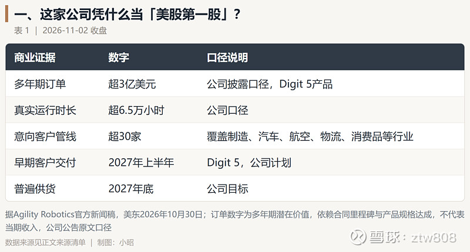
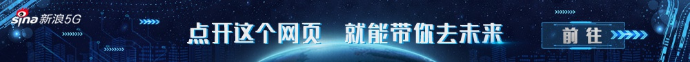
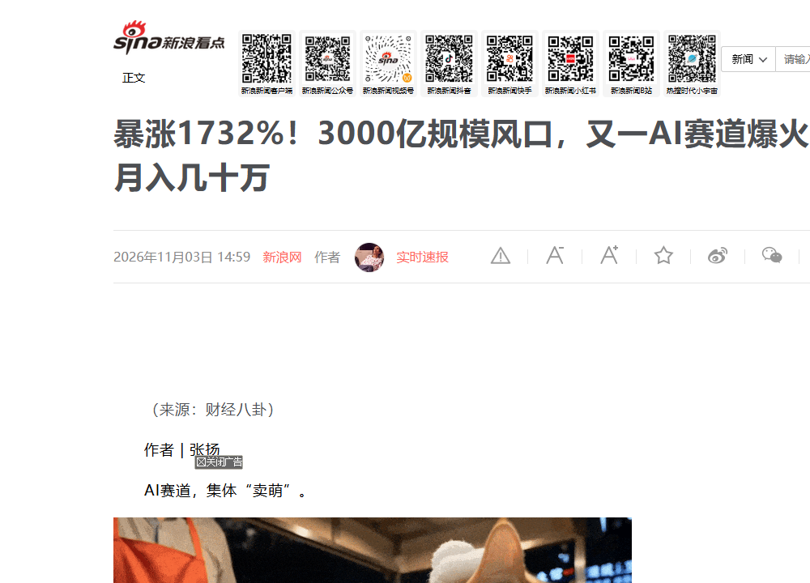
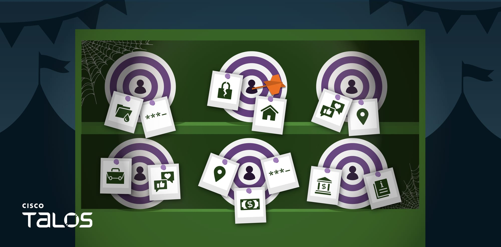

# 每日 AI 动态 · 2026-11-05

今天最大的事放最前：人形机器人第一次以整机公司身份站上美股。但敲完钟，账本才是真考验。

## Agility 挂牌，25 亿估值先接住 178 万营收

Agility Robotics 今天（11 月 5 日）以 AGLT 代码登陆纳斯达克。它成了美股首家专做人形机器人整机的上市公司。

这次 SPAC 合并募了约 4.65 亿美元，比 6 月说好的超 6.2 亿少了约四分之一。原因是公众股东赎回了六成多。

公司投前估值约 25 亿，可 2025 年确认营收只有 178 万美元，市销率算下来超 1400 倍。

Digit 机器人已在 9 个客户站点真干超 6.5 万小时，Digit 5 还有超 3 亿美元、折算不到 8 倍市销率的订单。

我更看重后一个数：订单簿能打折，是因为它真有交付记录，不是 PPT。今天开盘，市场要给"讲故事的估值"和"干活的营收"第一次算总账。

## Claude 取消限速，OpenAI 跟着翻倍

Anthropic 10 月 31 日把 Max 5x 改名 Max、Max 20x 改名 Ultra，月费还是 100 和 200 美元。

关键改动是：通过验证的 Ultra 账户，不再每 5 小时重置一次用量窗口，可以连续跑 Claude Code 到每周额度用完。

就在这前一天，OpenAI 的 Codex 负责人 Tibo 把 Pro 各档额度翻倍，还跑到 Anthropic 公告下喊话"最好 28 天重置"。

我判断这不是让利，是抢人：谁让重度写代码的用户更顺手，谁就锁住这块高价值用户。对个人来说，长任务、多智能体的成本结构，开始决定你用哪家。

## 阿里把编程智能体的首响，压到了 3 秒

阿里智能体编程平台 Qoder 这两天上线了 Fast 模式。第一次回你的时间从 8 秒降到 3 秒，花掉的 Credits 从 1.1 倍降到 0.8 倍，差不多省了 27%。

它不是靠堆更大的模型，而是分了层：简单的活儿用快模型秒回，复杂的才调更强的模型；再加上端侧执行和网络压缩，并发工具调用能到 50 个以上。

我把它和上面 Claude 的事放一起看：一边把额度给你放开，一边把响应给你压快。AI coding 的竞争，已经从"谁模型更强"滑到了"谁用起来更顺、更便宜"。对个人开发者，这就是实打实的效率账。

## AI 萌宠火了，赚钱的却是头部

今年以来，AI 生成的猫狗以"拟人打工日常"人设刷屏抖音、小红书、YouTube。

闲鱼上半年 AI 服务订单同比涨 157%，到 981.6 万单；其中 AI 编程与建站涨 1732%、AI 漫剧涨 1425%。头部"LT小狗日记"单条广告报价最高 8 万。

我得提醒一句：多家媒体都点明，8 万是头部里的头部，中腰部一条才 4500 元，更多靠橱窗带货。

而且生成成本约 1 元/秒，一条几十秒视频光生成费就上百，同质化内卷已经来了。普通人能做的不是"有手就行"，是编剧和人设——工具谁都有，创意才是门槛。

## 小偷都用大模型给你"估价"了

最后一条有点刺骨。Cisco Talos 10 月 31 日披露一种叫 VOLTA-AUTODOXER 的 Windows 木马。

它先偷浏览器密码、支付卡、加密货币种子、各类会话，再把证据包发给大模型。默认用 Claude Opus 4.6，被拒就降级到 Kimi K2、再到 Gemini。

它让 AI 当"法医分析师"，按变现价值给你的资产排低/中/高三档。木马自删除、没有攻击者自己的服务器，疑似做成了一键生成的作案工具。

我的提醒很具体：改掉浏览器里存的明文密码，重要账户开两步验证，Wi-Fi 密码别用生日。AI 把"研判"都自动化了，你的防护别还靠老办法。

---

额度都是有时效的，看到就先去点一下。
发现哪条已经结束了，欢迎在评论区指正。
