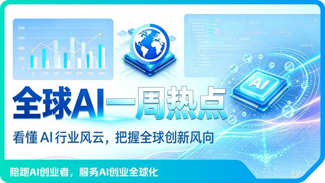
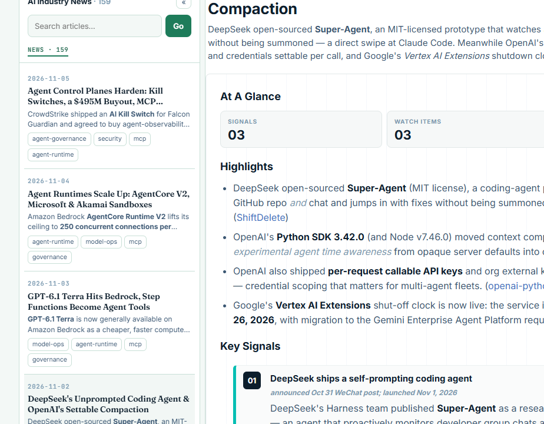
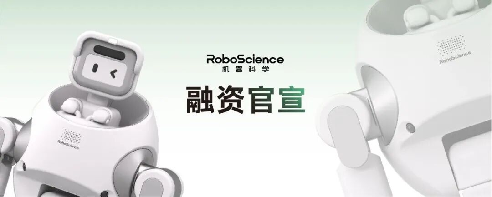

# 每日 AI 动态 · 2026-11-06

这周模型圈的关键词是「往里钻」：千问钻进了 iPhone，智能体钻进了团队通讯录，机器人公司钻进了新一轮融资。挨个说。

## 千问钻进了 iPhone

阿里和苹果这事定了。千问集成进 Apple 智能，中国用户在 Siri、写作工具、视觉智能里直接调用千问的文本和图像能力，11 月 4 日随 iOS 开发者 Beta 开测，12 月随 iOS 27.3 正式推送。

这是国产模型头一回进海外科技巨头的系统级入口。霞光 AI 周报里那句判断我很认同：能力趋同之后，价格和渠道才是胜负手，便宜决定开发者用谁，入口决定用户触达谁。

同一周，模型层在集体降价。OpenAI 的 GPT-6.1 Terra 每百万 token 输入 1 美元、输出 5 美元，约是上一代的一半；谷歌 Gemini 4 Carbon 以 59 分登顶 Artificial Analysis 指数，首发价 2 美元。还有 Anthropic 的 S-1 招股书：上半年收入 163 亿美元，同比涨了约 13 倍，估值喊到 1.5 到 2 万亿美元。

竞争已经离开了参数表，比的是谁能用上、用得起。对国内开发者，调用成本两年降了九成多，「按厘计费加零代码」足够个人冷启动。

## 编码智能体有了工号

这个月编码工具的主线很统一：把智能体从个人玩具变成团队基建。AmpCode 给 Agent 发了团队邮箱，线程归团队不归你，你休年假它还在跑；Cursor 把 Agent 做成可版本控制、可测试、可部署的代码，还开了应用商店；OpenCode、Zed、Claude Code 各自补齐重启不丢配置、长任务不爆内存这些基建活。

我看完这批更新的感受：会搭脚手架的人，比会写 prompt 的人值钱了。智能体有了自己的工号和凭证，「谁来管它、谁审计它」就成了新岗位，这也正好是团队级 agent 治理咨询的空位。

## 机器科学又拿了数亿

11 月 2 日，具身智能公司机器科学（RoboScience）宣布完成 A2 轮数亿元融资，360 战投、琥珀资本、上海半导体产投联合领投。创始人有两位，都有斯坦福履历：田野做过苹果 AI 平台技术负责人，邵林是新加坡国立大学助理教授。

他们放出来的数字里，单条训练数据成本 0.05 元、号称传统方案的 1/20 到 1/200 最扎眼。我把这个数核查了一遍：网易、腾讯新闻、21 世纪经济报道、OFweek 至少六家口径一致，但全都注明「据公司披露」。也就是说，这是厂商自证的成本，没经过第三方审计，也不含算力和研发投入。

我的结论：融资是真的，多源交叉证实过；数据成本的夸张成分要打个折看，兑现得看物流、零售这些场景接下来有没有订单。

## 土办法，真金白银

最后这条看着土，但能落进兜里。帮中小商家搭「数字员工」：写小红书文案、搭客服机器人、把周报和发票自动化，一家店一月收 500 到 3000 元。

三个条件刚好凑齐：模型便宜到按厘计费，零代码平台拆掉了写代码的门槛，老板们想用 AI 但连提示词都没听过。你看不上「一家店一个月 800 块」，这正是大厂懒得弯腰捡的钱。稳定服务 10 家店，就是一份不比工资少的副业。门槛在沟通，不在技术。

---

额度都是有时效的，看到就先去点一下。
发现哪条已经结束了，欢迎在评论区指正。
