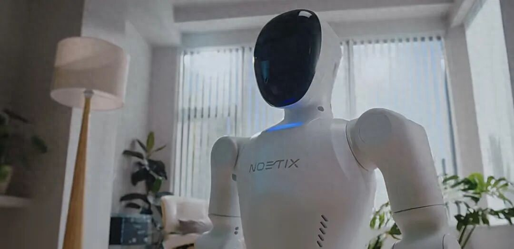
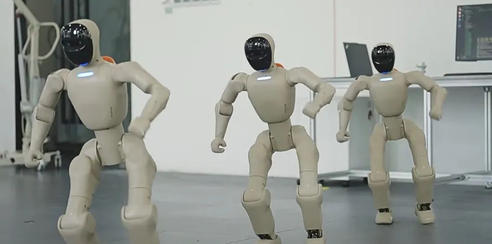

一台9998元的双足机器人，上过春晚小品，在京东卖断过货，创始人年初放话「今年至少破万台」。到9月底，实际交付刚过5000台。目标，完成一半。

这家公司叫松延动力，机器叫小布米。上周《每日经济新闻》采访创始人姜哲源，他把实情说了出来：截至9月累计交付刚过5000台，B端订单接近2000台，B端C端占比「我个人体感大概各一半」——注意，这是体感，不是账面数据。

## 万元门槛踩进去了，活儿还没跟上

9998元这个定价，第一次把双足人形机器人拉进万元以内。行业里的对手此刻在干什么？宇树把R1从3.99万降到2.99万，登顶京东销量榜；智元系的启元19999元起售，两款个人机器人已经下线到第5000台。

价格战打到这里，打法变了。以前比谁更便宜，现在比这个价位能不能真干活。姜哲源自己也承认，行业真正的核心瓶颈是泛化能力——机器人在练过的场景里能干活，换个没见过的场景就歇菜。

我还注意到一个细节：年初立的「破万台」，等于要求四季度一个季度交出前九个月的总量。供应链、产线、工人管理，哪一层都可能卡住。这家公司据多家媒体报道已在秘密递表港交所，60亿估值的B轮刚落地，二级市场肯不肯为「交付能力」买单，明年见分晓。

## 代码写得更快了，交卷的队伍更长了

海外这边，GitLab在10月29日把Orbit正式开放。这是一张软件生命周期的上下文图谱，把代码、合并请求、流水线、漏洞、归属权连成一张网。agent接上之后，同样的任务最高少45倍幻觉、省4.5倍token。

数字好看，但那是GitLab自己测的。更扎心的是同一周的两份第三方数据。Atlassian问了1155名开发者，87%说AI让自己写得更快。但65%的时间花在审和改AI代码上，每周真能省出10小时以上的只剩25%。上一轮调查，这个数字还有68%，掉得厉害。

LinearB看了810万次PR：AI写的PR等首审，要等上人工的4.6倍时长，接受率32.7%，人工PR是84.4%。

我自己的判断：瓶颈已经从「会不会写」挪到了「审不审得过来」。工具厂把宝押在上下文上，而不是更大的模型上，方向是对的。但普通人短期内更该关心的是，你交出去的AI代码，谁来看。

## AI副业开始按结果收钱

副业这条线，最近的共识是别卖课，去交付。给本地商家搭客服机器人、写内容、理周报，月费500到3000元一家店，这条路过去几期写过。这周我注意到一个更值得琢磨的信号：计费方式在变。

有从业者把AI销售助手按成交抽佣，设计工具按稿件通过率收费。行业从按token收费，转向按结果收费。这对能跑通交付的人是好事，你对结果负责，客单价就翻着涨；跑不通的，连入场券都拿不到。

三件事放到一起，主线是一个词：兑现。机器人要兑现交付，AI代码要兑现质量，副业要兑现结果。讲故事的阶段快结束了，接下来比的是谁交得出货。

---

额度都是有时效的，看到就先去点一下。
发现哪条已经结束了，欢迎在评论区指正。
