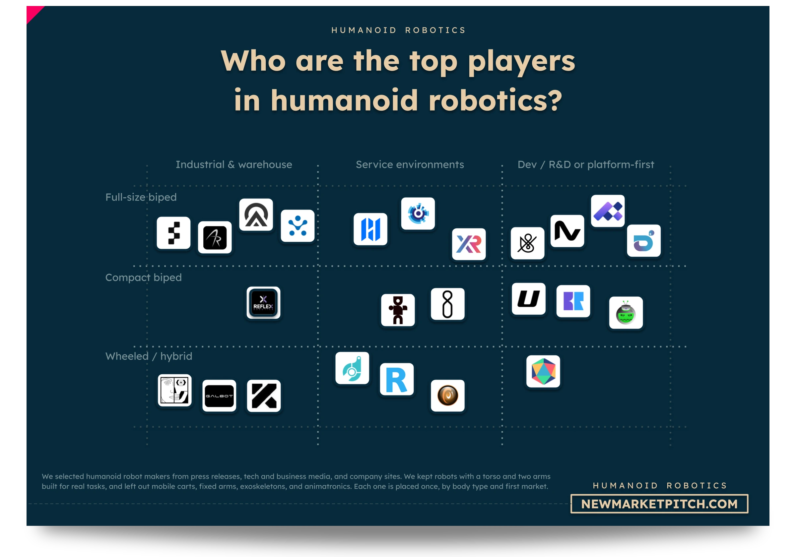
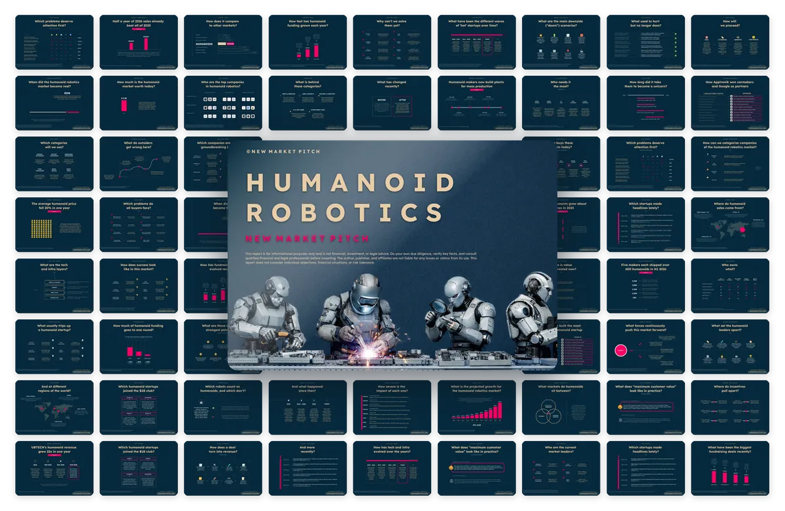

上周有组数字，值得停一下看。

OpenAI 的新模型 GPT-6 Cyber，在火狐浏览器里挖出 81 个此前没人知道的高危漏洞。这些漏洞，过去是留给人类安全研究员花几周去翻的。

「AI 帮忙查代码」已经不够形容它了。它能自己找、自己复现，还能写出能用的攻击程序。

## AI 自己会挖漏洞了

先看硬数据。11 月 5 日发布的 GPT-6 Cyber，在 ExploitGym 基准上拿 48.5%，上一代 GPT-5.6 Cyber 只有 32.1%，涨了约 51%。实战里，它复现了 1724 个 Linux 内核漏洞，给其中 948 个写出了可用的提权利用——上一代只做到 166 个。

火狐那 81 个高危漏洞，它连证据和可复现测试一起交给了 Mozilla，对方已经开始合入修复。

我特意核了一下：这些数字都来自 OpenAI 官方博文，环球网、腾讯科技、TLDR 多家转述口径一致。但要说清楚，这是厂商自己的红队结论，第三方还没独立复现；「81 个」是火狐单次研究的量，不是全网漏洞总数。所以这条我给四星——靠谱，但留一分。

更值得琢磨的是分级。OpenAI 把它的网络安全风险从「高」提到「关键」，只放给审核过的 Daybreak Red 客户用。一家公司主动给自己的产品上锁，说明这个能力已经跑到连他们都觉得要踩刹车的地方。

## 编码智能体有工号了

同一天另一条线，是编码智能体的身份在变。

AWS 把 Kiro Bots 正式放出来，这东西有记忆、能按你在聊天里说的排期（比如「每半小时查一次 CI」），还能拉别的 agent 一起干，20 美元一个座/月。Meta 收了 Conductor，一个在隔离空间里同时跑 Claude Code、Codex、Cursor 的并行编码智能体。Gartner 也发了第一个「智能体管理平台」魔力象限，微软、IBM、ServiceNow 进了领导者。

我的判断是：企业现在真正头疼的，是 agent 太多、不知道哪个在干什么。模型聪明不聪明，已经不是问题了。给你的 AI 配个「工号」，让它有身份、有权限边界、离职了项目还在跑——这才是今年下半年真正在发生的事。

## 钱流向了机器人

再看一级市场。到 11 月 4 日，今年人形机器人赛道 121 笔融资、至少 82 亿美元，中国按笔数和金额都是全球第一。

RoboHub 的榜单里，Figure 以约 17 亿美元总融资排第一，德国 NEURA 16 亿、中国银河通用 9.86 亿紧随。但前十里中国厂商占六席——银河通用、自变量、智平方、宇树、千寻、星动纪元。

钱往头部聚，中尾部更难拿。这对想进这个赛道的人是个提醒：别再攒整机了，做卡上游的部件、灵巧手、数据服务，反而更稳。

## 冷门副业：校文稿

副业这条线，这周冒出一个不太起眼的方向：给录音做精修。

博主、讲师、企业录完音，AI 先转写、初校，人再通读一遍，改错别字、删口误、分段加标点、区分说话人，交付成干净文稿。新手一天接两三单，日入 80 到 180；熟手接长音频和企业单，日入 200 到 400 不难，复购还强。

它和「给小老板搭数字员工」是一个逻辑：不训模型，靠把工具拼成别人能用的东西赚钱。图文、剪辑早卷成红海，音频背后的文字服务反而没人抢。

## 视频生成又降价

最后一条，跟做内容的人有关。

Google 把 Gemini Omni 1.2 Flash 视频模型正式可用，单次最长从 10 秒延到 15 秒，价格降约 30%，720p 大概 0.07 美元一秒，一条 15 秒的片子约 1.05 美元。它还能对话式改背景、光线、比例，不用整条重生成。

OpenAI 这边，Images 2.6 新增了最快 6 秒出图的 Flare、能导出矢量图的 Sunburst，还有动画 GIF 和可复用的参考图，官方说整体快了约 50%。

对做短剧、带货视频、课程插画的人，单位成本还在往下走。窗口没关。

AI 一口气给 Firefox 找出 81 个没人知道的高危漏洞，安全研究员的好消息是活儿更值钱了，坏消息是这活儿以后可能不用自己干了。

---

额度都是有时效的，看到就先去点一下。
发现哪条已经结束了，欢迎在评论区指正。
