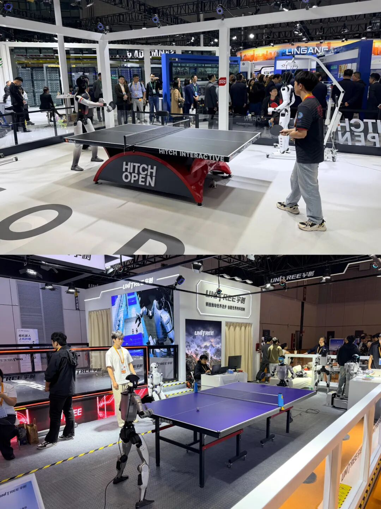

上周 GitHub 在开发者指南里，把 AI 辅助开发拆成 Plan、Build、Verify、Observe 四个阶段。同一份材料还藏着一个数：10 月某一周，平台提交量超过 12 亿次，同比涨了 400% 以上。

## AI 写得越快，审得越慢

生成变便宜之后，瓶颈从「会不会写」挪到了「谁来审、怎么审」。

Faros AI 测了 2.2 万名开发者、4000 多个团队。团队从低到高采用 AI 后，PR 在评审里停留的时长涨了 441%。首审等待多了 156.6%，实际评审工时多了 199.6%。

我的判断是，管理者别再拿提交量、采纳率汇报 AI 成效了，那会高估价值。更该盯的是评审排队时长、返工率和线上缺陷。GitHub 把「验」单列成阶段，而不是真去疏通拥堵，本身就说明了问题。

另一组独立实测把 AI 提效收敛在 25% 到 40%。所以 441% 是「从低采用到高采用」的跨度值，不是横截面均值。这个数用来预警排队还行，拿来算 ROI 会失真。

## 编码智能体跑出了 IDE

第二条线，是编码智能体从自家编辑器里跑出来了。

GitHub 把 Copilot 塞进 Xcode 27.3 beta 和 JetBrains Air。它走的是 Agent Client Protocol，正变成编辑器里智能体的「标准插座」，像当年的 LSP。

同一周 Claude Code 让长耗时的 MCP 调用转后台跑。它新增 denyInsteadOfPrompting：没人点确认就直接拒，专为 CI 和定时任务这种无人值守场景准备。Codex 也加了统一管理多个 agent 的「命令中心」。

我想到的是，做 Agent 平台的人，ACP 标准化和「无人值守权限」是比模型本身更稳的切入口。它们不依赖某家模型的版本。Xcode 把 Copilot 做成内置助手。JetBrains Air 走同一套 ACP，编辑器不再各自为战，智能体成了能插进任何 IDE 的零件。

## 机器人开始算工时

进博会上，智元抛出一个新指标：Worken，有效智能工时。

按「活跃设备数 × 工作时长 × 任务效能」折算，2026 年 10 月常态化口径下，智元累计形成超 6.2 万个有效智能工时。这些工时覆盖文旅、交通、零售、工业、民生五类场景。广州地铁站点的 120 台精灵 G2 已部署，北大人民医院单台 10 月自主运行 170 小时。

同期海外伙伴与智元达成约 2 万台人形机器人合作意向。机器人圈新的尺子，不是「造了几万台」，是「连轴转了多少小时」。现场宇树用两台 G1 对打乒乓球，特斯拉 Optimus 演示工厂分拣和遛狗。但智元把「2 万台」标成合作意向，不是已签订单，这一点我标了待核实。

## 副业样本：把招投标包成 agent

今天这条线，是「AI 副业」里最接近落地的一个样本。

重庆三个 90 后，做出覆盖「找标、判标、算标、写标」全流程的投标决策智能体「知彼」。为喂数据，俩月仅智谱 GLM 一家就烧了 178 亿 token。团队不训模型、不卖课，而是把招投标这个重脑力活按项目交付，一家国资背景企业已经表达了收购意向。

门槛不在技术，在「比客户多走两步」的行业 know-how。这条我给的是观察，不是推荐。它能不能复制，要看你手里的行业资源。团队最早试的是 AI 短剧，发现边际收益低、改十几次是常事，三四个月后才转向招投标。后来加入两位 90 后行业专家，产品才引起资本关注。这个样本的价值，不在技术多新，在它证明了「重脑力活」能被包成可交付的 agent。

额度都是有时效的，看到就先去点一下。
发现哪条已经结束了，欢迎在评论区指正。
