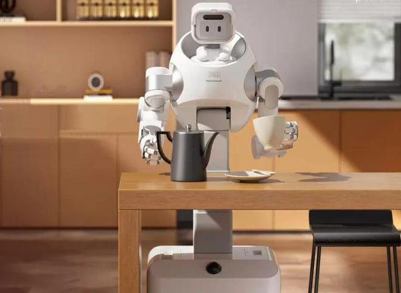
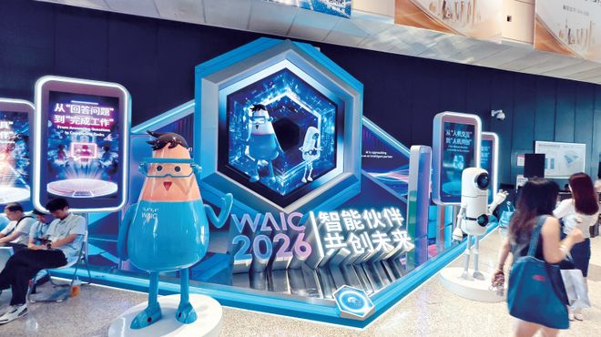

> 这周有点密集。11 月 3 日到 5 日，腾讯、美团、月之暗面先后把新模型摆上台面。腾讯 Hy4 能看也能操作电脑，美团 LongCat-2.5 在纯国产算力上跑出 1.6 万亿参数，月之暗面 Kimi 在 SuperCLUE 拿下国内第一。三件事拆开看，结论只有一个：国产模型正在从「能对标」跨到「可托付」。

## 腾讯 Hy4：第一次能看也能动手

11 月 4 日腾讯发混元 Hy4。Hy3 系列参数还不到 300B，Hy4 直接做到 770B。更关键的是补齐三条能力线：第一次引入视觉理解，第一次支持 Computer Use，长程智能体把任务从分钟级拉到小时级。

Computer Use 是个分水岭。以前的模型只能吐文字，Hy4 能看图、点按钮、敲命令行，把「说」变成「做」。腾讯列了十二个办公场景，文档、表格、幻灯片、邮件、会议纪要都在里面，Hy4 在九项里排第一，已经集成进办公产品 WorkBuddy。它同步在元宝 App 和腾讯云 API 开放，开发者当天就能调。

我自己判断，Hy4 真正的看点不是 770B 这个字数。参数只是入场券，能看、能动手、能持续做三件事同时到位，才决定它能不能被企业真正用起来。腾讯承认和顶尖闭源还有差距，这份克制反而让「跻身最强开源」更可信。

## 美团 LongCat-2.5：全程国产算力

11 月 3 日美团发 LongCat-2.5，总参数 1.6 万亿，走 MoE 架构，每个 token 只激活约 480 亿。训练全程跑在国产算力上，官方称这是目前国产算力上规模最大的一次训练任务。

官方给的数字是：长上下文训练单卡吞吐提升 86%，推理吞吐提升约四成。评测成绩介于 Claude-Opus-4.8 和 Opus-5 之间，部分项目超过 Opus-5。它原生支持多模态，重点强化智能体编程和复杂软件开发，接口也兼容主流 Agent 框架，开发者不用重写工具链。国产算力这条路，之前被认为只够训中小模型，LongCat 把天花板往上抬了一截。

基于 LongCat，美团的 AI 经营工作台「妙手」已经落地古茗、益禾堂这类连锁品牌。同场乌镇峰会上，网易智企发「帝王蟹」平台、智能工牌、知识引擎「万典」；小鹏联合北大、港大发约 40 亿参数的具身感知模型 GroundingPI，在 34 项公开感知基准里综合第一。

我的观察是，大厂现在比的东西变了，看的是「我的算力、我的场景、我的业务」能不能闭环。LongCat 全程用国产算力训出万亿模型，等于给国产芯片和整机链交了一份答卷。

## SuperCLUE 11 月榜：Kimi 国内第一

11 月 5 日 SuperCLUE 放出 11 月榜，19 个模型参评。谷歌 Gemini-4-Argon 以 73.62 分居首，GPT-6.1-Sol 71.76 第二，两个都是闭源。月之暗面 Kimi-K3.1-Pro 61.46 分，拿下国内第一，也是开源模型第一。DeepSeek-V4.1-Flash-1017 58.95 分，智谱 GLM-5.3 50.66 分，跟在后面。

分项更能看出差距。Gemini 在超长上下文拿到 95.63，幻觉控制 83.19，几乎没有短板。Kimi 的幻觉控制 67.78，在国内模型里领先，但跟 Gemini 还差一截。这张榜说明一件事：国产模型已经能跟住第一梯队，可「少胡说」这块还没补齐。榜单由第三方机构维护，国产进步是事实，但「国内第一」和「全球第一」之间，还隔着 Gemini 这一档。

说完模型，看机器人。RobotHub 最新融资榜里，Figure 以 17 亿美元排第一，NEURA 16 亿第二。第三到第七全是熟面孔：银河通用、Apptronik、自变量、智平方、宇树，中国厂商占了半壁。2026 年至今这条赛道 121 笔交易、至少 82 亿美元，中国按笔数和金额都是第一。

## 副业这头：客户只为结果买单

最后说回普通人。网易转载的新财富专题有个扎心数据：搞 AI 副业的人里，稳定月入过万的不到 5%，近六成月收入不足 800 元。能赚钱的就四条路，一人公司、垂直智能体、内容个体户、知识付费。

钱明显在向头部和落地能力集中。New Market Pitch 的统计里，中国 96 笔、53 亿美元，美国才 18 笔、18 亿美元，中尾部的公司今年日子会更紧。新财富的专题还提到，多数没赚到钱的人，问题出在「有工具没客户」，模型用得熟不熟反而是其次。

落到副业上也一样。零代码平台（扣子、百炼、千帆）把门槛降到拖拽，做电商客服智能体单价 2000 到 4000，本地商家代运营月费 3000 到 5000 一家，签约三家月入就过万。可决定成败的，还是「能不能把 AI 接到具体的行业需求上」，会调模型只是基础。一句话：客户不为技术付费，只为确定性结果付费。

---

额度都是有时效的，看到就先去点一下。
发现哪条已经结束了，欢迎在评论区指正。
