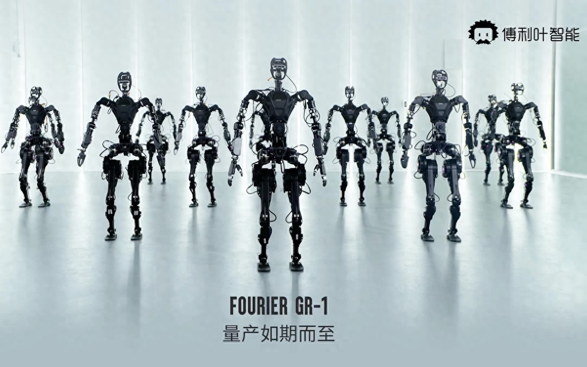
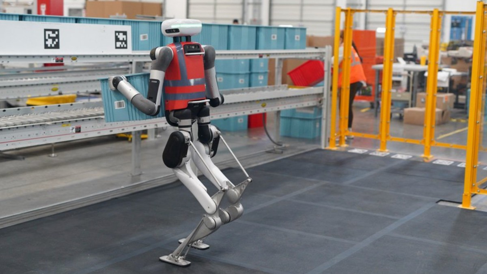
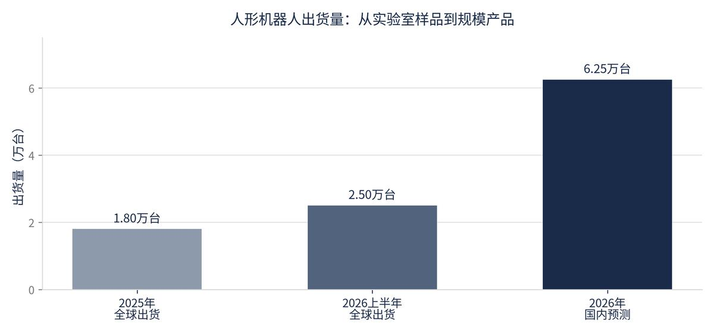

> 这周模型圈有点挤。OpenAI、Google、Mistral 三家几乎同周把新模型摆上台，但发法变了，能力不再按付费墙发，改按风险画像发。企业别急着押一家，今天的第一名，一月后可能被价格和性能双杀。我把这几天的发布连起来看，只有一个感觉：模型越来越像水电。我的看法是，这一轮拼的不是谁参数大，是谁能被放心地用。

## 三款前沿模型同周落地

OpenAI 发的 GPT-6.1 Terra 主打电脑操作与视觉推理，每百万 token 输入价压到 1 美元、输出 5 美元，便宜到能规模跑。Google 的 Gemini 4 Carbon 登顶独立评测，却先发给受信任的网络安全客户；GPT-6 Cyber 更被锁在「白昼红队」级别的已核验安全客户手里，身份要审、机构要达标。Mistral Large 4 直接把万亿参数、每 token 激活 490 亿的开源权重甩了出来，主打开源智能体编程。

这跟以前先发榜、再慢慢开权限的顺序反过来了，能力本身变成了需要分级管理的东西。我把这当成信号，不是参数，实验室开始按风险分层投放，说明「谁能调用什么」成了新变量。对企业而言结论很直白，搭可换模型的管道，比押注一家靠谱。我自己的判断是，单模型优势窗口已经短到按周算，十一月定的方案，一月就可能过时，真正的护城河不在模型，在你切换模型要花多久。

## 机器人开始挤泡沫

Agility 的 Digit 通过 SPAC 登陆纳斯达克，招股书第一次把 RaaS 成本、出货量、日历填满率摊开，被解读为从「想象力定价」转向「交付定价」。Digit 5 面向仓储，单次搬 22.7 公斤、举高 2.2 米、续航 90 分钟、9 分钟充满。同一周特斯拉 Optimus 才在弗里蒙特量产线下线首批，官方说周产两万台还要一年，造出来和交出去之间，隔着一条产线。

国内端，松延动力小布米到 9 月累计交付刚过 5000 台，B 端约 2000 台，距年初「破万台」目标还差一半。高工咨询在 11 月 3 日的年会上给了两组数，今年中国人形机器人整机出货预计超 5 万台、市场规模超 100 亿元，但增速低于年初预期；前三季度本体融资 818.2 亿元，四季度开始遇冷，未来三年超 15% 的公司要出局。产能上来了，钱却开始挑了。

这行业裁判标准变了。不再比谁会跳舞，比谁真能在岗位上连干几天、真出货、真算清账。15% 这个数不是唱衰，是提醒资本开始要可审计的部署数据。我更看重小布米那条线，它把双足机器人拉进万元门槛，可交付进度证明价格不是壁垒，只是入场券。

## AI 写代码卡在验收

GitHub 披露 10 月单周提交超 12 亿次、同比涨 400% 以上，听着很猛。转头它自己承认，团队从低 AI 采用转到高采用后，PR 卡在审查环节的时间反而长了 441%。Google 对百万级编码智能体会话的分析更直白，约 13% 的读文件会话撞上过期 bug 引用，这些绕路凭空多耗 70% 步骤、77% 的 token、105% 的等待时间。GitHub 自己也说，提交多不等于产能高，人工提交也算在里面，改得越多，审查和集成的活越重。

我在几个团队都见过同一个画面，智能体把代码写得飞快，人却在审查队列前面排队。跑五个智能体不会让产能变五倍，只会让五个智能体一起制造五个版本的烂摊子。真值钱的不是写 prompt，是设计任务图、验收检查点和失败恢复，这是判断的活，光会敲代码不够。我现在看一个团队 AI 用得怎么样，先看它的 review 队列，不看它买了多少席位。

## 楼下餐馆的海报也能接单

说回普通人能落地的。一批已跑通的轻资产副业被集中梳理：给线下小店做美团图文、短视频脚本、活动海报，单张 30 到 80 元，月包 200 到 500 元；把博主的录音转成干净文稿，新手日入 80 到 180，熟手 200 到 400。不露脸、不拍视频、不做账号，靠复购细水长流。这类单子最稳的地方是不靠流量爆发，客户一旦满意会持续下单，比追爆款踏实。

归结起来就一句，找个真实需求，用 AI 把交付效率拉高。巨头看不上的细分服务，才是普通人能安稳赚钱的地方。我自己的观察是，这行最贵的不是模型，是「这事交给你准成」那句承诺，技术只是基础，确定性结果才有人持续下单。

---

额度都是有时效的，看到就先去点一下。
发现哪条已经结束了，欢迎在评论区指正。
