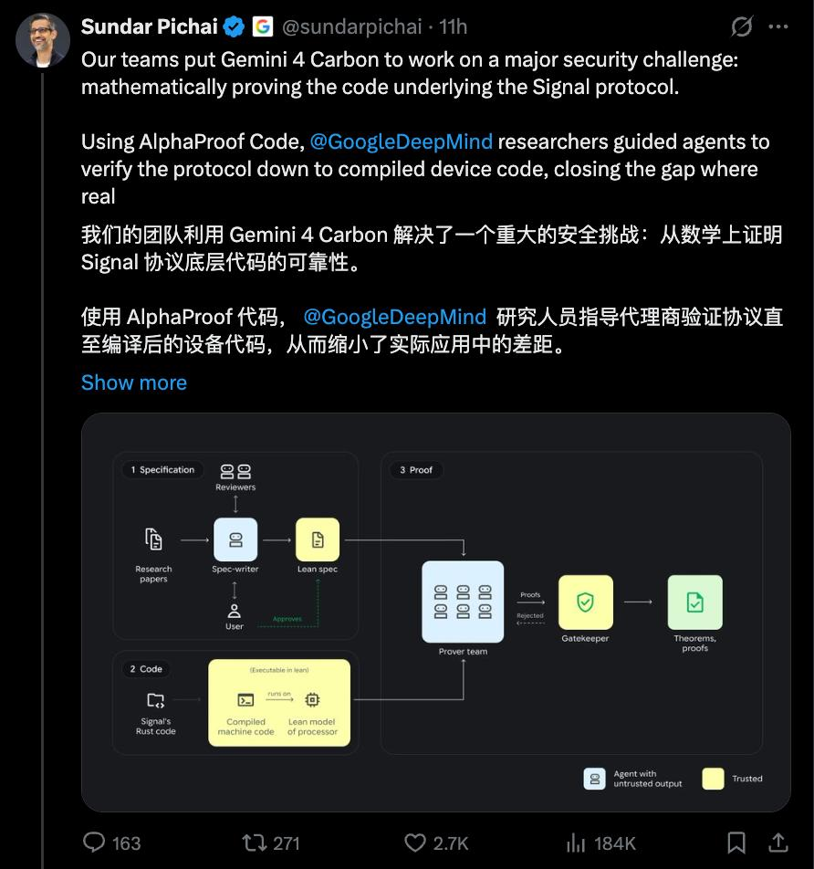
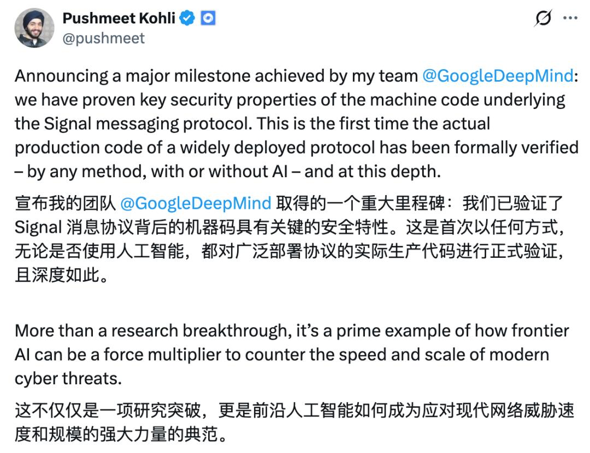
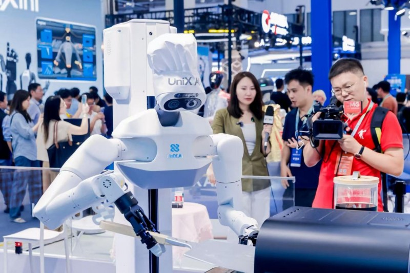
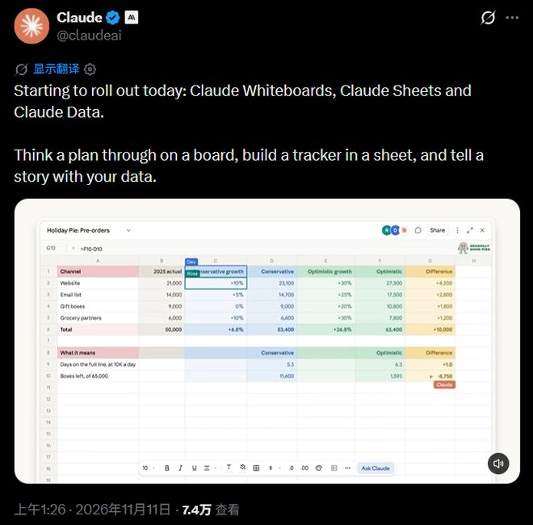
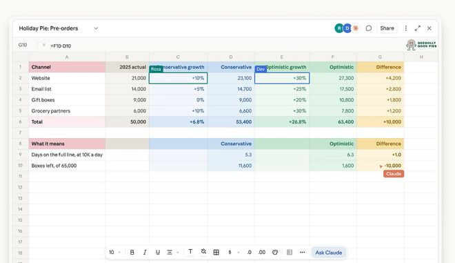
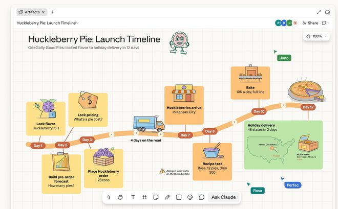

> 今天 AI 圈四条消息，我先说那个刺眼的反差：机器用四周写出了 650 万行机器验证的数学证明，人却还在排队等号复核。我把这条说清楚，再补三条离普通人更近的。

## Gemini 4 Carbon 全量放开，650 万行证明才是重点

Google 在 11-10、11-11 把 Gemini 4 Carbon 面向全球开发者与企业全面开放。入门价每百万输入 token 2 美元，约为 GPT-6 Astra 的五分之一。同步在 Antigravity 平台预览 /swarm 多智能体蜂群：一条提示词就能拉起一支协同 AI 团队。

真正的重点是 AlphaProof Code。DeepMind 让一群由 Carbon 驱动的 agent，在四周内生成约 650 万行经机器验证的 Lean 证明。这些证明把 Signal 加密协议的核心代码，从设计层一直验证到编译后的 AArch64 机器码。过去这类形式化验证要专家团队耗数年。编码智能体的价值重心，正在从「写代码」挪到「编排与验收」。

## 打假：650 万行证明，哪句是真的

多家媒体把这件事写成「AI 让代码永无漏洞」。我查了 DeepMind 官方博客和论文摘要，给这件事评 ★★★★。但边界得讲清：验证的是特定版本的 libsignal 核心实现，不是整个 Signal App。人类专家仍要定义并审核安全规格。另有约 1% 的代码库还需人工复核。把它理解成「形式化验证的成本被 agent 砍了下来」，比「代码永无漏洞」准确。

> AI 四周写出 650 万行数学证明，人类的代码评审还在排队等四倍时长——机器开始替你交卷，人还在替机器看卷。

## 优理奇机器人拿了 5 亿，绿地进场

苏州的优理奇机器人（UniX AI）在 11-09、11-10 宣布完成 5 亿元 Pre-A。绿地集团作为战略方入局，柯力传感、华工创投等跟投。公司称月交付峰值已超 300 台，落地到安防、酒店与养老，绿地还规划在安保、酒店、养老三类场景合作。

今年机器人融资整体在收紧，但能拿出真实交付和下游场景方的项目，钱照样追着给。绿地这种物业和地产方进来，说明机器人开始从展会 demo 往日常运营走。我更看重另一头：今年钱开始挑项目，比谁真能上岗、真出货，比谁只会演示。

## 大模型从聊天框变成操作台

Anthropic 在 11-11 给 Claude 加了表格（Sheets）和白板（Whiteboards）。它还能开会议自动记笔记、更新文档。下面是官方放出的界面。

同一天 OpenAI 推出 "Businesses in ChatGPT" beta。企业可以认领门面，也能建 Business Agent 自动答客。两边干的是同一件事：让 AI 不止对话，还能读写表格、开会议、替企业接客。对普通人来说，可配置的 Business Agent 把接客门槛又压低一截，让 agent 落地少了一道坎。

## AI 设计代工，副业的新切口

行业平台报的价格很实：海报 15 到 50 元、店铺主图套装 50 到 150 元。logo 定制 80 到 300 元，熟练几分钟出一套。再叠上零代码商家智能体搭建，单店 2000 到 4000 元、包月维护 300 到 1500。

「AI 设计 + 智能体」组合着卖，是本地商家轻量代运营一条能复制的路。设计代工利润空间清晰，智能体做成月费制复购稳定。这两个口子还有真实需求、竞争不算大，适合普通人从副业走向稳定小创业。我自己的判断是，这一行值钱的不是模型，是「这事交给你准成」那句承诺。

---

额度都是有时效的，看到就先去点一下。
发现哪条已经结束了，欢迎在评论区指正。
