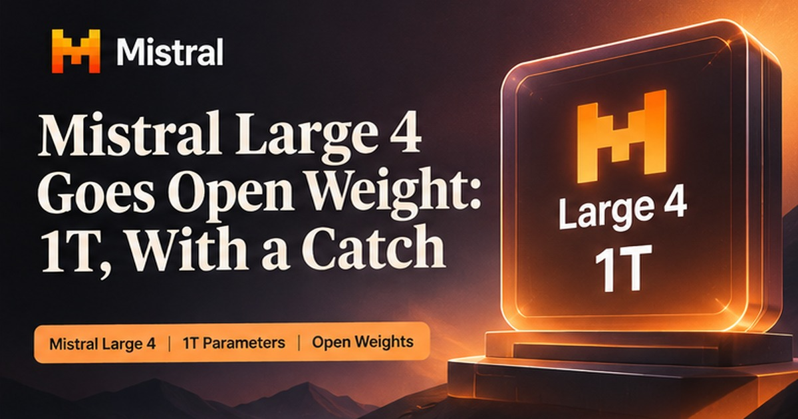
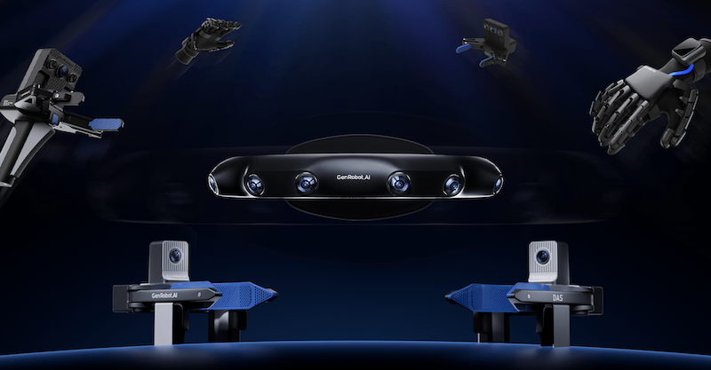

万亿参数的大模型，现在能下载到自己服务器上跑了。

Mistral 这次把 Large 4 的权重整个开源。一万亿总参数、约五百亿激活、一百万 token 上下文，图文都能吃，主打写代码和防黑客。我第一反应是——企业自托管最强代码 AI 的门槛，被它一次性踩平了。

## Mistral 把万亿模型扔进开源池

成绩挺实在。Terminal-Bench 4.0 干到 41%，比预览版多 13 个点，输出 token 还少三成；综合编程榜 48%，和 GLM-5.3 打平，但每道题少烧 47% 的 token。API 价压到 0.7 美元输入、2.1 美元输出每百万 token。安全维度也硬，恶意请求拒绝率 96.6%，是开源模型里最高的。

可你细看许可就乐了。改、用、卖都免费，前提是不拿它做"模型即服务"。要做 MaaS？得再单独签一份商业许可。这波开源，更像是给个人玩家发门票，企业想靠它赚钱还得补票。

我的判断：欧洲实验室第一次拿出能对标开源前沿的"主权 AI"候选。对普通人，这是自托管自由；对顾问，MaaS 许可的坑又是一片新蓝海——帮企业私有化部署、过合规，一单两千到一万。

## 机器人公司不造机器人了

简智机器人（GenRobot AI）刚拿了 1 亿美元 A+。投资方名单才好看：上汽、百度、银河通用、首程控股。它压根不造机器人本体，专做"教机器人干活的数据"——让人穿戴设备录动作，再清洗标注成数据集。

它已经开源 1.3 万小时数据，单月下载破百万，手里还攥着超百万小时。背景更逗：今年上半年全球人形机器人卖了 19100 台，同比涨 272%，中国占 97% 以上；全年融资 121 笔、超 82 亿美元，中国笔数和金额都第一。

结果资本发现，造身体的钱不好赚，卖铲子反而先拿到大钱。上汽百度排队投数据层，等于在说：你们卷机器，我卖你们 shovel。这路子和当年云厂商不卖应用、卖算力一个道理。

## 副业终于不卖课了

早年 AI 副业等于卖课加卖提示词包，割完一波又一波。现在零代码平台（扣子、Dify、飞书多维表）成熟了，有人把"做着玩"做成了交付生意。

帮商家把客服、获客、内容流程固化成自动跑的智能体，一单几千到几万。电商客服智能体 2000 到 4000 一个，月接三五单就月入过万；本地代运营 300 到 1500 一家一个月。卖的不是代码是方案，和早年卖课有本质区别。

区别在哪？卖课教你怎么用，卖方案直接替你跑起来。一个靠复购焦虑，一个靠复购结果。这届副业，总算从"教学费"毕业到"交结果"了。我更看好后者：技术只是门票，确定性结果才是收银台。

---

额度都是有时效的，看到就先去点一下。
发现哪条已经结束了，欢迎在评论区指正。
