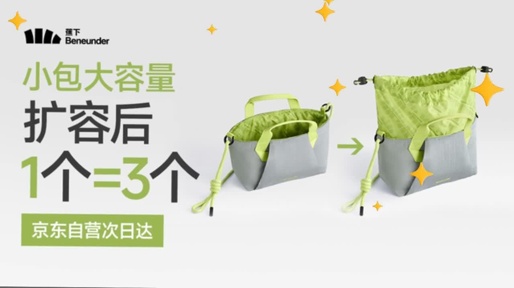
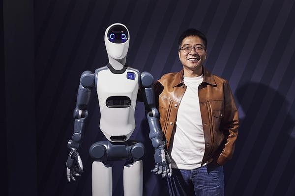
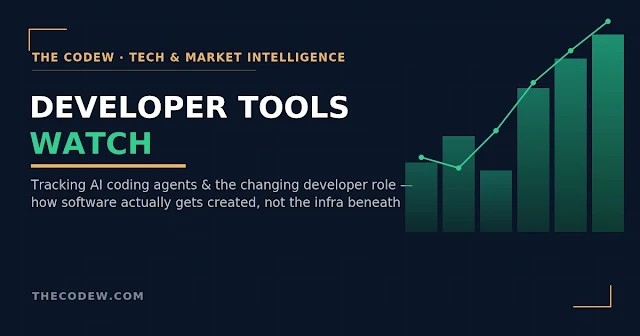

写代码的人，这几天有点像突然被提拔的包工头。模型谁更强已经不是重点，重点变成谁能把一窝 agent 排好活、盯住别把活干砸。机器人那边也在换打法：融来的钱不再拿去炫技，而是去抢工厂的产能。普通人这头，副业也从卖课滑向了卖方案。三条线今天拧在一块儿：编码在拼编排、机器人在拼产能、普通人在拼交付。看了一圈，我的判断是今年年底前这条线上的动作只会更密。

## 思灵 5 亿美元，软银领投

思灵机器人（Agile Robots）11 月 12 日宣布 F 轮 5 亿美元，投后估值 85 亿美元，软银领投，英伟达、日立、T.Capital 跟投，累计融资到 20 亿美元。我在打假里交叉核对过：官方稿加上腾讯、网易、同花顺，再加三家外媒，核心数字零出入，靠谱度给四星。资金明确用于扩产和全球市场布局，不是又一轮纯估值游戏。

它的新基地在慕尼黑附近，年产能上限一万台足式和轮式人形。注意是"产能上限"不是已交付，这口径得留着。但 2 万套工业机器人方案已经铺出去，10 月它和英伟达在 GTC 联合发了科研人形 Agile ONE SN，深度接进 Isaac GR00T 生态。软银加英伟达这个组合，把"人形机器人进工厂"从发布会推到了量产线，这比单笔融资更值得盯。国际资本在物理 AI 上加注，节奏比上半年明显快了。

## 曦选创智 5 亿元天使

端侧也在动。曦选创智 11 月 12 日完成 5 亿元天使轮，纪源、经纬领投，估值 40 亿。它由沐曦股份、优必选和锋龙今年 5 月合办，首颗芯片要做机器人"大小脑一体"主控 SoC，走国产 GPGPU 架构，目标压过 NVIDIA Thor，2027 年给验证平台、2028 年出片。沐曦给算力、优必选给本体、锋龙补齐制造，三家各出一块拼图。

我的看法：具身智能的竞争正从"本体加大模型"下探到最底层算力。机器人要在功耗散热里完成感知、推理、动作，专用芯片比复用智驾 SoC 更对路。端侧芯片供给还在早期，谁先量产，谁就卡住位置。这类国产专用端侧芯片现在下注，等于提前占坑。

## IDE 变多智能体指挥台

编码这边，JetBrains 11 月 11 日发了 Air，把 Codex、Claude Agent、GitHub Copilot 几个编码智能体塞进同一套工作流，支持并行会话和人工审查。同一周 Google 给 Antigravity 加 Gemini 4 Carbon 和协调智能体群，Cursor 推 Multiplayer，GitHub 把 Copilot 扩成 Fusion。四家往同一个方向挤，不是巧合。

我自己的判断：IDE 正从写代码的地方，变成调度 AI 工程团队的指挥中心。谁能把多个 agent 组织好，谁就握住工作流入口，也多一份议价权。审查权还攥在人手里，这恰恰是现在最值钱的环节。

## AWS 让 agent 自己验

AWS 把自家 426 个云服务做成本地可跑的模拟器，代码全由几十个智能体写成，两个月 29,684 次提交，发布版自带保真度分数 56.5%。谷歌把智能体循环里最常见的"判断"类调用——选工具、查策略、路由模型、给上下文打分——拆成独立接口 Gemini Decision 1，一次前向给 1000 个问题打分、输出不计费。阿里开源 Qwen Code 1.0 的 Harness 内核，美团把 1.6 万亿参数 LongCat-2.5 按 MIT 放开。

AI 编程从"会写"推进到"会自己验证"。这个 56.5% 比任何 benchmark 都诚实——它直接告诉你生成的东西离真实还差多远。编排层不再是某家的黑箱，这点比单次跑分更有看头。保真度分数摆出来，等于把"差多远"从黑话变成了可比较的指标。开源 harness 把编排逻辑摊开，后来者不用从零搭脚手架。

## 副业从卖课到卖方案

普通人用 AI 智能体赚钱，今年跑出几条实路。

智能体定制，基础版 500 到 2000 元、定制版 3000 到 10000 元、月维护 500 到 2000 元；工作流自动化，标准化 300 到 800 元、年服 2000 到 8000 元。教程录播 99 到 399 元，本地商家代工 300 到 800 元一家一个月。海外 2026 年 AI agent 市场 109.1 亿美元，企业部署平均 ROI 171%。零代码平台拖拽就能交付，门槛在行业理解不在技术。

但平台已经收紧无脑灌水流量，AI 产品也有生命周期，能活下来的只有"AI 辅助、人工校验、真实经验"这一条。想入场别囤课，先拿免费工具跑通一条最小闭环：做 Demo、定报价、内容获客，再横向复制。

---
额度都是有时效的，看到就先去点一下。
发现哪条已经结束了，欢迎在评论区指正。
