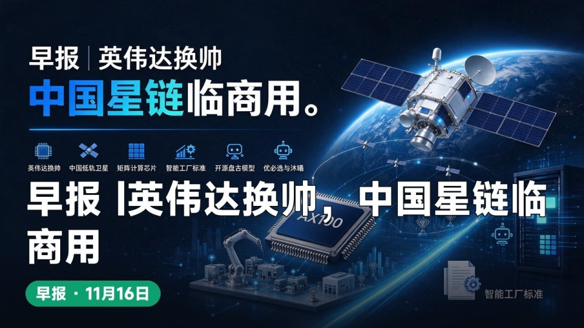
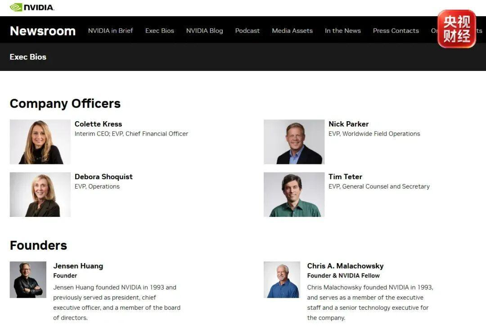
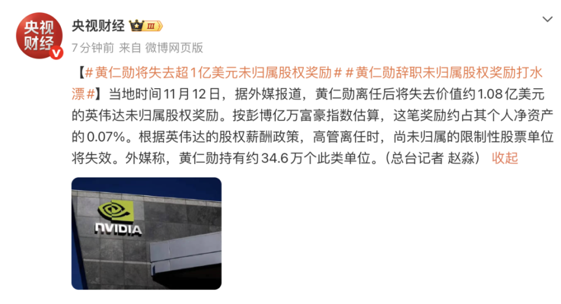

> 今天 AI 圈最重的一块石头，落在了英伟达头上。掌舵 33 年的黄仁勋辞任 CEO，一周市值蒸发约 3.8 万亿元。我把这件事拆开讲清楚，再补三条——国产模型集体进生产、机器人开始在真实产线打卡、副往窄里走。四条线拧在一起，指向同一个词：确定性。

## 黄仁勋离任，市场连夜重算供应链这笔账

当地时间 11 月 12 日，英伟达宣布创始人黄仁勋辞去总裁、CEO 和董事席位，即刻生效。CFO 科莱特·克雷斯接任临时 CEO，公司同时启动正式遴选。官网当天把他从高管名单移除，只留创始人一栏。

导火索是个人品行问题。黄仁勋 11 月 8 日在内部信中承认对妻子不忠，董事会随后启动独立调查。四天后，辞呈落地。

我盯着的是市场的反应。消息出来，英伟达股价盘中一度跌超 14%，收盘跌 4.34%，一周市值蒸发约 3.8 万亿元。A 股产业链 11 月 13 日跟着受挫，天孚通信、胜宏科技跌约一成，生益科技跌停。

起初我也以为业务要断。转念一想，没那么快。公司反复强调产品路线图和客户承诺延续，多家英伟达供应商对媒体说合作没有变化，算力卡价格也没显著波动。真正的不确定性在华盛顿——黄仁勋一直反对收紧对华芯片出口，他要在感恩节前出席国会听证。这个位置空出来之后，政策天平往哪边倒，比谁接班更值得盯。

## 国产模型同一天集体进了生产

黄仁勋前脚交出帅印，美团后脚把一份开源指南里的 NVIDIA 选项删了。

巧不巧？偏偏挑这天。美团以 MIT 协议开源 LongCat-2.5，1.6 万亿参数、100 万上下文，训练和自托管全跑在国产加速器上，自托管指南以 194 张华为昇腾为基线，压根没给 NVIDIA 留位置。成绩是分裂的：Terminal Bench v2.1 拿 88.4，到更难的 v4.0 掉到 38.5。分数我倒没太在意，真正值钱的是那份"不用英伟达也能跑通超大规模 MoE"的施工图。

同一天还有两件事。华为云在 MaaS 上线盘古 2.1-Pro，推理每百万 token 输入 0.8 元、输出 3.2 元。经济参考报说，英国金融科技公司 Revolut 把约 2000 名工程师的默认编程模型换成智谱 GLM，公司称编程耗时缩短约 60%、调用成本降近 90%。百度则发布文心 5.5 Flash，顺手推了个叫"词元所"的平台，专门核验模型真伪——针对的是中转站偷换模型、虚标参数。

参数竞赛已经不是主线了。能不能进生产、能不能被核验、能不能算得过账，才是新门槛。

## 机器人上奔驰产线拣料，成功率 96%

这条最容易被"96%"这个数字晃过去。

谷歌 DeepMind 的 Gemini Robotics 2.5 驱动 Apptronik 的 Apollo 2，站上了奔驰在匈牙利和德国的产线——注意，是正在生产汽车的产线，不是展厅。任务是按装车顺序从料箱里拣金属支架，成功率 96%。新模型在 200 多项任务上比前代成功率提升 30% 到 100%，速度快 20% 到 30%。

DeepMind 的总监自己把话说得很克制：人做这类任务几乎不出错，弥合最后 4% 仍是一条陡坡。这句话比 96% 更值得记。

同一周还有两个方向相反的例子。德国 Neura 把 4NE1 送进电网变电站，实地试点排在 2027 年;而成立仅 9 个月的无境动力，账面上 1.1 亿元融资、近 10 亿元框架订单，交付记录是零。资本也在换口味：10 月具身智能融资 33 笔，比 9 月的 60 笔接近腰斩，钱开始流回半导体这类每台机器人都绕不开的上游。

不看演示，看交付。这已经是行业这周的共识。

## 副业往窄里走，能收费的都是"偏头痛"问题

最后这条离普通人最近。

做 agent 副业，到 11 月已经不用自己写代码。掏得出钱的活儿都在窄处：本地小店内容代运营，月费 500 到 1500 元一店;垂直行业小助手定制，搭建费 500 到 2000 元加月维护;个人提示词包，9.9 到 39.9 元挂闲鱼。收入按三层走——接单交付、模板复用、资产沉淀。

我更看好两个新方向：Agent 安全审计即服务，帮企业查投毒、越权调用;还有把开源具身模型落到自己边缘盒的部署托管。门槛都不在模型。集成、护栏、监控，这些没人爱干的活才是真门槛。

说句实在的，凡是先收会员费、培训费，宣称"日结 300 躺赚"的，都是骗局。

## 一条需要拆口径的消息

今天还有个数据被自媒体写飞了：Anthropic 11 月 19 日上市，估值 1.4 万亿、募资 900 亿，被叫"史上最大 IPO"。

数字来自 SEC 文件，没错。但"1.4 万亿"是完全稀释口径，按发行价上限算的实际市值约 1.02 万亿。被反复引用的"净亏 1040 亿"，其中约 943 亿是可转债公允价值上升带来的非现金费用——公司估值涨了，账面负债跟着涨，并非真金白银烧掉。同期经营亏损其实从 52.2 亿收窄到 12.6 亿。

我给这条三星：事实为真，口径得拆。下次看到"全球第三大公司"这种说法，先问一句是哪种口径。

四条线看下来，从算力龙头的人事到普通人接单，今年年底前最值钱的三个字都是同一句：确定性。供应链要确定、模型要可核验、机器人要能交付、副业要有人肯为结果付钱。谁的确定性先立住，谁就先拿到下一轮的票。

---

额度都是有时效的，看到就先去点一下。

发现哪条已经结束了，欢迎在评论区指正。
