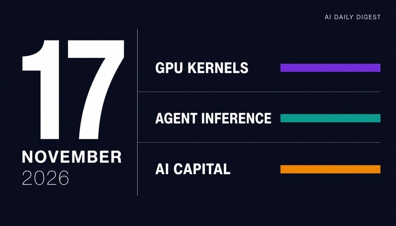
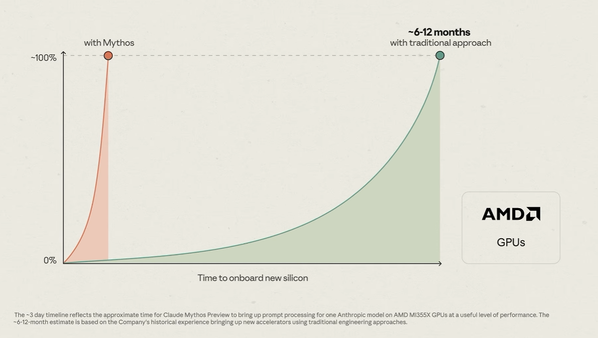
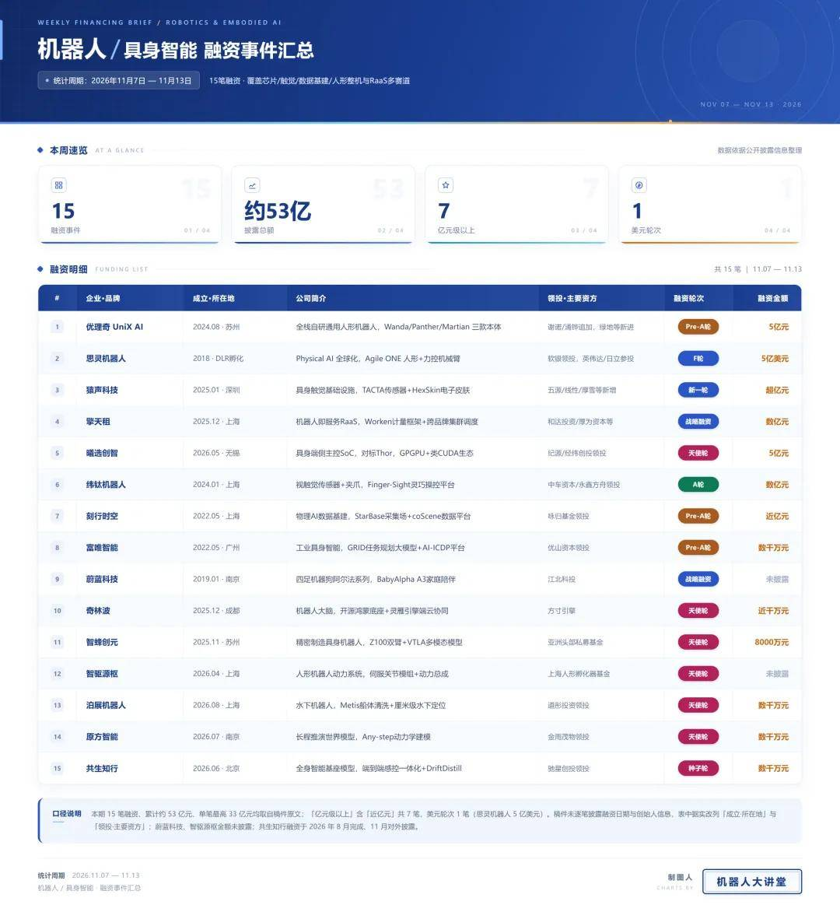
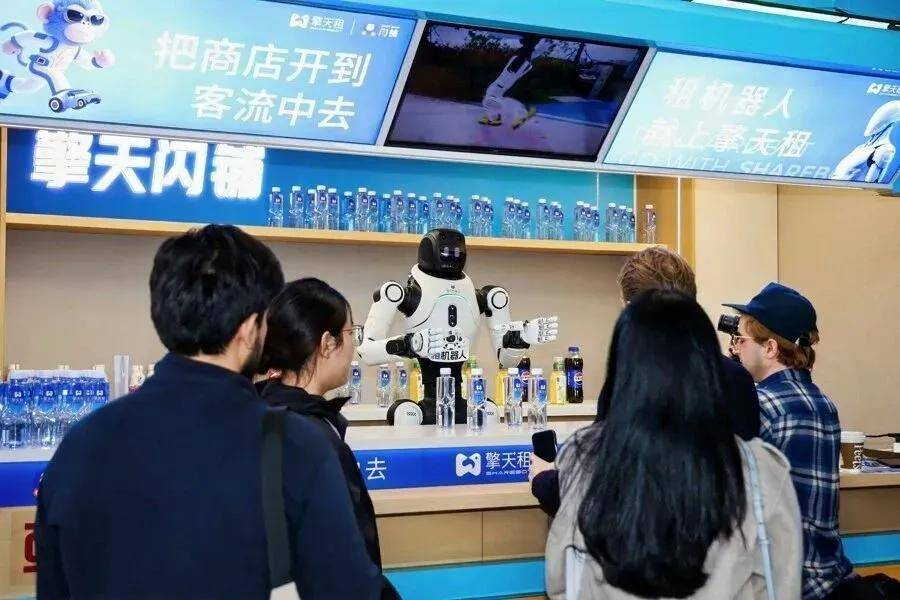
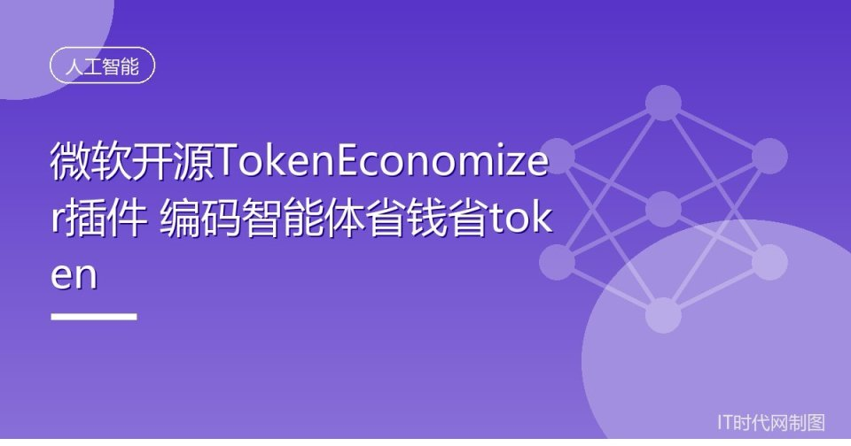

> 今天最炸的一个数，是「3 天」。Anthropic 在 IPO 路演里说，Claude 用三天就把自己搬到了 AMD 的芯片上。我把那张图翻到底下，看见一行脚注，味儿就变了。同一天，机器人行业把「最后一厘米」写成三个能招标的数字，编码智能体开始比谁更省钱。三条线都指向一件事：数字得看口径。

## 三天换芯片，脚注却把范围缩到一半

11 月 10 日，Anthropic 把招股书递到 SEC，11 月 19 日以代码 ANT 挂牌。路演视频里，联合创始人兼首席算力官 Tom Brown 说了句狠话。自家前沿模型 Claude Mythos，三天，就让 Claude 跑上了 AMD 的 MI355X GPU。几乎没人插手。

起先我也信了。照这个说法，英伟达那道靠 CUDA 砌了近二十年的墙，一夜就被推倒。可我去翻那张图的脚注——

三天，指的只是「一个 Anthropic 模型、在 MI355X 上、做到『有用性能水平』的输入处理」。输入处理是推理的前半段，模型读入你那句话。后半段，也就是生成回复，一个字没提。图表横轴写着「把新芯片上线所需时间」，两条线都画到「约 100%」。可 100% 是什么，没人说。

六到十二个月这个数，脚注也交代了，来自公司自己过去用传统方法引入加速器的经验。拿自家历史估值当行业标尺，这账不能这么算。

还有一层。英伟达和 AMD 都是这次 IPO 的认购方。卖股票的材料里，说自家投资人的芯片容易被撬动，这话值得多想一秒。我给这条三星：事情是真的，口径得拆。

那道墙没倒。只是有人第一次认真量了量它有多高。

## 机器人开始盯「最后一厘米」

11 月 16 日，《人民日报》第 18 版用整版写灵巧手。核心零部件百分之百国产化，精度 0.1 毫米级，寿命突破 100 万次。记者手记里有句话我记下来了：灵巧手，是机器人走向物理世界的最后一厘米。

北京那份 2026 到 2028 年行动方案，把这一厘米拆成三个数字，都能拿去招标。额定负载寿命 100 万次，指尖分控分辨率 0.1 牛，单只成本一万元以内。

口号归口号。这三个数写进了方案，能拿去验收。一个行业成熟不成熟，我只看它有没有从「讲故事」走到「填参数表」。

出货预期也在往上调。《证券时报》说，摩根士丹利把中国 2026 年人形机器人出货预测，从 2.8 万台上调到约 5 万台。高盛给的是 5 万台以上。方向上机构没分歧，争的是节奏。

资本那边反倒收紧了。中国经营报统计，11 月前 11 天具身融资 15 起、约 40 亿元。钱开始绕开造整机，流向触觉传感器、关节模组这些上游。上面那张汇总表更细：7 天 15 笔、约 53 亿元，单笔最高 33 亿。

造得出来，已经有答案。用得住、用得起，才是这一厘米真要回答的问题。

## 编码智能体开始比谁更省钱

11 月 17 日，腾讯新闻报道了一件事。加州大学伯克利分校、微软研究院和微软安全团队联合开源了一个插件，叫 TokenEconomizer。它让编码智能体从同一仓库的历史会话里学经验，复用验证过的操作路径，少做重复探索，省下 token。有个关键：不用改智能体本身，也不用改底层模型，在现在的流程上直接加装就行。

另一个例子更直接。Parcha 这家公司给 AI 审查工具 Greptile 付月费。账单从 2025 年 12 月的 180 美元，涨到 2026 年 11 月的七千多美元。自家编码智能体开的 PR 越来越多，按量计费的账单跟着滚。

Parcha 没接着付，索性开源了一套自建审查器，用便宜模型把单次成本压到约 18 美分。它在自己仓库留出 30 个 PR 做测试，抓到的真实缺陷比例是 42%，Greptile 是 26%。

这个对比有前提。仓库是它自己的，答案也它自己判，没有可比的误报率。所以 5 比 1 只能当参考，不能当结论。方向我倒认——用量定价的 AI 服务，正把「省 token」本身做成一门生意。

## 三条线连起来看

副业那边，被点得最多的还是老一套。本地小店内容代运营，月费 500 到 1500 元一店。垂直行业小助手，搭建费 500 到 2000 元加月维护。一人公司配营销智能体，一个人维护七八家店。凡是先收会员费、培训费，宣称日结三百躺赚的，直接划走。

今天这三条，看着不搭界，卡住的却是同一个地方。芯片那条数字很炸，你得翻到脚注。机器人的指标够硬，硬到能拿去招标。写代码这条最实在，账单贵到逼人自己造替代品。

我判断，接下来该盯的是三件小事：谁把口径写清楚，谁把指标摆上验收台，谁真帮人把成本降下来。参数谁更大，先搁一边。省下的每一分钱、设好的每一个数字，到头来都得有人肯为它买单。

---

额度都是有时效的，看到就先去点一下。

发现哪条已经结束了，欢迎在评论区指正。
