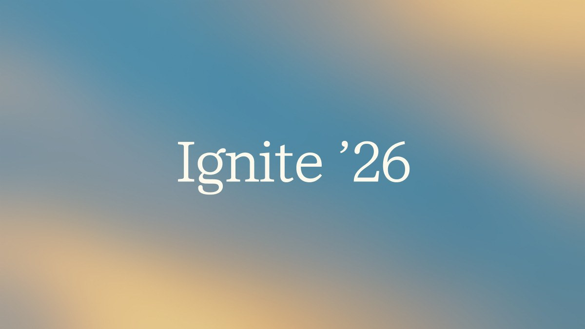
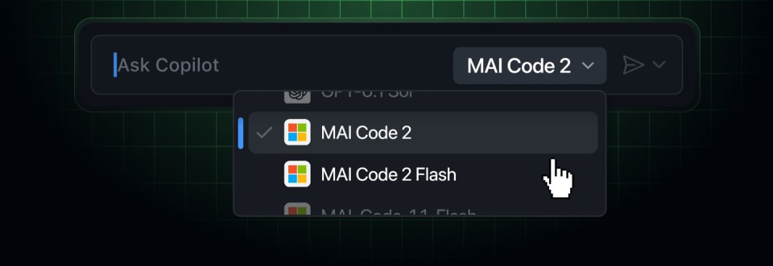
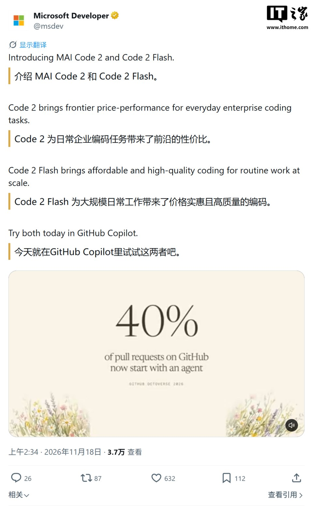
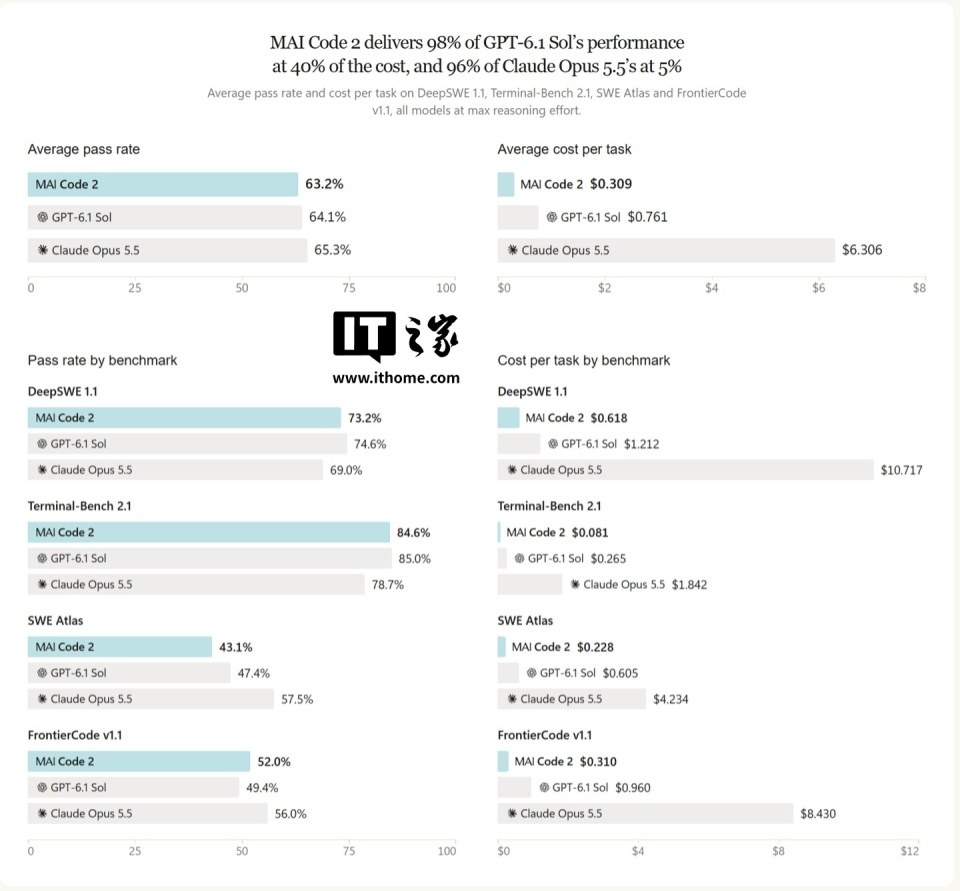
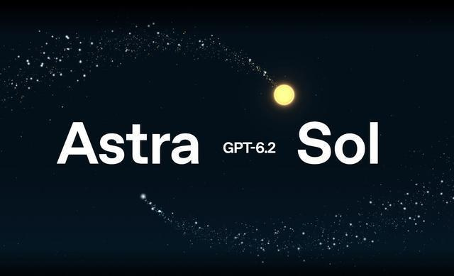

> 今天最抓眼球的数字，是「5 美分」。微软在 Ignite 上把编程模型打到每次任务五美分，标题一个比一个猛。我把发布页翻到底下，看见脚注里写着「50% 促销价」，味儿就变了。同一天 OpenAI 也发了新版，机器人行业拿到了一套能招标的等级标准。三条线讲的其实是同一件事：数字得连着口径看。

## 五美分的那行脚注

11 月 17 日，旧金山 Ignite 2026 大会。微软 MAI 团队一口气发了七款自研模型。编程那两款，叫 MAI Code 2 和 Code 2 Flash，已经在 GitHub Copilot 上线。

官方口径很猛。四项编程基准平均下来，Code 2 做到 GPT-6.1 Sol 约 98% 的表现，价格约 40%。对着 Claude Opus 5.5，是约 96% 的表现、5% 的价格。折算单次任务成本 0.309 美元，Opus 5.5 是 6.306 美元。轻量版 Flash 在五折促销价下，最低 5 美分一次。

我起初也觉得这是把桌子掀了。且慢，翻到产品页脚注，一句英文：成本按 50% promotional price 计算，藏在页面最底下。最抓眼球的两个数字，5% 价格和 5 美分，都是拿打折的自己，去比没打折的对手。促销一停，账得重算。

这四项基准也是微软自己选、自己跑的。Open Loop News 直接点明，tests are Microsoft's own，没有第三方复现。苏莱曼在 keynote 里也承认，这些模型「尚未针对最难的问题和超长程智能体任务调优」。所以那个 96%，只在「企业日常编程」这个划好的赛道里成立。

便宜是真的便宜，我没打算否认。AT&T 拿定制版 Code 2 Flash 做 5G 网络分析，微软说它比 GPT-6.1 Sol 强，还便宜 50 倍。这是厂商举的例子，我没查到独立测试。我给这条三星：数字能追到官方一手源，但四个前提得摆齐——自测、五折、限定赛道、最难任务没调。少看一个，账就算歪了。

## 同一天，OpenAI 也在按计算器

11 月 18 日，OpenAI 发布 GPT-6.2 Astra 和 GPT-6.2 Sol。官方说法，复杂工作流的 Agents' Last Exam 测试比上一代高 5.2%，成本不到三分之一。对比 Claude Fable 5.2，高 5.5 个百分点，单项任务成本约其 5%。Sol 面向日常办公。

把这条和上一条并排看，有意思的地方出来了。一家喊我便宜，一家喊我降价还变强，谁都没提第三方复测。9 月那版 GPT-6 Astra，优势被 Claude Fable 5.2 和 Gemini 4 Carbon 迅速追上。背景在这儿。

我判断，模型圈的裁判正在换人。以前看榜单分数，现在看每美元能买到多少可用产出。对我们这些掏订阅费的人，这是好事。对做 AI 应用的人，选型那本账得重新算一遍——参数和价格都在动，只盯一头的会吃亏。

## 机器人拿到了一把标尺

11 月 16 日，工信部发布 2026 年第 30 号公告，五项人形机器人行业标准即日实施。智能化能力分级、一体化关节、灵巧手、训练场、训练数据，写进同一批文本。能力按感知认知、决策学习、执行表现、协作交互四个维度，从 L0 排到 L5。

要说清一点：这是行业标准，跟国家标准是两码事。它的用处是给采购和检测一把公共尺子。过去具身行业各说各话，谁都能说自己先进。现在有了分级，能力能拿去招标、能拿去验收。一个行业成不成熟，我看它有没有从讲故事走到填参数表。

同期小鹏在三季度财报会上把 IRON 定档，2027 年 1 月 1 日启动量产，二季度对外交付，首条产线核心工序自动化率超 80%。时间表精确到日，这是进步。

但标准生效，和厂里的机器按等级交货，中间隔着检测和宣贯。还有一面更值得记。Genesis AI 刚拿了 5 亿美元 A 轮、投后估值 35 亿美元，创始人转头承认，灵巧手正常工作大约几周就要更换。估值按年写，零件寿命按周算。这落差，比任何口号都说明问题。

## 副业那条路，还能走吗

本地商家营销智能体代运营又被反复点名。月费约 1000 元一店，一个人维护七八家店，内容、数据采集、定时发布、回评论都交给智能体。海外对应的做法是微型 SaaS，用无代码加 AI 接口做只解决一个细分问题的工具，典型月经常性收入 2000 到 10000 美元。

两条路都避开通用红海，切结构相似、需求高频、大厂看不上的窄场景。这些数字多来自从业者自述，我没看到审计，别当成保证。

今天这三条，看着不搭界，卡住的却是同一处。编程那条数字最炸，你得翻到脚注看是几折。机器人的指标够硬，硬到能写进招标书。副业最实在，账要自己一笔笔算。

我盯的是三件小事：谁把口径写清楚，谁把指标摆上验收台，谁真把成本降下来。参数谁更大，先搁一边。

---

额度都是有时效的，看到就先去点一下。

发现哪条已经结束了，欢迎在评论区指正。
