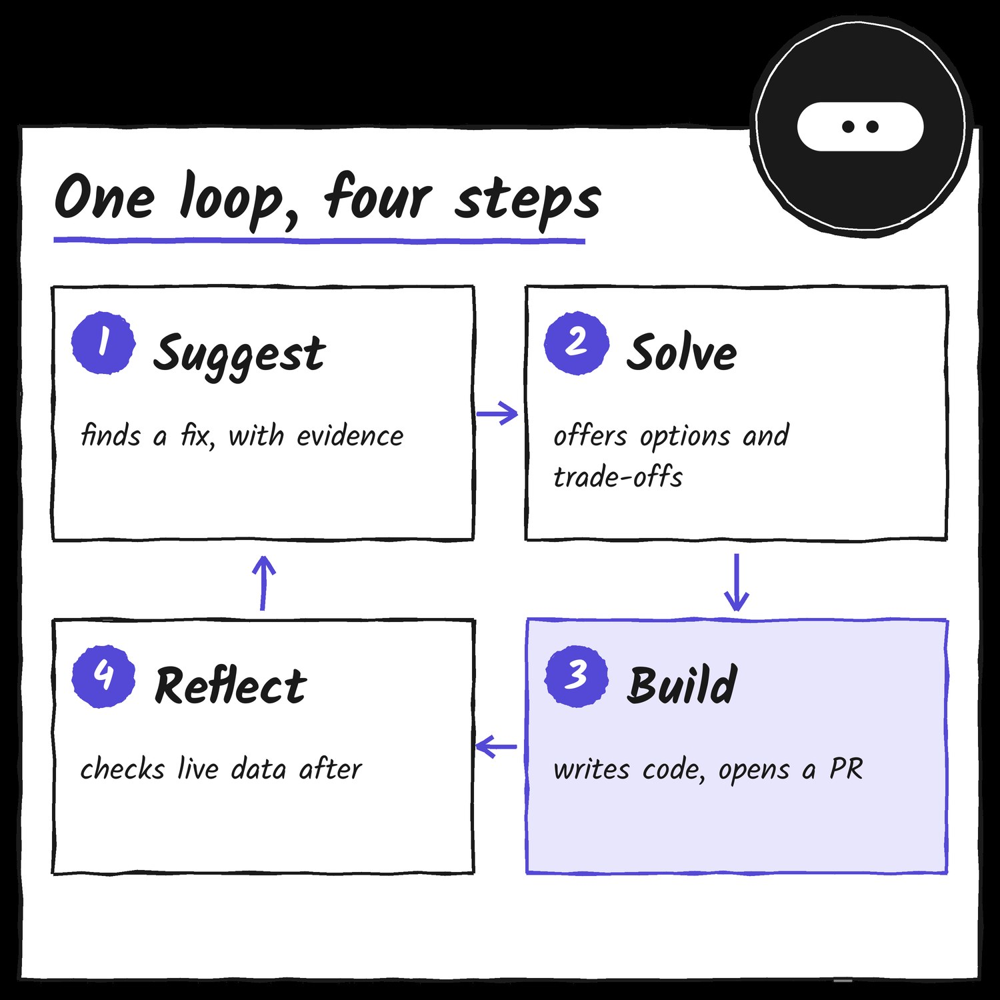
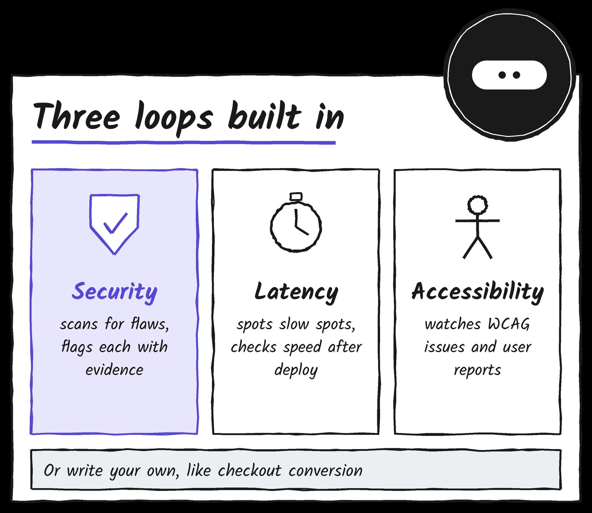
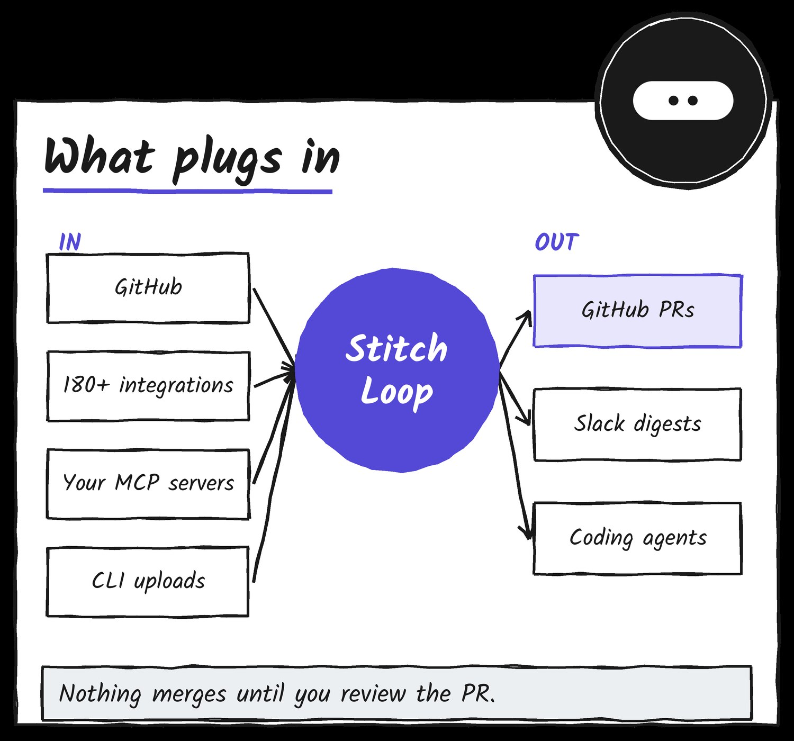
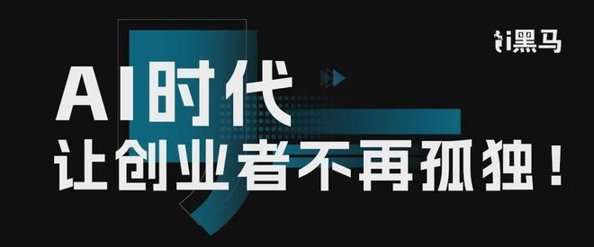

# Anthropic今日开盘1.4万亿，买单的三家也是供应商

今天纳斯达克多了一个代码：ANT。Anthropic正式开盘，成了美国第一家上市的前沿模型公司。我把招股书翻到后面，1.4万亿那行字之外，围着它站了一圈自己人。这个更值得看。

## 1.4万亿这个数，要除三次才看得清

11月19日，Anthropic以代码ANT开始交易。前一天定价落定：每股70到78美元，发行8.25亿股，公开发行规模约578亿到644亿美元。完全稀释估值约1.26万亿到1.41万亿美元，按当前流通股算约1万亿。订单据报约为可售股份的六到七倍。高盛和摩根士丹利牵头承销。

1.4万亿除三次，得到三个答案。按10月底810亿美元的年化收入跑率，市销率约17倍。换成过去四季度实际入账的352亿美元GAAP营收，是约40倍。再按路演口径把算力和基础设施费用全扣掉、只留约43%，接近93倍。承销商和多数买方挑了17倍那一档。

我在招股书里翻到另一组数。截至2045年的采购和租赁承诺接近9000亿美元，约707亿美元要在未来12个月内付掉。可撤销客户合约的剩余待确认收入，只有约138亿美元。成本按十年排，收入按月走。且慢，这里得停一下——这是我最在意的地方。

那句扎心的吐槽我留着：同一个价签除以三个分母，算出17倍、40倍、93倍。买家挑最好看的那道题做，市场却要它每个季度用最难的解答。

## 英伟达投100亿，谷歌亚马逊合起来持股28%

真正让我停下来的是股东名单。英伟达在同步私募配售里认购约100亿美元。亚马逊和谷歌在IPO后分别持股约14.7%和13.7%，合计28.4%，且多为无投票权股。

这三家还有另一重身份。谷歌卖它TPU和云容量，亚马逊卖它AWS算力，英伟达供芯片。投进去的钱，一部分顺着算力账单又流回自己手里。外媒把这个结构叫循环持股。说白了——姑且这么说吧，我并不觉得这里头有什么见不得人的事。但买了ANT的人，接下来要盯的正是关联交易。

还有一处。创始人实体在普通股东事项上握有50.1%投票权，另有一份信托能任命董事会多数席位。散户的角度说，话语权基本别指望。

## 谷歌让智能体去管上线之后的事

11月18日，谷歌Labs放出实验产品Stitch Loop。它接的是产品上线之后的活：连上代码库和线上数据，自己盯缺陷、安全问题和性能瓶颈，在隔离沙箱里写好代码，开一个GitHub PR。要人逐条批准，改动才会合并。

一轮循环走四步。提建议、给方案、写代码开PR、盯线上数据复盘。默认带三条，安全、延迟、可访问性。安全那条用Gemini 4 Carbon配DeepMind的代码安全智能体CodeMender。

价格、正式日期、收录人数，谷歌都没公布。我的判断是，编码智能体的活儿正从"上线前写代码"往"上线后守着修"挪。审查这个当下的痛点，被人直接做成了产品本身。

## 机器人圈的两句话，对着听才有意思

雷军说，具身智能机器人的想象空间会超过汽车。同一周，宇树王兴兴说了句大实话：机器人换一个场景就要重新训练，泛化能力还是头号难题。

落地这边，星动纪元的机器人已在广东邮政8市11地常态化运营，海康机器人完成上市辅导备案。钱还在进。优必选和沐曦合资的曦选创智拿了5亿元天使轮，估值40亿；德国思灵完成5亿美元F轮，软银领投、英伟达跟投，估值85亿美元。

喊话按年算，技术卡在换场景。判断谁真落地，我看有没有在真实网点连轴转的数据。发布会先放一边。

## 一人公司的收入账，别只看那个10万

海外有份按月更新的榜单。开源社媒排期工具Postiz，月经常性收入约43万美元。大模型聊天前端TypingMind，约13.7万美元。把照片转成纹身模板的Stencil AI，约4.87万美元，每订阅月付28美元。

国内同日热搜。上海一位00后女生用AI跑选款、看数据、管库存，把穿戴甲卖到海外，单月利润接近10万。

共同点是切一个够窄、重复度高、能被工具完整吃下的环节。定价照着"工作台"来，别学"玩具"。另一面也得看清：榜单里的Heyron上线13天冲到8374美元月经常性收入，随后六个月一路下滑。爆发不等于留得住，有趣得很。

---

额度都是有时效的，看到就先去点一下。

发现哪条已经结束了，欢迎在评论区指正。
