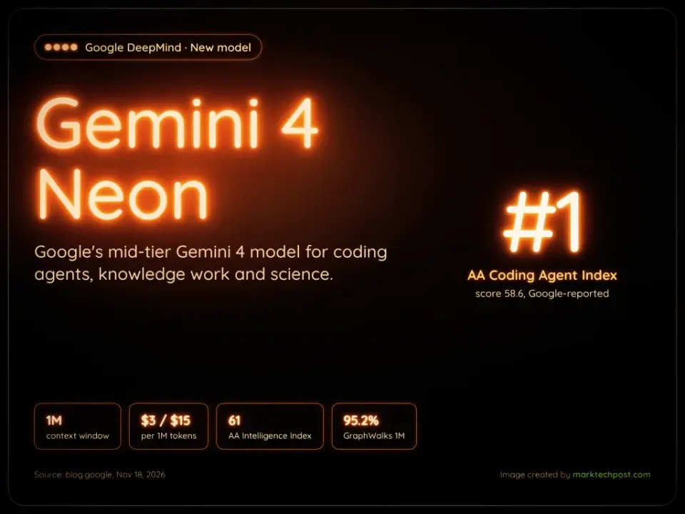
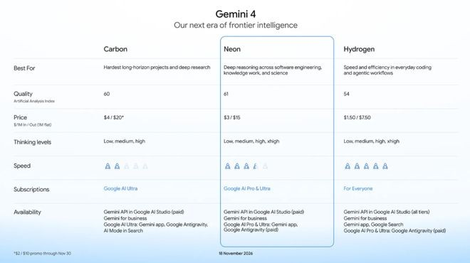
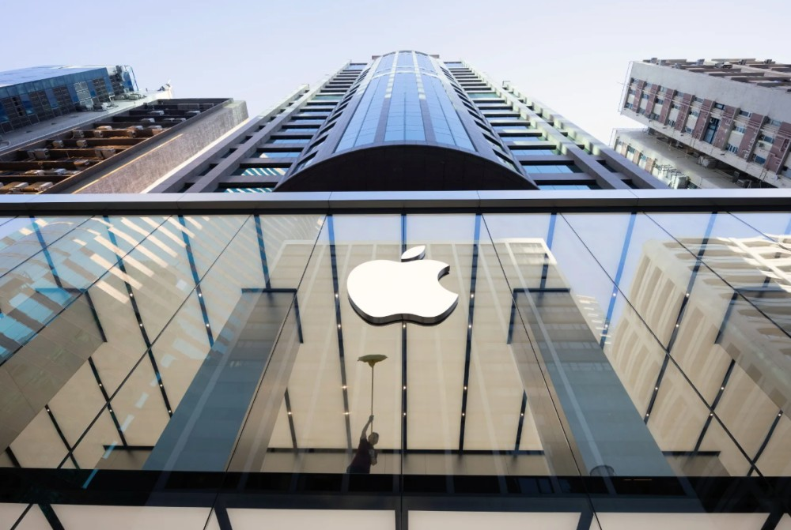
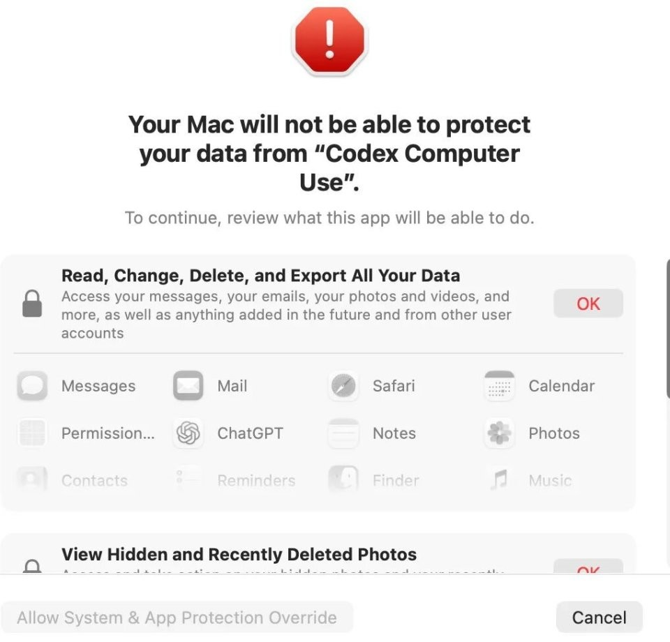
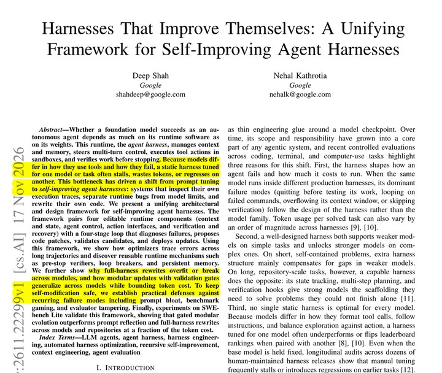
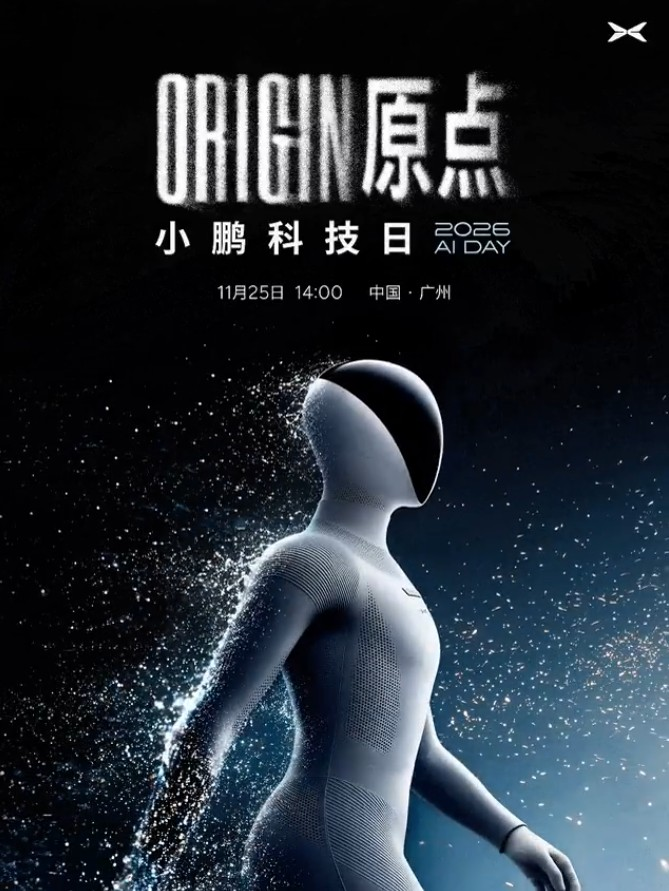

# 谷歌Neon登顶编程榜，便宜三成是跟自家比的

11月19日谷歌把 Gemini 4 Neon 摆上货架，官方那篇博客我读了三遍。榜首那行字很亮，亮到多数人没往下翻第二屏。第二屏里藏着两个分数，还有一句默认 high 档。这才是我想说的。

## 中间档的生意

Neon 卡在旗舰 Carbon 和轻量 Hydrogen 中间。官方的说法是深度和速度都要。100 万 token 上下文，四档思考等级，默认 high、最高 xhigh。API 输入每百万词元 3 美元、输出 15 美元，缓存输入 0.15 美元，官方称打了九五折。它能在 Gemini API、AI Studio、Antigravity 里当编排器，指挥并行的 Hydrogen 子代理。Artificial Analysis 编程智能体指数 58.6 分，居榜首，Claude Opus 5.5 和 GPT-6.2 Sol 排在后面。长上下文的 GraphWalks 榜 95.2%，也在前列。

且慢。这个榜首，是第三方那个编程子榜。换个综合榜，Artificial Analysis Intelligence Index，Neon 在 xhigh 档拿 61 分、排第三——同一家机构，两个榜，两个名次。便宜 32% 那句，原文写的是 compared to Carbon，自家兄弟，且只在默认 high 档；另有一句便宜 36% 以上，比的是竞品的最高档。两句放一起，稍不留神就混成便宜三成打遍天下。我把官方那页纸数了两遍，模型多大、训练数据多少、烧了多少卡，一个没写。它自己倒摆出两项：Terminal-Bench 4.1 是 65.2%，FrontierCode 2.0 是 46.2%，Opus 5.5 这两项更高。登顶是真的，赛道是挑过的。带网安能力的版本还只给通过审核的防御方。姑且这么说吧，我不觉得这里有什么猫腻，但买账之前得看清比分是怎么记的。

## 苹果在招人

彭博社的 Gurman 11 月 20 日说，苹果官网挂出 Agentic AI - Proactive 高级工程经理岗位。招聘词写得像产品文案：像能干的人一样用电脑，在浏览器、文档、终端、代码编辑器之间切换，自主挑工具。它得规划并完成跨应用、跨命令行的多步骤任务，还能协调一群各管一摊的子智能体。摆明了要它真动手，不做只会聊天的摆设。

权限那段苹果写得挺细，沙盒隔离、操作透明，毕竟要拿用户凭据动手。有意思的是时间表——最早 2027 年底，还没定，苹果对置评没吭声。所以这条的正确读法是苹果在招人。招聘启事当发布会读，中间隔着几百个岗位和一个还在换 CEO 的公司。

## 142 行代码

谷歌那篇《Harnesses That Improve Themselves》，做 AI 编程的都该看一眼。所谓 Harness，是套在模型外面的一层运行框架，管上下文、调工具、检查执行结果、决定何时收手。研究里给一套 142 行的编程智能体框架切四块，每轮只许改一块，验证集筛、Token 封顶，过关的留下、不过关的丢掉。在 Gemini 3.8 Flash 上、40 道没参与优化的 SWE-bench Lite 题里，成功率从 5.0% 爬到 40.0%。

放开了让它整体重写呢？42.5%，高那么一点点，每项任务却从 4.67 万 Token 烧到 45.16 万，近十倍。只靠提示词约束？2.5%，比不动还差。我的判断是，改框架这条路走通了，但数字别当通法——40 道题、一个 Gemini 3.8 Flash。方向我信，数值先存疑。

## 机器人算交付账

中国证券报的横账摆得很清楚：赛道全线扩产，口号从造多少台换成能不能交货。优必选柳州万台级工厂投产，众擎深圳基地具备万台交付能力，智元多基地累计下线 2 万台，宇树登科创板后募 6.24 亿建年产 7.5 万台人形、11.5 万台四足的线。灵巧手去年全行业出货约 2 万台，今年预计 6 万到 7 万台。控制器也在放量，仙工智能上半年出货超 8000 台，均胜高算力控制器交付破 2000 套。钱还在进：原力无限三个月连拿四轮、估值近百亿，知行机器人拉上柯力传感，要把力觉模组的 BOM 成本三年压掉 35%。小鹏把科技日定在 11 月 25 日，主题 Origin 原点，IRON 头回走到台前现场互动，计划年底量产、明年上半年交付。

判断谁真落地，我现在只看四样：能不能复制、能不能一致、能不能交付、能不能核算。发布会上那句通用，先放一边凉着。

## 副业卖成品

theaireceipts 榜单 11 月 19 日那版，跑出钱的几乎都是成品。notis.ai 在 WhatsApp 里把语音转任务，约 1.29 万美元月经常性收入；GETebook.ai 选好主题、受众、语气，直接交一本排好版的书，约 1.2 万；Mono 一个订阅聚合 OpenAI、Claude、Gemini 等多家模型，约 1.11 万。共同点是交付一个够窄、重复度高、能被工具整个吃下的环节，按工作台定价，别按玩具。取客的渠道也朴素：X、YouTube、Reddit、开源、SEO，没有一个是靠囤流量。

反面在同一页。GETebook 靠广告投放两个月冲到月入约 4.8 万美元，可多数收入不 recurring，CPM 一涨利润就被挤；Mono 这类聚合生意好上手，模型商一打包、同行一跟进，门槛就塌了。爆发和留得住，是两回事。有趣得很。

---

额度都是有时效的，看到就先去点一下。

发现哪条已经结束了，欢迎在评论区指正。
