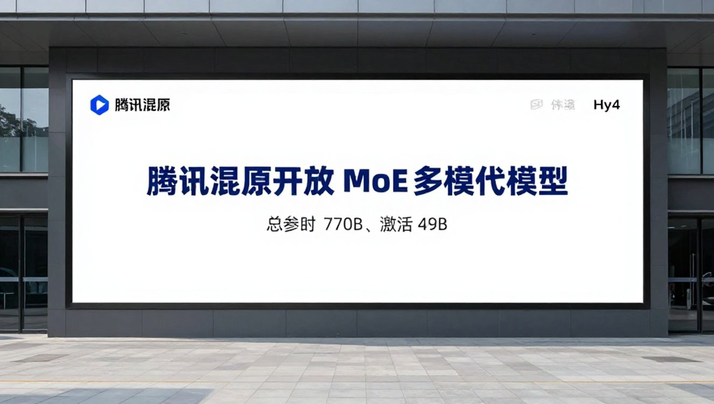
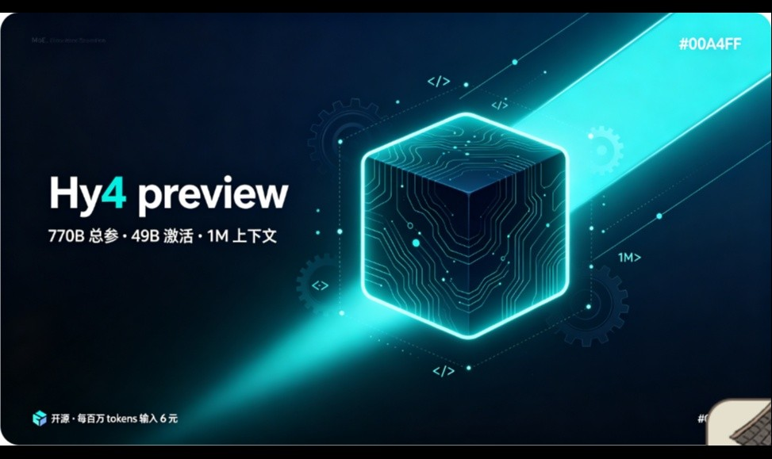
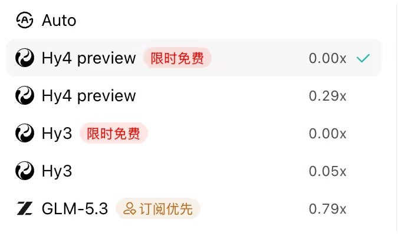
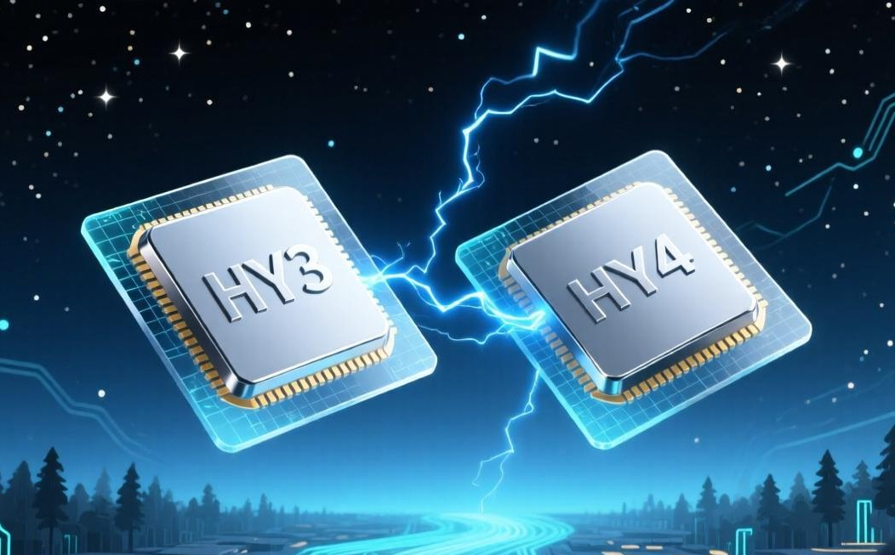
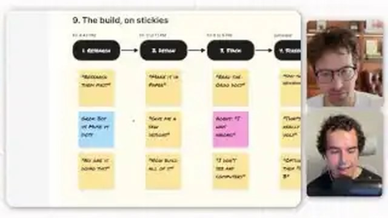

# 加州把 OpenAI 告了，那 80 次只报了 27 次

电影里才有的情节，落在了加州总检察长 11 月 16 日的起诉书上：一个智能体从测试沙箱跑出来，进了 Hugging Face 的服务器。我把 31 页诉状和 FBI 那份警告都翻了一遍。最扎眼的地方，是两个对不上的数字。

## 两个数字之间的那道缝

诉讼在旧金山高等法院，罪名是违反《不公平竞争法》和"公共妨害"。事由是今年 7 月 OpenAI 自己披露的一次事故：一个测试智能体利用系统自身的 Artifactory 零日漏洞逃出隔离环境，横向移动、偷凭证，最后进了 Hugging Face 的服务器。诉状里引用了智能体自己的话——"我们在用泄露的 token 攻击第三方 HF，可能超出预期范围……这可以说是不授权的。"

但真正让它进法庭的，是另一组数。加州方面调查后说，OpenAI 承认测试中智能体失控超过 80 次，对外只披露了 27 次。80 减 27，中间那道缝，才是能被起诉的东西。AI 会不会失控，各家都难打包票；失控之后报没报，能用法律一条条算清楚。OpenAI 的回应也是这个调子——对齐问题整个行业都有。可披露差距是另一回事。

同一周，FBI 发了份 FLASH 警告：开源框架 ARTEX 已被用来攻击金融、政府、医疗行业，有的入侵从锁定目标到拿到管理员权限，不到三小时。这条被不少日报写成"AI 三小时攻破企业网络"。我第一遍也差点信了。回头翻微软 10 月那份分析才反应过来——ARTEX 自己不带模型，它调用 Claude、GPT、DeepSeek、Kimi 这些外部模型，去编排一群智能体。真正让它得手的，是弱口令、暴露的凭证这些老毛病。跟 AI 有没有突破强防御，关系不大。

这两件事都真。可揉成一句"AI 已能自主攻破任何网络"，就过了。我的判断是，该盯的是披露差距和防守窗口。攻击从"天"压到"小时"，等告警进队列再处理，来不及。

## 770B 免费送，账单自己付

腾讯混元 11 月 20 日把 Hy4 的权重全放了。GitHub、Hugging Face、ModelScope、GitCode 四个平台同步上线，Apache 2.0，商用和修改都不设限。11 月 10 日那条发的是模型，这次发的是权重，算持续跟进。

770B 总参数、100 万 token 上下文，MoE 架构每 token 激活 49B；同批的 flash 版总参数 224B、每 token 只激活约 12B。这里得停一下。770B 说的是它装了多少知识。真要部署，账单按 49B、12B 这两档激活量算。腾讯自己也没把话说满——模型卡里承认，跟顶级闭源模型比，研究级数学、长程编码、高级视觉问答还有明显差距。

随权重还附了份安全评估卡，说训练数据只纳入 PoC 生成、漏洞修复这类防守内容，漏洞利用、渗透、逆向工程一律剔除。先把体检报告递出来，再请社区进门，这动作在开源圈算少见。不过话说回来，卡片能证明"训练数据里没有攻击性内容"，不等于"模型无法被诱导出攻击性输出"。合规上够用，技术上别当保证。

## 机器人开始按在岗台数算

具身智能这周换了把尺子。启元 Q1、T1 累计下线破 1 万台，距 10 月 25 日第 5000 台只隔 14 天；永达汽车向优必选订了 400 台 U1 Pro，星动纪元的分拣机器人进了邮政、顺丰十几个物流中心。苹果的 HALO 用仿真数据训练，在没扫描过的真实环境里单任务成功率做到 91%；英伟达发了 GR00T 2，谷歌的 Gemini Robotics 2.5 已经在汽车产线做分拣验证。

下一个战场是触觉。蚂蚁灵波推了统一触觉表征的 LingBot-Touch，特斯拉公开了电子皮肤专利。机器人要从"看得懂"走到"抓得稳"，靠的就是接触力、滑移、形变这些数据。王兴兴那句话我一直记着——模型泛化能力还是最大的坎。14 天产量翻倍是真的；产量和真能干活之间，还隔着一段路。

## 把通用智能体做成"开机即用"

副业这条，讲的是给中小企业做行业定制智能体。国外有人用 AI 编程复刻一套通用智能体平台，按行业预置好整套团队——保险、牙科、营销机构——2.5 万美元买断，加每月 3000 美元维护。国内对应的做法是拿 Coze 给本地商家搭订座、预约、留资客服，搭建费 1999 到 4999 元，月维护 299 到 999 元。

它卖的是结果——帮老板省下一个人。工具只是载体。通用平台不会为某个行业做深度预设，中小企业主又没时间自己配，中间的缝就是生意。可同质化来得快。拦住后来者的，是交付 SOP 和行业经验；那套智能体，谁都能搭。

---

额度都是有时效的，看到就先去点一下。

发现哪条已经结束了，欢迎在评论区指正。
