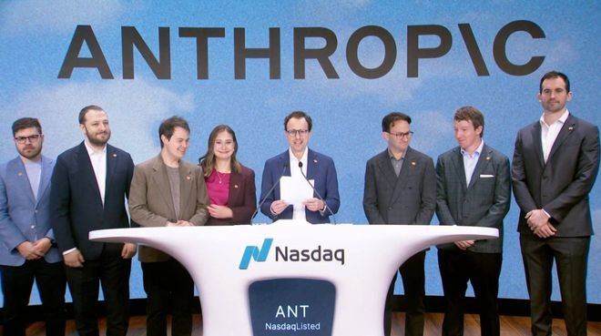
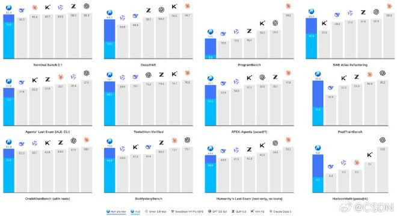
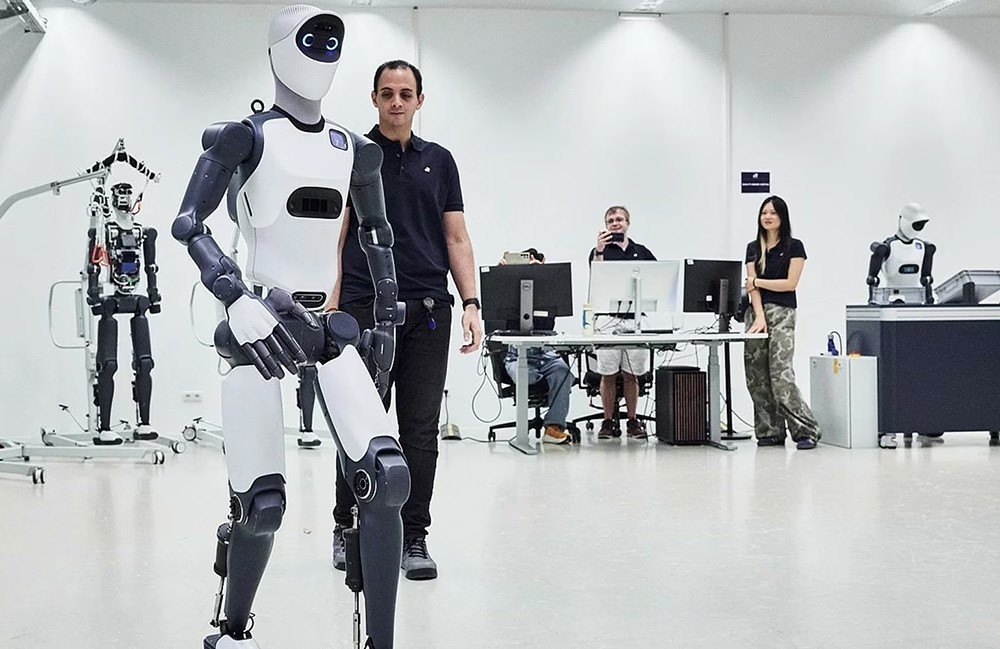

# Claude两版只差0.1分，选之前先看推理那栏

今天榜单上出了件怪事。Claude Fable 5.1 和 5.2，总分一个 81.4，一个 81.3。我起初也没当回事。翻完那张八项能力表，才觉出这 0.1 分的怪。

## 八项能力，4 比 2

thinQit 11 月 22 日这次刷新，名次没动。5.1 排第五，5.2 排第六。可把八项摊开，5.1 赢下编程、人类偏好、多模态、速度和价格四项；5.2 赢下推理和智能体两项。最悬的是推理：95.3 对 80.2，差了 15 分。

分差这么大，名次却几乎贴在一起，原因在权重。这套指数把编程按 25% 算，推理按 20% 算。5.1 靠编程那 4.1 分的优势，把 5.2 在推理上的 15 分抹平了大半。

还有一处容易被漏掉：5.2 的 LMArena WebDev 分是 1823.64，5.1 是 1741.88。单看编程这一项，5.2 其实更高。榜单名次摆在那儿，你手里的活是另一码事。

我的判断很直接。天天写代码、跑智能体的人，别照总名次下单；先问自己要的是那 15 分的推理，还是那 4 分的编程。这一栏没看准，省下来的钱和浪费掉的钱，差距比 0.1 分大得多。

## auto mode 成了默认起点

编码工具这边，本周的变化藏在版本号里。Claude Code v2.1.328 在 Bedrock、Vertex、Foundry 这些第三方平台上加了 auto mode，而且没有设权限模式的交互会话，默认就从它启动。

变了什么？以前每做一步都要人工点确认，现在换成一个独立的分类模型在旁边看着，动作由它判定。你没改任何设置，被弹窗打断的次数可能就变了。同周 Codex 把 GPT-6.2 Sol 设成默认，Gemini CLI 修了几条权限策略匹配的老毛病。

工具不再只比谁写得准，开始比谁能自己跑、又不越界。这方向我不反对，但有一说一：默认开着，和每次问过你再动手，责任完全不一样。第三方平台上线这个模式的，最好先搞清楚那条分类器卡在哪一层。

## 2 万亿的三个口径

今天最扎眼的数字，是 Anthropic 上市首日的 2 万亿估值。发行价 83 美元，开盘 111.50，盘中摸到 115.10，收盘 97.17，涨 17.07%。含私募的整体融资约 1073 亿美元，超过 SpaceX，成了美股史上最大的一笔 IPO。

我把五家权威源对了一遍，同一个"市值"能说出三个数。完全稀释口径把期权和限制性股票全算进去，是 1.8 万亿到 2 万亿；按已发行股份算，收盘约 1.27 万亿。

"破 2 万亿"用的是最宽松那把尺子，还取了盘中最高点。收盘的真实市值，比这个数低了七千亿。那 1073 亿，是 IPO 的 813 亿加私募的 260 亿，单看 IPO 本身是 813 亿。

同天还有条反向消息。路透说 SEC 正在查英伟达的会计实务，股价当天跌 12%，创 52 周新低。一边融资刷新纪录，一边监管翻账本。数字都真，挑哪个口径拼进标题，才是文章想让你看见的东西。

## 灵巧手翻了三倍，队伍却少了六十人

具身智能这周交了供给侧的底。灵巧手全行业出货，去年约 2 万台，今年预计 6 到 7 万台，一年翻三倍。仙工智能上半年控制器出货超 8000 台，101 家产业链上市公司前三季累计营收 3531 亿元。

浙大和宇树把 Movens-5M 开源了，500 万条经 G1 仿真验证的机器人动作，加 1500 万条人体动作，总共超过 1 万小时，覆盖 16 类场景。数据从哪来这件事，被人用一条开源管线重新答了一遍。

工信部那套 L0 到 L5 的分级，真实用途也被点破：写进招标文件，当供需双方统一的验收语言。采购方的问题，从"你家机器人会什么"，变成"在哪个维度达到第几级"。

供给侧的账，我第一遍也以为是全线飘绿。翻到阿米奥那笔才停住——核心团队相继离职，规模从约 130 人缩到 70 多人。产能、数据、标准都在往上走，交不出交付记录的团队，退场也在加速。这两件事一起看，才算看清这个行业。

## 卖结果的那一层

副业榜今天更新到 11 月 21 日。海外的 Postiz 月经常性收入 45.1 万美元，做纹身模板的 Stencil AI 做到 4.88 万，每个订阅约 28 美元。国内用 Coze 给本地商家搭智能体，诊断收 99 到 299 元，搭建收 1999 到 4999 元，维护按月 299 到 999 元。

两件事看着不搭，逻辑是一个：卖的是"帮你省下一个人"的结果，工具只是壳。挑一个慢且重复的工序，套上模型，按工具定价，别按玩具定价。说穿了，客户要的是省人，不是会聊天的机器。

得提醒一句，这些收入不少是自报口径，幸存者偏差摆在那儿。看思路可以，别当承诺。

---

额度都是有时效的，看到就先去点一下。

发现哪条已经结束了，欢迎在评论区指正。
