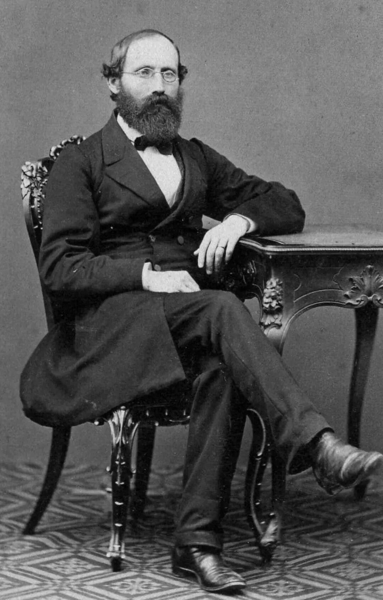
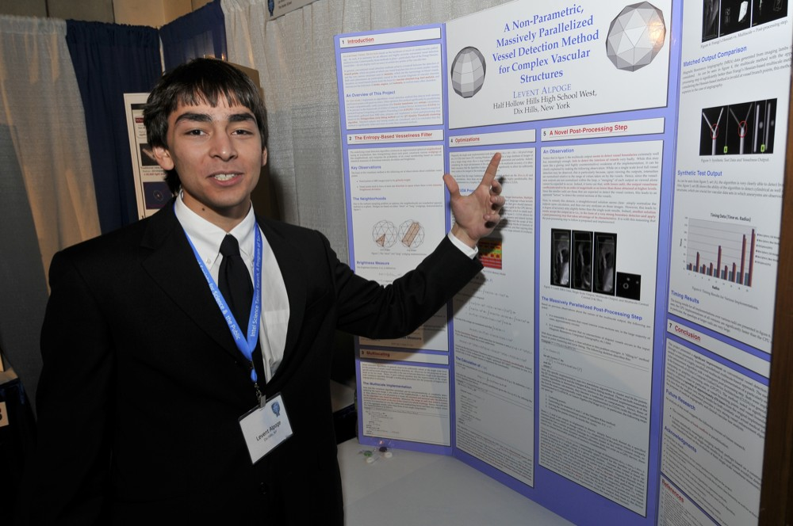
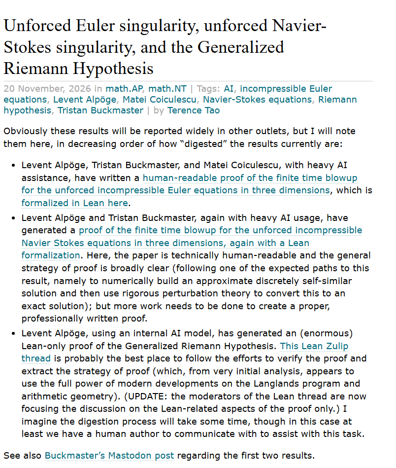
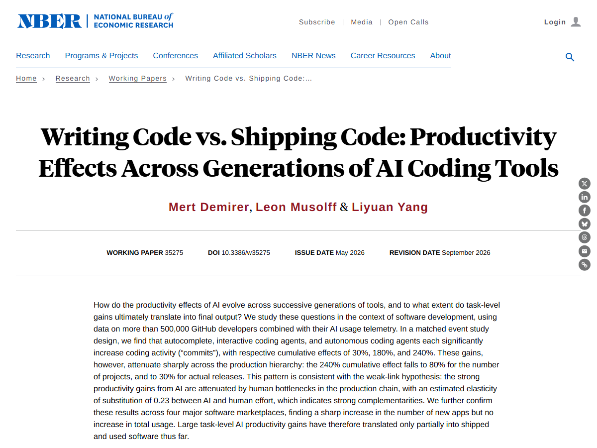
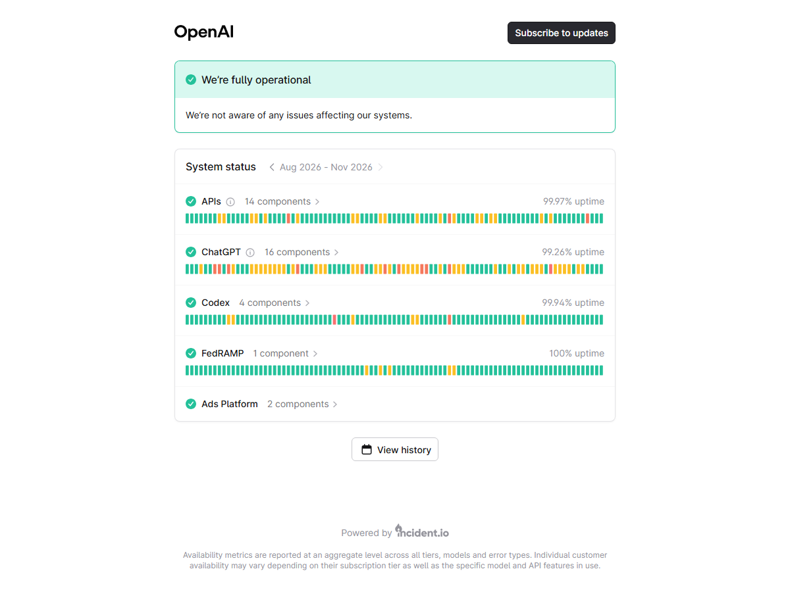
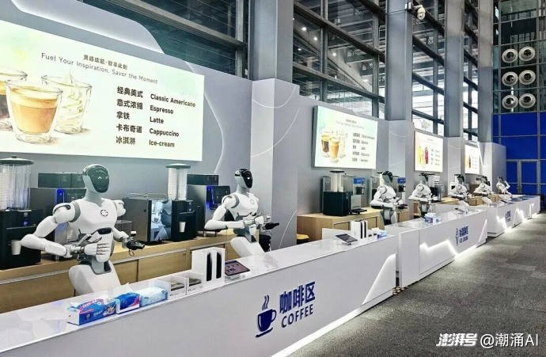
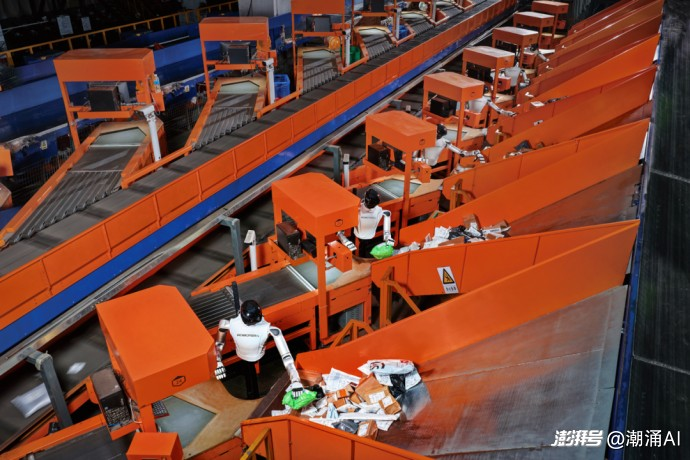
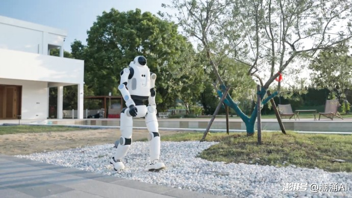

# 别急着宣布黎曼猜想获证，公开的只是1700万行代码

11月20日那份声明刷屏时，我去找论文正文。只有4页说明，加14个压缩包。能通读的正文，一页没有。我第一遍也差点当成数学史翻页——且慢。

## 公开物只有四页说明

Anthropic的数学家莱文特·阿尔珀格声明，他在Claude协助下找到了黎曼猜想及其推广形式的证明。公开材料是一份4页说明和约1700万行Lean形式化代码。他写过超过25万页的自然语言草稿，因为太长，没公开。

坐实的部分，先摆两件。麻省理工学院的安德鲁·萨瑟兰独立下载代码，编译跑通。清华博士后张凯羿用128核服务器，跑了约8小时22分，也通过。有具名，有过程。这两次我认。

没坐实的那一半，卡在一个动作上。帝国理工的凯文·巴泽德提醒，编译通过只说明每一步逻辑没错。还差一次比对运行——确认代码里那个定理，到底等不等于广义黎曼猜想本身。这一步，目前没人宣布做完。

数学家没站成一队。丘成桐给了很高的评价：数论上的伟大贡献，数学进入新纪元。陶哲轩给三项AI深度参与的结果排了序，广义黎曼猜想这一项排在末位，只有"一份巨大的、仅有Lean的证明"。邓煜更直接：25万页不可能可读，可读版本出现前不评论。

我把这件事拆成两道门。门一，代码内部自洽；两轮独立编译已经过了。门二，数学界认可；比对运行没做完，人类能通读的论文没有，克雷数学研究所还要求期刊发表加两年验证。我第一遍差点把门一当门二——不，急了。

## 代码多了25倍，发布只多三成

NBER工作论文35275，是同一天翻出来的另一份材料。三位作者追踪50万余名GitHub开发者，再和微软内部AI使用数据对齐。自动补全、同步智能体、异步智能体，分别把提交量累计抬高30%、180%、240%。

再往下，生产链上涉及项目多了80%。发布版本呢？30%。同步智能体用户新增代码7.0倍、删除12.2倍，新建分支多79%。新仓库首月后没动静的比例，从2021年的60%升到2026年的69%。

作者管这叫"弱链"。人与AI的替代弹性0.23。评审、测试、发布，没跟着扩。论文未经同行评审，关键数据来自微软，作者自己披露了潜在相关关系——那行字我读了两遍。当提醒可以，当定论，姑且慢着。

## Agent比人贵，还把认证压在一条链上

11月23日华尔街见闻那组数，我盯着看了半天。OpenAI研究员人均每天调用的Agent，按API标价折算约2400美元；用量排在前10%的研究员，单日能到2.3万美元。内部Agent开销已经是研究员薪酬的两倍。

同一周还有一份复盘。巧不巧？11月21日13:48到17:21，全站中断211分钟，ChatGPT与API请求失败率峰值75%。例行维护，两个承担实时查询的Postgres只读副本同时失效。Primary API还管着整个技术栈的用户认证和服务间认证，把故障放大成了公司级中断。

两件事并排看，才有意思。Agent用得越深，账上的钱越往验证和容灾挪。故障面也挪了——从某个接口，挪到鉴权那条链。省钱？稳住？两码事。有趣得很。

## 机器人的账，第一次摊开到单价

具身这边，先递上来的是一份招股书。行星减速器厂商纽氏达特11月13日创业板过会，15日提交注册，拟募资8.23亿元。招股书里，来自具身智能机器人的收入从2023年30.70万元涨到2025年9662.82万元，增长1235.46%。

同一份招股书还有另一条线。该领域平均单价从2024年的1256元降到2025年的849元，2026年上半年只有598元。综合毛利率从55.49%降到48.05%。招股书承认，对部分头部客户给了更优惠的价格。

收入涨12倍，单价两年腰斩。两件事并不打架——大抵是订单有了，零部件正在变成标准件。另一边，深圳K11影院里越疆的人形机器人每天工作14小时，日销超千杯；伯克利用单卡约3小时，在特定动作基准上超过了128卡训练7天的对照。我看这类消息，只盯两个数：在岗多少小时，单台多少钱。

## 一个人开公司，省的是房租

呼和浩特OPC社区，内蒙古日报11月23日写到了。做AI短剧的张杰华算了一笔账：同样的生意，在深圳或北京综合成本要5万元以上，在当地2万元以内就能做出同样的剧本。

云谷OPC社区6月4日投运，集成100余款常用大模型，开了国际互联网专用通道，已集聚95家企业。李振华7月入驻，5个多月收益7万到8万元，这是受访者自报的数，我按个案看。另一处园区签约49家AI企业，其中31家是一人公司式的小微团队。

门槛真降了吗？但有一说一，房租和算力接入费确实降了。交付风险一分没少。谁替你验收，谁对客户负责，自己扛。

---

额度都是有时效的，看到就先去点一下。
发现哪条已经结束了，欢迎在评论区指正。
