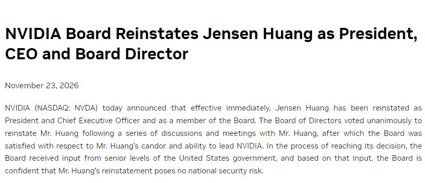
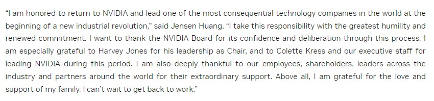
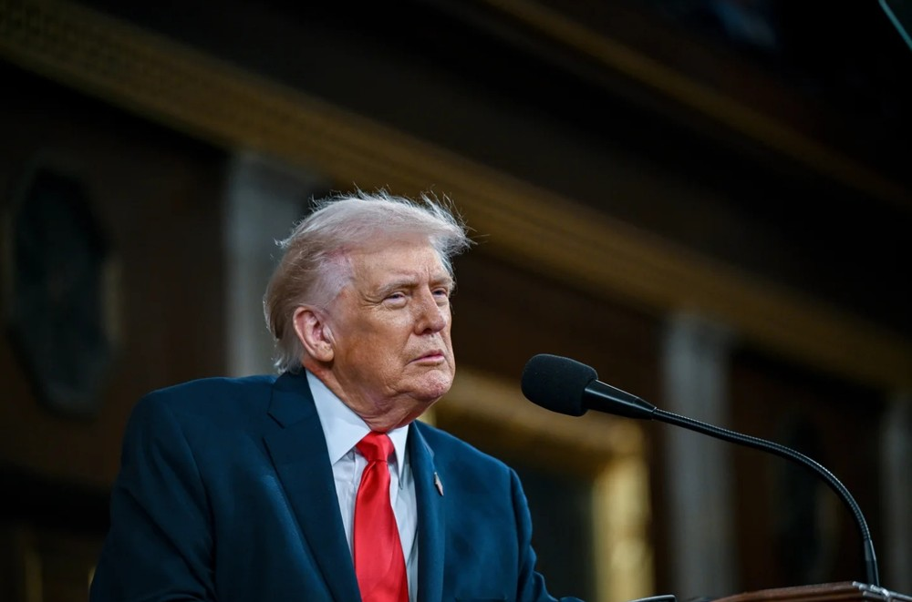
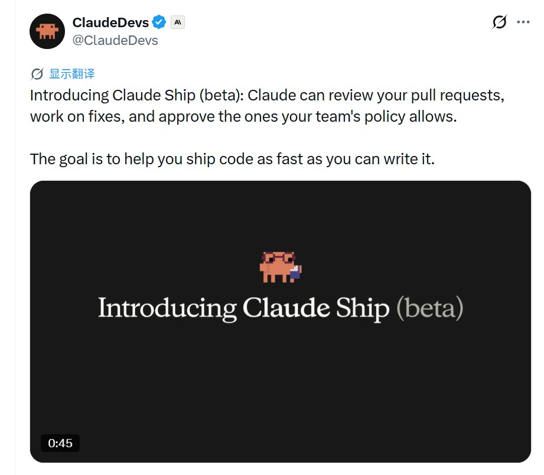

# 11月23日黄仁勋复职，一天涨回9520亿的三笔账

> 9520 亿美元，我翻了两遍行情，没找到一笔真金白银的转账。值钱的是另外三样东西。

## 第一笔：涨的是估值

先看两个数。11 月 23 日收盘 165.05 美元，前一个交易日 125.53 美元。差出来的 31.48%，是 2003 年 5 月以来单日最大涨幅。市值比前一天高 9520 亿美元，折合人民币 6.39 万亿。全球上市公司单日市值增加额，这个纪录今天归英伟达。

我核了两遍。腾讯行情的前复权数据是这个数，央视新闻和腾讯新闻的稿子也是这个数。配套那组：纳指涨 6.51%，费城半导体涨 14%，美光涨 19%，英特尔涨超 16%。一家公司涨出来的市值，比不少国家的股市总市值还高。

钱进账了吗？没有。9520 亿是市场把未来利润按新倍数折到今天，账上并没有多出一分钱。我第一遍看稿时也差点读成资金流入——且慢，这是估值重定价，两码事。数字是真，指的是另一件事。

后面的动作倒是实在的。伯恩斯坦把评级从「与市场表现一致」调到「跑赢大盘」，目标价 275 美元抬到 300 美元。

## 第二笔：人回来了，案子还在

11 月 12 日辞的职。理由写得含糊，婚外情独立调查。临时 CEO 是 CFO 科莱特·克雷斯。

不到两周，董事会全票把人请回来。Wired 提到一个时间点：上一周还说无意复职，一周后改口。中间发生了什么，公开材料里空着。

央视的稿子写，特朗普曾直接或间接与董事会沟通，支持复职，并就国家安全疑虑向董事会作了保证。Semafor 说总统投票前打过电话。副总统万斯周末介入协调，这条的出处是知情人士。特朗普被问到股市因素，回了句「probably so」。

董事会那边的说法：听取了美国政府高层意见，确信回归不构成国家安全风险。同一份声明里还留着一行——独立调查仍在推进，公司增设首席合规官。两句放一起并不打架。人回来了，案子还悬着。

参议院的安排已经挂出来。12 月 3 日上午 10 点，银行、住房和城市事务委员会听证，主题是监督美国出口管制，目前列名证人只有他。部分英文简报写 12 月 1 日，和官网对不上。我信官网。

## 第三笔：规则开始收费

复职这条占满了版面。另外三件被压在下面，我倒觉得更耐看。

Anthropic 上线 Claude Ship 测试版。三个智能体分活：Code Review 分三档评审；PR Steward 修 CI 失败和合并冲突，批准与合并权被明确拿走。第三个 Claude Approvals 才是眼。它读仓库里那份 `.claude/approvals.yml`，判断改动还需不需要人签字。签字权被写成一份能 diff、能回滚、能审计的配置文件。官方建议先跑 observe-only，只看它怎么决定。厂商说自己团队 6 到 9 月合并的 PR 翻倍、回退率降了四成以上——这话我打折听。评审只是工程流程里的一层，账不能全算在它头上。

具身这边，11 月 22 日国家数据局启动数据国标研制，「十五五」期间要做 20 多项专项标准并试点。11 月 23 日四部门「一老一小」方案鼓励养老场景的机器人、外骨骼进机构和社区，措辞是「鼓励」「设置体验区」，离采购单还隔着几道坎。海外 GXO 和 Apptronik 签了意向书，四年最多部署 1000 台 Apollo，按生产率、安全、运营三类 KPI 逐场景验收。国内微亿智造和顺丰在吴江做到约 11 秒一件、部署周期两周、回收期约两年。今天板块上涨里被反复引用的高盛 7.5 万台、摩根士丹利 5 万台，是 8 月和 9 月的旧研报，不算新数。

还有一条容易漏：新华社系把一人公司写进了年度叙事，在运营的 OPC 社区超过 800 个，覆盖 94 座城市。宁波一个三人团队用 12 位 AI 员工做外贸智能体平台 Seresway。海外榜单上 notis.ai 月经常性收入约 1.31 万美元。这些数字都是自报，1 元 AI 成本替代 72 元人力也只是社区测算。我没查到审计口径。

三件事摆一起，方向就齐了。模型会不会写代码，算不上新鲜。签字依据能不能审计，机器人一天干多少件、多久回本，这些东西开始单独标价。能力过剩之后，规则层成了新的收费口。我记下来，下个月再看它对不对。

---

额度都是有时效的，看到就先去点一下。
发现哪条已经结束了，欢迎在评论区指正。
