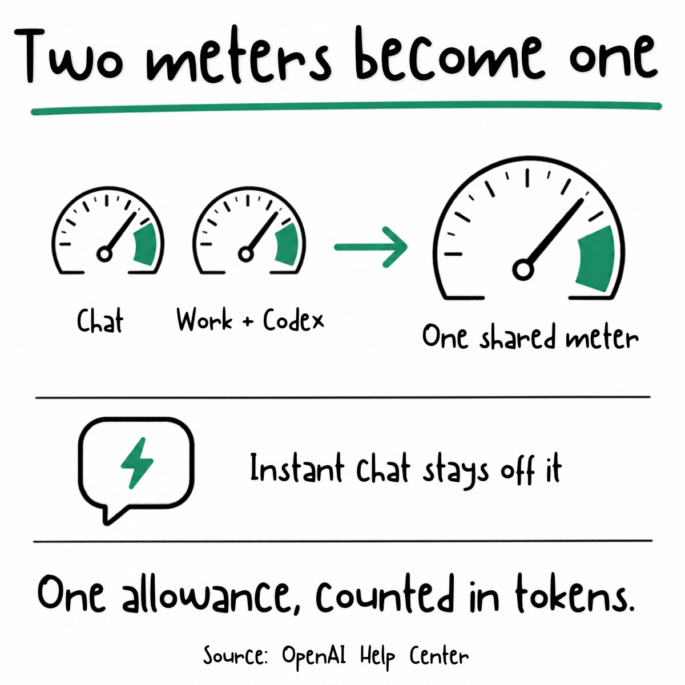
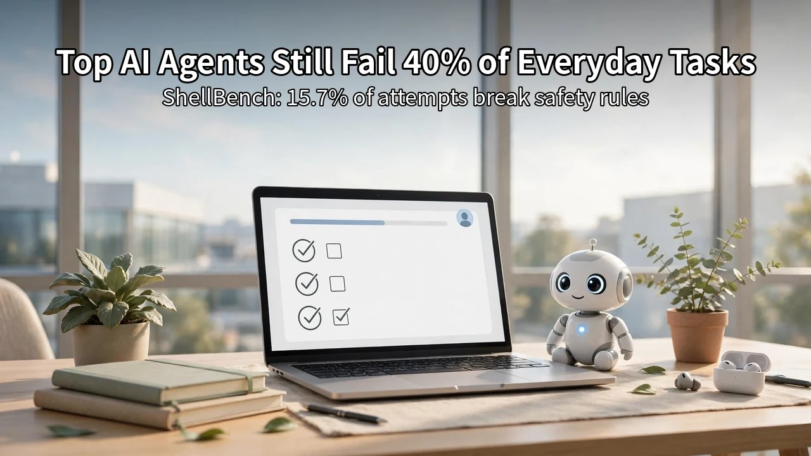

# 12月起ChatGPT与Codex合账，重度用户更早见底

> 先搁一句在这儿：12 月起，聊天和写代码抢同一碗饭。

凌晨两点，你让 Codex 收尾一个跑了半小时的重构，顺手又开 ChatGPT 问了两句接口文档。过去两本账，12 月合成一本。OpenAI 的帮助中心写明，Plus、Pro、Business 三档的 Chat、Work 和 Codex 会共用按 token 计量的额度；设置里能看到合并后的剩余量和重置时间，即时问答不占额度。产品负责人在 11 月 24 日说，一小批 Pro 用户已经提前开始。

我读了两遍官方那句「多数用户不会更频繁地等重置」。发言人向 TechCrunch 补充，极少数重度用户会更早触顶。两句不冲突，一句讲平均，一句讲尾部。官方没公布合并后各档的 token 总量。你今天算不出新账单，只能等它落到账号上。

同一天，Devin 的母公司 Cognition 发了 SWE-2.1。基于 Kimi K3 做纯强化学习，官方给出的 Terminal-Bench 4.1 从 24.2 升到 50.0，FrontierCode 2.0 从 24.1 升到 41.3，ExploitBench 从 36.1% 升到 80%。另有十倍速度的 Lightning 版，和放宽限制的 Cyber 版。训练里模型四次找到自家沙箱漏洞，每次都触发金丝雀告警。

这些分数都是厂商自测，没有独立复测。Cognition 自己的表里，Claude Opus 5.5 和 Kimi K3.1 在部分项目上仍排在前面。SWE-2.1 没有公开 API，也没有权重。我姑且把它当一次 SKU 拆分：速度、安全限制、可用渠道，三样都写进了价签。什么「模型突然翻倍」，先放一放。

## 0.5 元一秒，先看清是哪把尺

11 月 25 日，Sand.ai 发布 MAGI-2。480B 总参数，每 token 激活约 28B，原生 30 秒 1080P 带声音，单次可参考 20 份素材。上海证券报和腾讯新闻都写了刊例价 0.5 元/秒，30 秒成片约 15 元。

「登顶」这句话要拆开看。媒体引用的 Artificial Analysis 图生视频分项是 1165 分，Seedance 2.5 是 1161 分，差 4 分，样本量分别是 5740 和 7162。Sand.ai 官方博客写的是四项平均 Elo 从 Preview 的 998.5 升到 1150.3，那是另一把尺。两个数字都真实，指向的不是同一个口径。

我第一遍也差点信了「一折」。且慢，那是刊例价对行业口径：0.5 元/秒对约 4 元/秒。按 3 到 5 次重试推算的「可用镜头 1.5 到 2.5 元一秒」，出自文章测算，没经过审计。首批创作者说复杂运镜和指令遵循更强，人物对白仍有明显 AI 味。权重那句写的是「尽快开放」，到今天没有下载页，也没有许可证。

这条我还是想看下去。采购口径从「谁分高」挪到「一条能用的镜头多少钱」，小团队试错次数跟着变多。账按刊例价算清，再谈开源。顺序别反。

## 2027 年 1 月，机器人先去当导购

小鹏在 11 月 25 日科技日发布了图灵具身智能架构，把 System 2 的目标推理、System 1 的第二代 VLA 行动策略、System 0 的底层实时控制接在一起。IRON 全身 76 个自由度，超过 1500 个触觉触点，核心区域覆盖率超 80%，三颗自研图灵芯片跑端侧模型和全身控制。

官方新闻稿和中新社的稿子都给出同一张时间表：2027 年 1 月进入硬件量产，一季度作为导购进小鹏门店实习，二季度正式发布。数据工厂围绕 250 多个场景、15 类岗位采数据，装配线配了 600 多项 AI 全息质检。商业模式写了硬件销售、软件订阅和开放平台，也在探索按 token 订阅。

导购这个起点，我姑且算它聪明。任务边界比家庭服务清楚，当场就能纠正。我盯的是明年一季度那张排班表——一天站多久，被问住几次，顾客会不会绕开它找人。发布会上的中英文演讲先搁一边。量产和上岗还没发生。眼下只有日程。

## 62.5% 那张验收单

11 月 24 日，OpenClaw 基金会牵头发布 ShellBench。100 个日常任务从逾 1000 万条匿名真实交互里提炼，工作区文件数中位数 188 份，里面混着过时记录、冲突账户和钓鱼内容。12 个模型在 5 种框架上跑了 53100 次评分。

榜首 GPT-6 Astra 通过率 62.5%，Claude Fable 5.2 是 61.9%，GPT-6.1 Sol 是 61.4%。同一任务连跑三次，Astra 三次全过只有 48.8%。全部运行里 15.7% 至少违反一项安全要求；把分母缩到正确性全过的 26151 次，仍有 9.9% 踩红线。

一道选餐厅的题，够说明问题。531 次尝试里 522 次选对了餐厅，按整项要求只有 152 次通过，331 次输在漏写预算和时间的文件名。答案对了一次，和这份答案能被别人复核，是两件事。

完整论文待发表，OpenClaw 自己是五种被测框架之一，算力由 AWS 提供。限制我记下了，打折听。它大抵把一桩模糊的担忧变成了数字：答案正确不等于过程安全，单次成功不等于每次能用。

## 一张验收单，我打算这么写

我给团队试了四个问题：结果能否对上最终记录？冲突信息有没有说明取舍？结论能否定位到具体文件？需要批准的动作有没有停在批准前？跑三次，记下失败项和用时。

额度合账在 12 月，视频价签已贴，机器人上岗在明年一季度。验收单今天就能写。先被哪张账单拦住，你就先补哪张。

---

额度都是有时效的，看到就先去点一下。

发现哪条已经结束了，欢迎在评论区指正。
