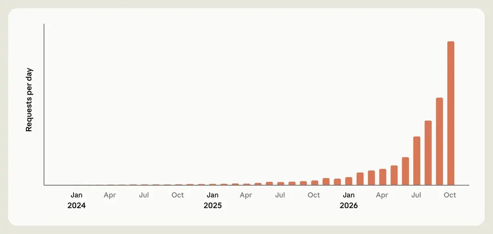
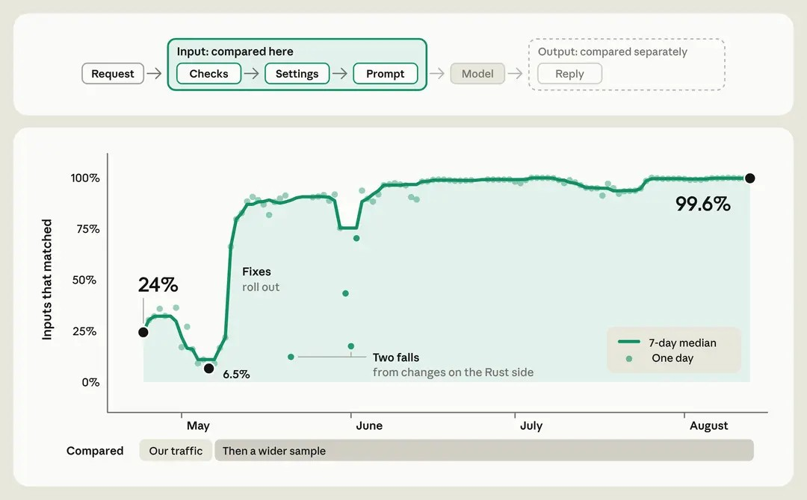
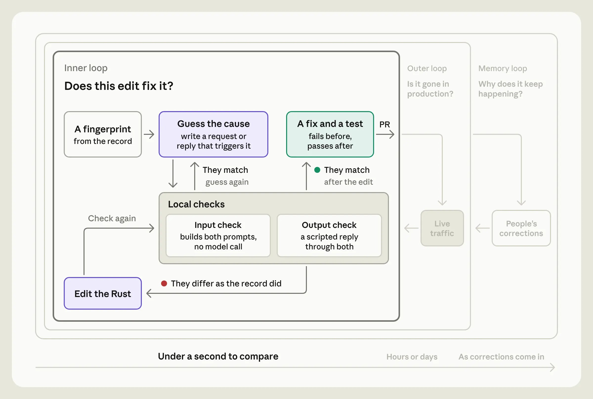
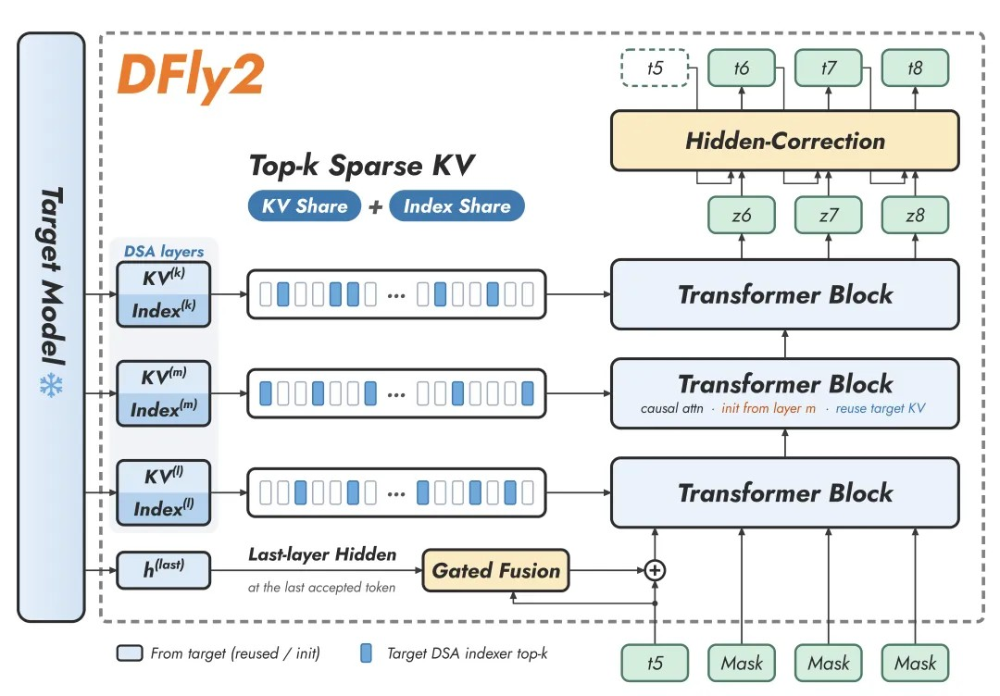
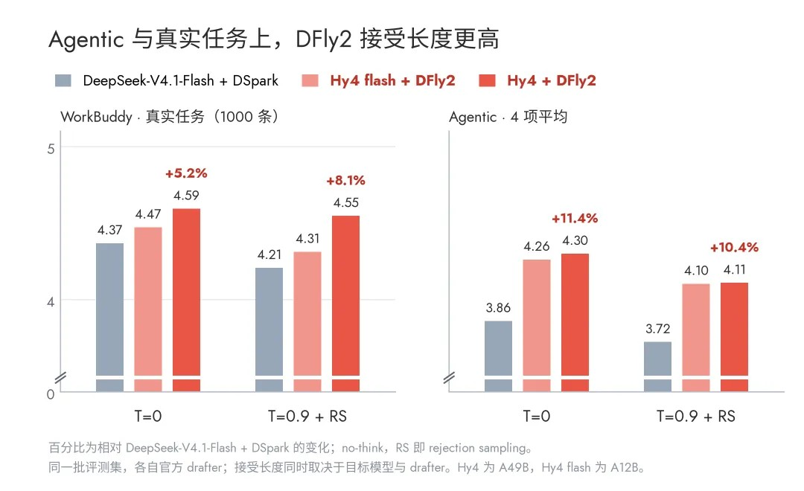
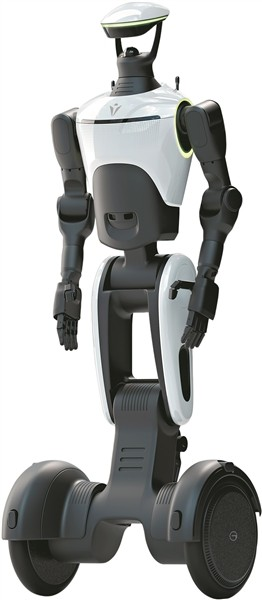

# 11月27日Claude接口换Rust，三个数看懂这次重写

> 一周写完的代码，用了几个月才敢放上线。

6.5% 这个数，我先搁在这儿。2024 年初到 2026 年秋，API 流量涨了约 1800 倍。2023 年的 Messages API 用 Python 搭，起初被工程师叫作「 basically 一个请求转发器」。后来它要管校验、分词、安全分类，还得把流式输出拆成文本和工具调用。每多一个对象，就多一份开销。11 月 25 日，Anthropic 把核心请求路径迁到 Rust 的经过写了出来。

第一个数，70%。官方说每请求 CPU 少用约 70%，首 token 中位时延降约 20%。8 月到 10 月，单请求内存降超 80%。9 月起公开流量一小撮一小撮切到 Rust，服务没停。Claude 写核心路径的第一版，用了一周。

我第一遍读到这里，差点信了「AI 自己重写 API，性能白捡七成」。且慢。团队先试过便宜方案：用 Rust 写解析器，从 Python 里调。只省了 8% 到 10% CPU，每个 token 还得在两种语言间来回三次。那 70% 背后是两年多的流量压力，加上几个月验证。提示词敲得再快，也换不来这个数。

## 吻合率 24% → 6.5% → 99.6%

第二个数，6.5%。同一批线上请求同时喂给 Python 和 Rust。模型只调用一次，输出回放给新实现，两边逐步比对。用户内容不能读，系统只记差异的形状：哪一步，字节位置，长度。4 月吻合率约 24%。5 月初掉到 6.5%。8 月回到 99.6%。

曲线先下后上，看着像事故。官方图把其中两次下滑标成 Rust 侧改动。我倒觉得，下滑那段比终点那个 99.6% 有用。一上来就全绿的比对，多半是尺子太松。

第三个数，100 多条。4 月时 Rust 版过了约 700 条集成测试的 98%，听着快收工。回头审计移植过来的测试，100 多条断言被放宽——为了在新代码上跑绿，检查被改轻了。让 AI 做迁移，测试 diff 得和代码 diff 一样看。生成变便宜以后，验货才是瓶颈。

同一周还有一张硬日历。Google 11 月 24 日宣布，Gmail、Drive、Docs、Sheets 四项服务的 MCP 服务器可用。Slides、Calendar、Chat、Tasks 也同期上线，Workspace CLI 同样可用。2027 年 2 月 1 日起，智能体必须走 MCP，不许再直连 Workspace REST API。OAuth 客户端要显式标出自己是智能体。

4 月 1 日，Scaled 档开始计费。官方说超 99% 活跃开发者仍在免费档。管理员能给敏感动作加人工确认，也能查审计日志；用户级 DLP 规则会自动套到智能体上。我姑且把它当一次身份登记：先把 agent 流量从普通应用里分出来，再谈限流和收费。做企业智能体的，两个多月，够拆客户端和改调用。

## 提速这件事，也被换成可测的数

腾讯混元 11 月 26 日开源 DFly2，一个挂在 Hy4 flash 旁边的草稿模型。它共享主模型的 KV 缓存和稀疏索引，至多看 2048 个关键位置。注意力开销不随上下文变长，也不用给草稿模型单独留显存。权重和训练代码都在。

官方口径里，AgentLongBench 单项加速 4.2 倍。Agentic 四项平均约 3.2 倍。WorkBuddy 真实任务接收长度领先 10.4%。4.2 是单项成绩，整体提速不该按它算。

蚂蚁百灵同期开源 Ling-3.2-air。总参数 1240 亿，每 token 激活 55 亿。SWE-bench Pro 从 26.40 到 58.28。AutomationBench-AA 从 15.7% 到 61%。激活量小不等于模型文件小。那 1240 亿的专家权重还得整套装。

上海 AI Lab 的 Sage-Interaction 把「能不能被插话」做成可打分项。报道给的数是 1.29 秒时延、80.73 分。三条都是厂商口径。我没看到独立复测，姑且先记着。

## 机器人先分层，再谈进厂

松延动力 11 月 26 日拿到近 2 亿元 Pre-B+ 轮，中金资本领投。距 10 月底那笔近 3 亿的 Pre-B 才一个月。这是年内第五轮。第三方统计说，11 月机器人与物理 AI 融资约 26 亿美元、27 笔。7 笔占约 83%。同期还有约 30 亿美元估值的公司被曝欠薪。估值到账和工资到账，原来是两件事。

沃尔沃在根特工厂让 AEON 先练把零件放进夹具。1.65 米，60 公斤，轮式，能搬 10 公斤。模仿学习起手。2027 年上半年才进厂试点，2027 年中投入生产。现在还只是训练。

国内这边，14 家主流车企已布局人形机器人。奇瑞墨甲累计交付超 3000 台。小鹏 IRON 排在 2027 年 1 月量产，一季度进门店当导购。

我更在意工厂那套验收口径。一个工位一天有效干几小时？单次成功率多少？客户多久回本？众擎给的说法是一年或十八个月。按这个问法，发布会上的动作数量就不那么要紧了。

今天能动手的只有一件。照 Anthropic 那套影子比对，给手里的 AI 迁移写一张验收单。同输入两边跑，只记差异位置，再看测试断言有没有被悄悄改松。Google 的日期是 2027 年 2 月 1 日。这张单子，这周就能写。

---

额度都是有时效的，看到就先去点一下。

发现哪条已经结束了，欢迎在评论区指正。
