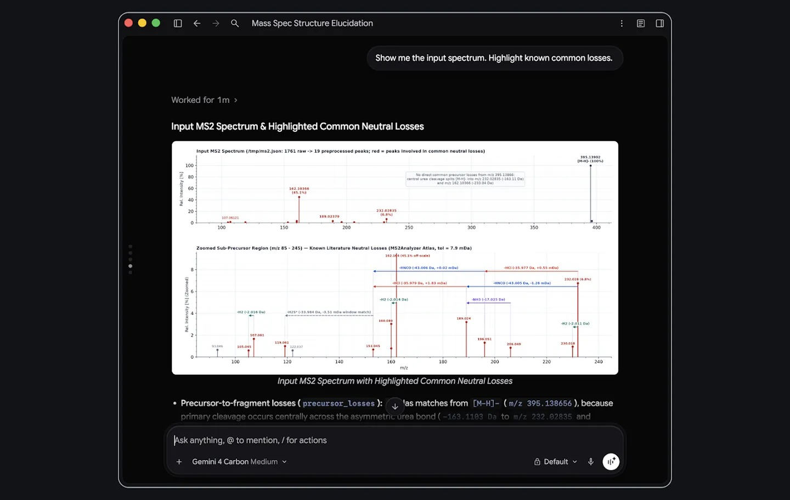
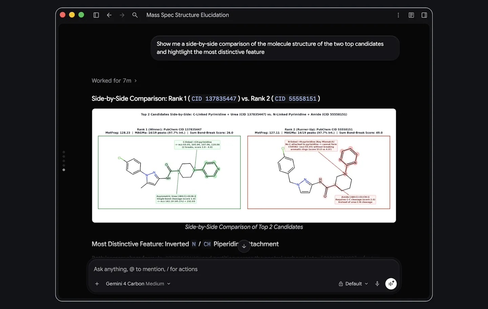
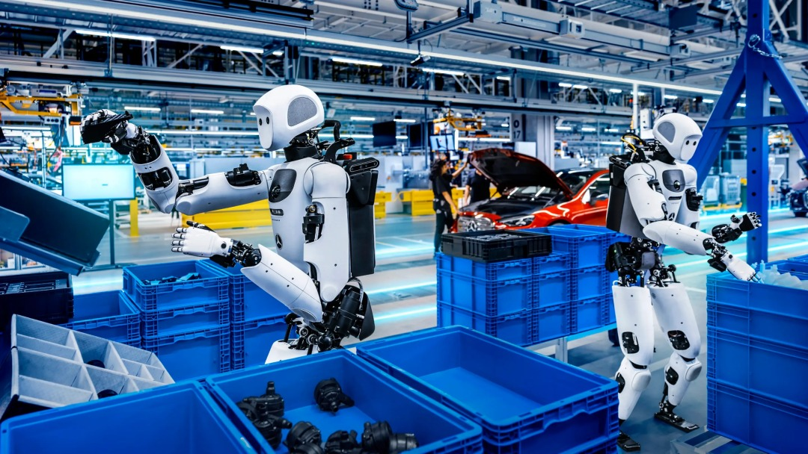
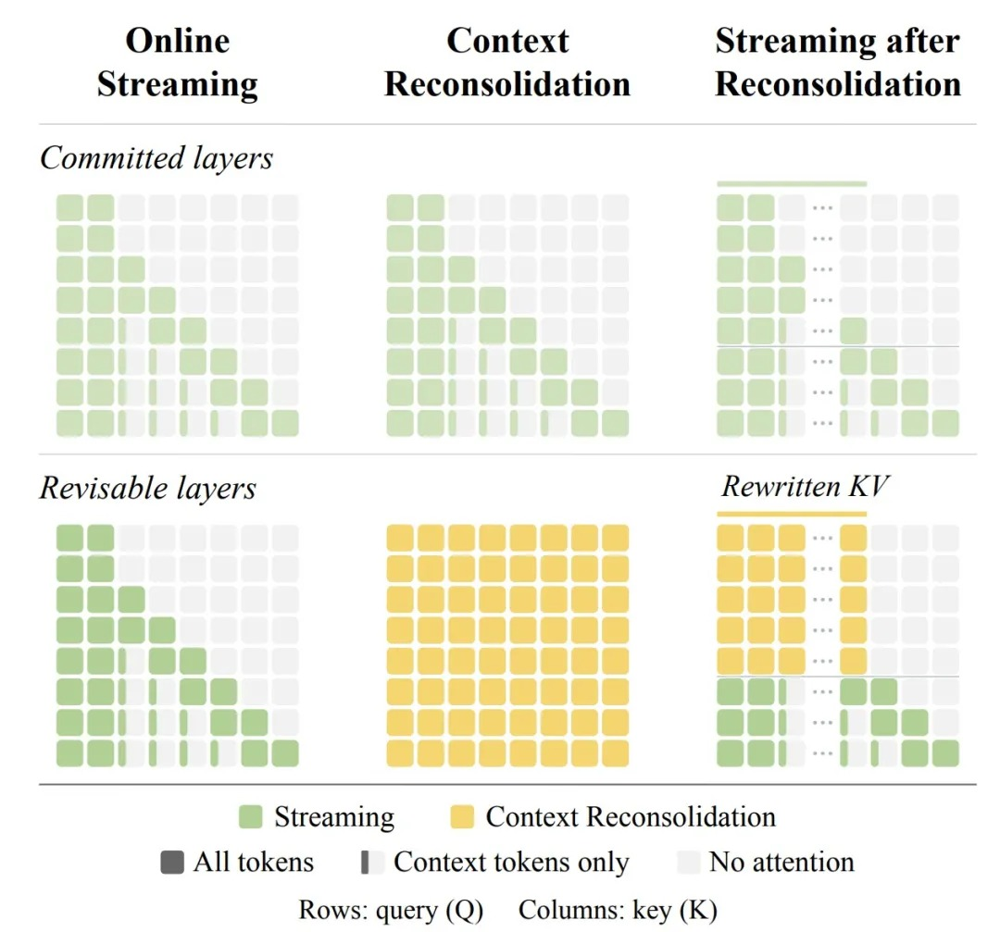
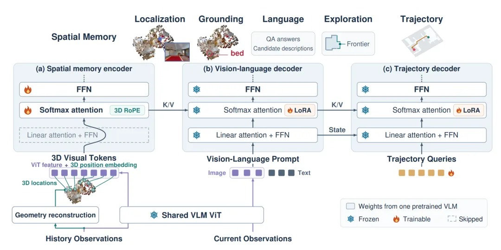
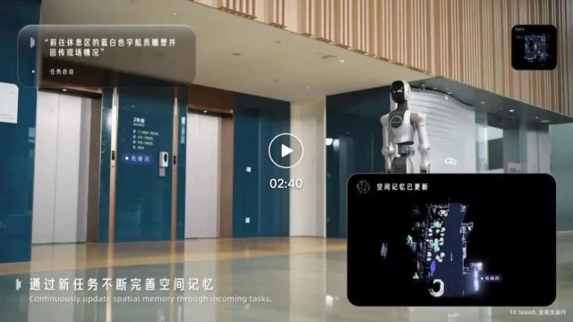
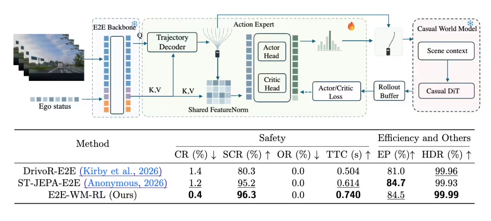
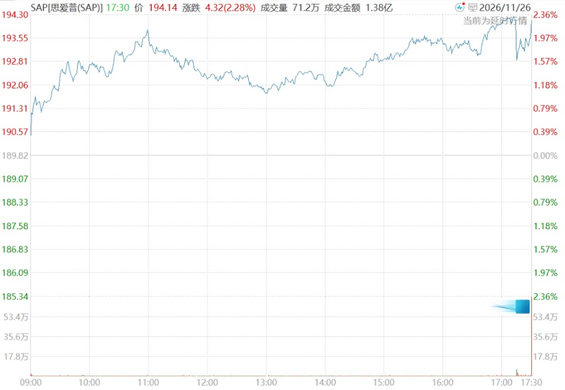

# 质谱识别4%到97%，1万名研究者可免费用6个月

> 同一批谱图，工具接上前后差二十多倍。模型一个没换。

4% 这个数，我盯了半天。Google DeepMind 11 月 25 日放出 Mass Spec Skills，国内媒体 26 日集中转载。官方在 MoNA 里挑了 100 种化合物，都有公共参考谱图。不给网络，也不给技能。只塞一张峰列表。三个模型——Gemini 3.8 Flash、Gemini 4 Argon、Gemini 4 Carbon——准确率全部不到 4%。

接上技能，三款模型都到了约 97%。生成 token 也跟着掉：Flash 降近 4 倍，Argon 降一半，Carbon 降近五分之一。流程里跑的是现成工具。matchms 去噪，GNPS 和 MoNA 查谱图。SIRIUS 推分子式，PubChem 找候选，RDKit 做校验。

且慢，97% 只在这 100 个已知分子上成立。对映异构体和结构挨得很近的那批，单靠 LC-MS/MS 分不开，还得上色谱保留时间、离子淌度或者核磁共振。数据库压根没收的新分子，系统只能给预测分子式和注释表，结构确认仍然要化学家做。我头一遍读标题也差点当成「AI 认出未知分子」。帽子太大了。

免费权益更实在：1 万名科研人员，6 个月顶格使用档位，滚动上线，要过资质审核。注册上去，未必有。想试的人今天就可以去看申请通道。

## 机器人开始记路了

同一天，蚂蚁灵波发了 LingBot-Map 2.0，并把 LingBot-Navi 开源。Map 2.0 的关键动作是改写模型内部的几何上下文，不再靠外接回环后端修一条输出轨迹。长达 5.2 公里、近 1.9 万帧的 VBR 城市长轨迹里，平均轨迹误差从 31.12 米落到 4.72 米，降幅近 85%。单张 RTX 5090 上跑到 27.51 帧每秒。

这套机制叫几何上下文重塑。底部 12 层留着每帧的局部几何，顶部 12 层管跨帧对齐。纠偏时顶部切双向注意力，重新对齐关键帧，再写回缓存。改的是记忆本身，后面的路程跟着受益。

Navi 这边治的是「健忘」。以往每接一条指令就从零搜一遍。它把见过的物体和位置沉淀成显式三维点云，跨任务复用。端到端导航在 GOAT-Bench 上成功率 56.09%，自建 36 个真实场地子集上是 32.36%。同口径下，搭配 GPT-6 Astra 的导航 Agent 分别是 51.97% 和 26.67%。511 个真实采集场景的数据集也开了。

端侧这条我更看重。图像和指令留在本地。进新场地不必先完整建图再逐点标注，准备周期也许能短一截。这些都是团队自测和闭环仿真，长期自主作业还早。物理世界记错一次位置，代价可比聊天答错一句话大。

## 汽车和机器人用同一套大脑

小米汽车 11 月 27 日发布世界模型 2.0。一套因果 DiT 架构，接住多视角视频生成、物理交互建模、三维重建和动作建模。支持 1 到 7 路摄像头。训练语料 1260 万段视频片段。官方说底稿来自通用视频、驾驶、机器人操作和物理因果事件四类数据。

PAI-Bench-G 上，驾驶视频生成质量 78.0，机器人视频生成质量 77.1，都是项目主页所列对比方法里的头名。1000 个闭环仿真场景，E2E-WM-RL 碰撞率 0.4%，对照组 1.2%；完成率 96.3% 对 95.2%。合成数据已交付超过 20 万段，进了感知训练和仿真测试。

我先把 0.4% 放在引号里。它出自 1000 个仿真场景。真实道路上呢？没数据。技术报告编号 arXiv:2611.01677，11 月 1 日就上线，这次新的是发布口径和落地清单。真正有用的变化在路线：车企拿生成模型大规模造危险场景的数据。宣传视频那部分，先放一边。

## 账本那头同时变重

彭博 11 月 26 日援引知情人士说，SAP 正筹备裁掉至少 1 万个岗位，占全球 11 万余员工的至少 9%，产品工程和销售是重点。方案还在谈，SAP 的回应是持续检视组织架构，不评论裁员。公司三季度营收同比增长 13% 到 102.7 亿欧元，经营利润增长 18% 到 29.3 亿欧元。

同一天，英国央行《金融稳定报告》给了一个数：大型科技公司债务和表外承诺合计超过 4 万亿美元。2026 年 AI 相关发债预计超过 3050 亿美元。约占投资级企业债发行总量的 8%。这条讲的是融资结构。技术值不值钱，另说。CDS 报价上行说明市场要的风险补偿变高，也不等于谁已经违约。

我读这两条时先划掉两个误读：「AI 抢走了工作」，「AI 泡沫破了」。SAP 2024 年那轮重组主要靠自愿离职和再培训，德国劳工委员会的雇佣保障签到 2028 年。被重估的是岗位里的任务。重复、可校验、输入明确的那部分先动。

## 钱开始沿链条往上游走

11 月 27 日，零次方机器人宣布完成新一轮数亿元融资。它的 R1 在合肥即时零售前置仓常态化作业。每台每天至少 1500 次任务。小店业务接近 200 套。年底打算开放 Picking API。同日大衍科技拿到数千万元 Pre-A 轮，做触觉数据和手套产线；前一天博登智能完成数亿元 B 轮，做的是数据与评测。海外那边，Embo 11 月 24 日完成 1.1 亿美元种子轮。名单里有 a16z、Khosla、DST，还有英伟达 NVentures。

这些钱不再只押整机。数据、评测、触觉、控制芯片，每一环都能单独收费。对一个人来说，能切的口子也跟着变窄变清楚：细分场景的数采外包、可判定的验收条件、机器人上岗后的运维陪跑。融资金额多是公司和媒体给的区间，工商交割和估值还没完整披露，先打个折。

今天能动手的一件事：给手里的 AI 列张工具清单。哪步查库，哪步算账，哪步留证据链。写清楚再谈选哪个模型。质谱那二十多倍的差距，就是这么来的。

---

额度都是有时效的，看到就先去点一下。

发现哪条已经结束了，欢迎在评论区指正。
